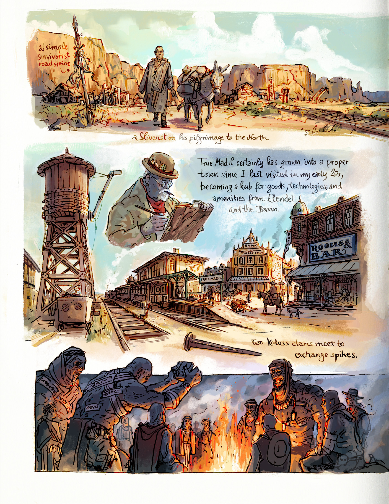
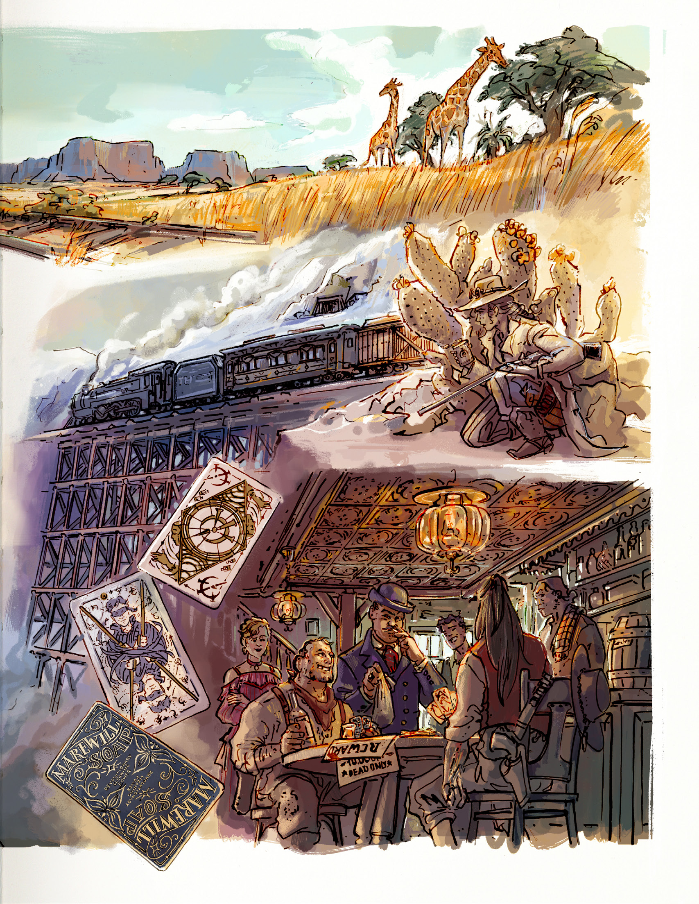
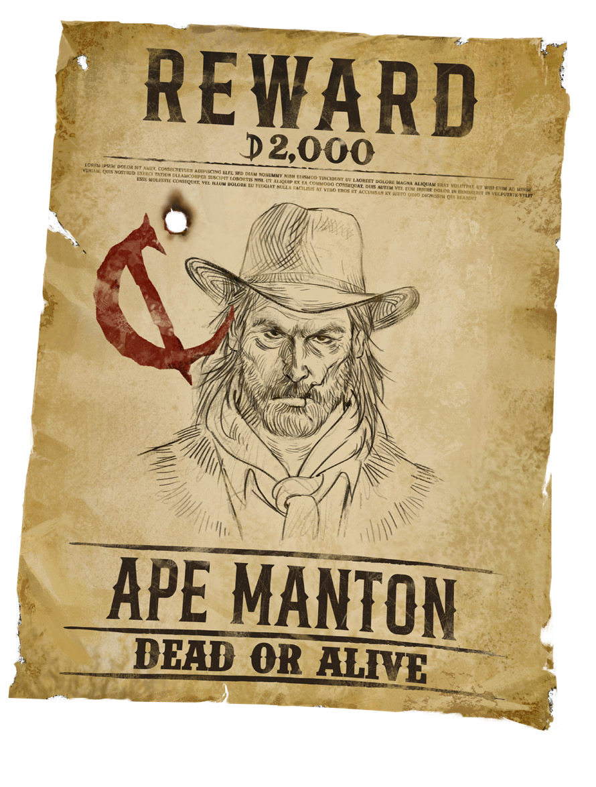
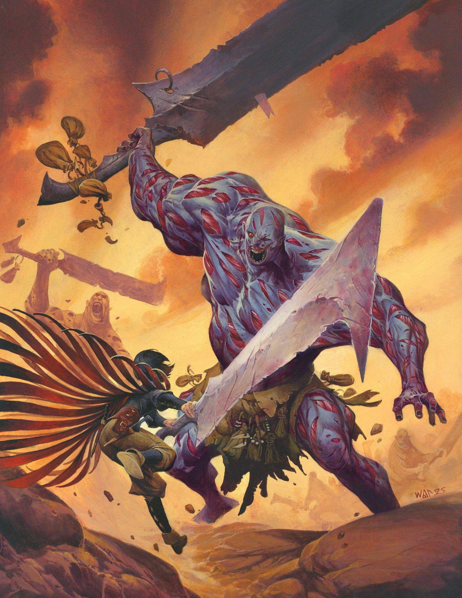

北方蠻橫區（Northern Roughs）在法治與拓荒生活之間取得平衡，最能體現拓荒定居者的精神。當地人眼中，這片塵土飛揚、討生活不易的土地象徵自由，讓他們得以擺脫盆地生活的種種束縛。

這裡草木稀疏，只有幾株枝葉零落的樹，混濁的水流穿過乾枯的草地。紅褐色的平頂山高聳在大地上，俯瞰蜿蜒的峽谷和幽深的洞穴，宛如站崗的哨兵。

從盆地出發的鐵路幹線沿著河流，通往真馬迪鎮（True Madil）等大型聚落。到了這些聚落，支線再像蛛網一樣向各個採礦權區延伸。不過，其中許多鐵路和礦區已經廢棄，年久失修。

蠻橫區（the Roughs）素有無法無天之名。一方面，盆地的罪犯會躲到這裡。另一方面，大量財貨集中運進運出，容易招來竊賊。儘管如此，蠻橫區居民（Roughians）和其他人一樣，也只是想討口飯吃。

以下各節著重介紹北方蠻橫區及其居民。關於更廣大的蠻橫區及其歷史，見第 2 章。

### 概覽

在蠻橫區設計新冒險時，可以考量以下因素。

#### 治理

蠻橫區自治與獨立的話題每隔幾年就會熱起來，但盆地的企業高層和貴族勢力總會把它壓下去。實際上，蠻橫區的各個社群各有決定領導方式的辦法。有的會選出市長，有的則把所有重大決策交由居民大會討論。蠻橫區最大的城市真馬迪鎮，目前由 Ramon Hestingdew 市長領導，但他的角色比較像市政管理者。真馬迪鎮的實權掌握在各家礦業公司的高層手中。

#### 居民

蠻橫區從未做過人口普查，許多人是四處流動的勞工，在這裡做雜工、農場工人或礦工。據估計，當地約有十萬名克羅司（koloss），人類和克羅司混血（koloss-blooded）居民合計則估計有八萬到十五萬人。北方蠻橫區的貴族和泰瑞司人比例很低，克羅司混血的比例則相對較高。當地的鎔金術師（Allomancers）和藏金術師（Feruchemists）很少，少到連他們從未去過的聚落，也有人叫得出其中許多人的名字。

北部和西部有幾個好鬥的克羅司氏族，東部的克羅司氏族則和蠻橫區的社群及礦業公司談成了協議。這裡有許多克羅司混血社群，尤其是東北一帶，Chennant 和 Hukainly 克羅司氏族都在那裡與蠻橫區各社群交易。

#### 經濟

數十家公司在數百座礦場開採。北方蠻橫區勢力最大的礦業公司是鑽岩航運公司（Diamond Rock Shipping Company）、雷卡物流與礦業公司（Lekal Logistics and Minerals）、真鋼金屬公司（Truesteel Metals）及 Tyrian鐵業公司（Tyrian Iron）。蠻橫區不易生產糧食，所以依藍戴（Elendel）定期運來罐頭和耐儲存的食品，由當地雜貨商販售。

卑金屬、礦物、煤、石油、鹽和貴金屬等原料會輸往依藍戴。鎔金術師罪犯會從這些貨物中偷拿一部分原料，在蠻橫區精煉，供自己施展金屬之子（Metalborn）的能力。驛馬車遭劫、火車遭搶是常有的事，礦業公司會在各聚落張貼懸賞與通緝告示。

#### 文化

蠻橫區大多數人以堅忍和認命豁達為傲。他們早已習慣因天候、盜匪和壞運氣而損失收成、貨物和建築。對他們來說，只要能離開盆地文化的虛禮和束縛，照自己的方式過日子，就值得冒這些風險。企業把利潤和產量擺在員工的安全前頭，因此一遇到難關，社群居民就會團結起來，互相照應。

蠻橫區的就學選擇不多，小鎮可能只有一間單教室的學校。

當地穿著講求實用，常見耐穿的長褲、鈕扣襯衫和寬邊帽，也常搭配一件色彩鮮明的防塵長外套。

第 7 章：第二紀元的特色地點 207

> 一座簡樸的倖存者教路邊神龕。
>
> 一名往北方朝聖的碎刺教信徒。
>
> 我上次造訪真馬迪鎮才二十出頭。如今它確實已經發展成一座像樣的城鎮，成了依藍戴和盆地的貨物、技術和各種生活服務的集散地。
>
> 兩個克羅司氏族碰面交換尖刺。
>
> 真馬迪鎮
>
> 銀行
>
> 客房及酒吧

> Marewill香皂
>
> 懸賞
>
> 只收屍體

MARIE SEEBERGER

#### 商業與娛樂

鐵匠鋪、旅店、雜貨店、洗衣店、五金行和酒館等對居民重要的店家，大多聚集在鎮中心。較大的聚落通常還有賭場、報社、銀行、學校、郵局，以及公用馬廄或牲口圍欄。大多數城鎮都有一兩座教堂，有些還設有藥房、劇院或醫院等專門服務。

葷腥的劇場演出和酒館表演都是熱門消遣，許多人會到酒吧和酒館打發閒暇時間。

### 重要地點

蠻橫區與依藍戴盆地（Elendel Basin）之間隔著山脈。「蠻橫區」是盆地外這片邊疆地帶的通稱。其中稱作北方蠻橫區的地方開發程度較高，目前正蓬勃發展。基礎建設、改善後的鐵路和新發現的礦藏，都帶動真馬迪鎮、耐抗鎮（Weathering）和其他聚落的人口成長。

#### 真馬迪鎮

真馬迪鎮是北方蠻橫區最大、也最現代化的城市，估計約有兩萬名居民。城市坐落在河流支岔處，附近有平頂山、岩石峽谷，以及數百座可供盜匪藏身的洞穴。一條鐵路幹線沿河連接真馬迪鎮與 Drypost，全長 125 英里，是整個地區的貿易命脈。真馬迪鎮的大街熱鬧非凡，開了許多店家，也有幾家大型礦業公司的辦事處。

碼頭上的駁船不停裝卸貨物，鐵路調車場日夜忙碌。鑽岩航運公司和雷卡物流與礦業公司都在真馬迪鎮設有辦事處，兩家公司最近的爭端愈演愈烈。雙方曾蓄意破壞、偷竊，甚至在 Isaeuc曲灣（Isaeuc’s Bend）爆發槍戰。

#### 耐抗鎮

耐抗鎮坐落在一片草原上，是北方蠻橫區西部最大的聚落。鐵路通車後，近幾年人口快速成長。耐抗鎮目前有一萬多名居民，包括住在郊區 Barrowcrest 的 Wilko 克羅司小氏族。當地主要的執法者（lawkeeper）是行事鬼祟的 Barl。要照看的人太多，他早已分身乏術，正找人幫忙保護居民和店家，以防盜匪及 Kogarroch 克羅司氏族來犯。

倖存者教會的首席祭司 Johanna Markal修女（Mother Johanna Markal）正積極競選，力求正式當選市長。真鋼金屬公司和 Tyrian鐵業公司最近買下了當地的採礦權，她希望號召居民抵制這兩家公司。廣受歡迎的拓荒定居者 Ferson Brown 也出來與 Markal 競選，但他暗中接受真鋼金屬公司資助。

#### Tyrian海

內陸的 Tyrian海（Tyrian Sea）所在之處，曾是最後帝國（Final Empire）一座傳奇灰山（Ashmount）的所在地。這裡魚類豐富，野生動物種類繁多。這片富饒的土地本來很適合建立聚落，但 Hinnaird 和 Hudowen 兩個克羅司氏族為爭奪南岸一帶的地盤，已經爆發衝突，而且很快就要演變成全面戰爭。Hudowen 動用 Tyrian鐵業公司的船隻攻打 Hinnaird 後，情勢進一步升高。

礦業公司堅稱船隻是被偷走的，但有人抱持懷疑。如果 Hudowen 和 Tyrian鐵業公司暗中結盟，公司就可能取得當地幾處價值不菲的採礦權。這則傳聞促使 Tyrian鐵業公司的主要競爭對手真鋼金屬公司介入，這場克羅司氏族間的衝突可能因此演變成一場破壞慘重的代理人戰爭。如果 Hinnaird 能證明 Tyrian鐵業公司違反採礦規定，讓其他公司追究其責任，就有可能阻止戰爭。反過來，如果證實 Tyrian鐵業公司沒有違規，真鋼金屬公司就不得介入這場衝突。

#### Faradana

Faradana 是座較小的城市，規模約為北方鄰城遠多瑞斯特（Far Dorest）的一半。當地以煤礦和油砂聞名，主要由雷卡物流與礦業公司開發。市長 Savannah Hukainly 是克羅司混血，與東部山麓的 Hukainly 及 Chennant 克羅司氏族維持互惠的貿易協議。

Faradana 有三千名居民，其中一千多人是克羅司混血。許多在盆地出生的克羅司混血孩子會先到這裡認識克羅司文化，再跟其中一個氏族一起旅行。近來，南方礦場屢次坍塌，傳言有一頭懷恨的野獸住在地底。但 Hukainly 市長和當地公司代表 Vestran．雷卡（Vestran Lekal）都深信這些事故是有人蓄意破壞。

第 7 章：第二紀元的特色地點 210

### 冒險引子

你可以用以下點子展開一場以蠻橫區為舞臺的冒險。

#### Ape越獄

Ape Manton 是個惡名昭彰的竊賊，痛恨鎔金術師。他逃出了真馬迪鎮的監獄。鑽岩航運公司懸賞 2,000 盒金（boxings），要人把 Ape 帶回來，死活不拘。傳聞他往南找人算帳，但他很可能躲在某個小鎮裡。

#### 一把盒金

酒館裡有個病懨懨的老人坦承，他把從公司偷來、原要發放的工錢埋在鬼鎮 Feltrel「太陽與倖存者之矛（Survivor’s Spear）相會的地方」。隔天一早，老人便已死去，一場尋寶就此展開。角色必須應付尋寶客、Ironbrand盜匪和 Kogarroch 克羅司戰士。

#### 馬戲團命案

奇觀女伯爵（Countess Spectacular）的極光馬戲團（Aurora Cirque）來了！這支巡迴馬戲團有受過訓練的動物、小丑、算命師，還有以鎔金術驅動的遊樂設施。居民正看得熱鬧，卻發現當地一名牧場工人遭到殺害。角色能在鎮民把矛頭指向馬戲團的鎔金術師之前破案嗎？

#### 完美配方

真馬迪鎮的 Logshine啤酒廠（Logshine Brewery）莫名停下所有作業，讓工人回家。廠門從裡面閂上了。一名主管雇用角色，請他們跟她一起破門進去，查清發生了什麼事。他們在裡頭發現一名脾氣暴躁的坎得拉（kandra），正試著調出完美的啤酒配方。

#### 墨水寫下的祕密

已故化學家Jorben（Jorben the Chemist）的日誌在真馬迪鎮公開拍賣。許多人相信，他有一本日誌藏著工業用燃燒劑的配方。預計會競標的人有幾家礦業公司的高層、來自 New Seran 的 Hortense．塞特－泛圖爾（Hortense Cett-Venture），以及一名依藍戴大學（University of Elendel）的代表。與此同時，Vestran．雷卡雇用角色去偷這批日誌。

#### 其他場景

「蠻橫區遭遇」表提供可用於任何戰役的個別場景點子。

##### 蠻橫區遭遇

| d6 | 遭遇 |
| --- | --- |
| 1 | 一名化作長頸鹿的坎得拉請人幫忙取得新的骨頭。 |
| 2 | 盜匪騎馬進鎮，威脅一名在地方上舉足輕重的人物。 |
| 3 | 一名上流社會的冒險家吊在二樓窗外，苦苦哀求有人伸出援手。 |
| 4 | 一名克羅司想向一個固執的貴族買下休耕地，請人幫忙談條件。 |
| 5 | 泰瑞司尋鄉者（Terris Hearthseekers）擊退盜匪的襲擊。 |
| 6 | 一輛驛馬車在鎮上橫衝直撞。馬匹已經失控，車裡的人尖叫求救。 |

> 蠻橫區是個複雜的地方，但解決事情的辦法往往很簡單。

一張通緝海報就能展開一場大冒險。

> 懸賞
>
> 2,000
>
> Ape Manton
>
> 死活不拘

WHITE HORN

第 7 章：第二紀元的特色地點 211

