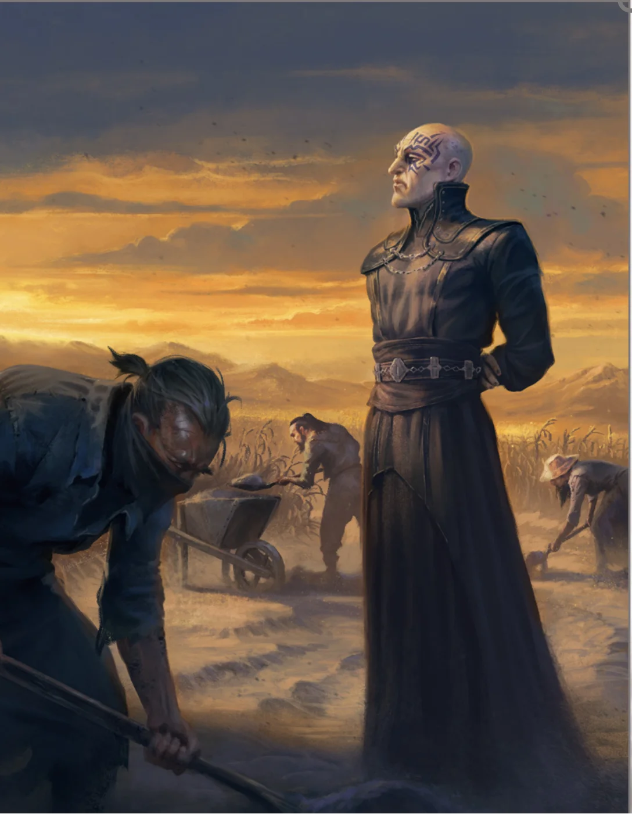

### 東方統御區：第一時代

鐘聲響起，提醒眾人時辰將至。一身灰衣的司卡（skaa）工人手忙腳亂，趕著刷去鵝卵石路面上鬆散的灰燼。一名貴族穿著白色西裝外套與華麗長裙，大搖大擺地走上步道，指揮另一群工人搭起裝飾精美的遮陽帳篷。步道中央，貴族們小心地將一片純金圓盤放入專設的凹槽。一名貴族男子開始午後散步，途中停下腳步，用靴跟敲擊金盤，留下自己到場的痕跡。在這片精心整飭的東方統御區（Eastern Dominance），秩序與謹慎的社交舉止備受推崇；但若揚起塵土，就會招來危險的目光。

黑湖（Black Lake）位於 Faleast 灰山（Ashmount Faleast）以北，湖水連接東方統御區與中央統御區（Central Dominance）。這座大湖被視為東方統御區一心侍奉、迎合統御主（Lord Ruler）的象徵。兩百年前，東方統御區曾爆發大規模叛亂，稱為共謀時代（Age of Collusion）。那場起義之後，這個統御區成了順從守禮的堅定典範，藉此遏止進一步的反抗。

### 政府

在東方統御區，就連聖務官（obligators）也和其他人一樣受到監視。共謀時代裡，貴族、司卡與聖務官相互勾結的貪腐醜聞，助長了叛亂。叛亂遭到鎮壓後，連負責維護統御主權威的人也得頻繁接受稽核，以免重蹈覆轍。因此，聖務官調查、懲處平民時，會臨時編成三至五人的小組，下一件案件開始前就重新分組，避免他們共謀串通。

### 文化

灰燼在東方統御區文化中占有重要地位。貴族出席正式場合時會穿一身白衣，因為他們認為衣上毫無灰漬，才是最得體的表現。相較之下，司卡則必須穿暗沉的衣服，讓自己融入他們負責清掃的灰燼之中。

貴族盡可能少和司卡交談，藉此與自己的祖先劃清界線；畢竟，有些祖先曾與反叛的司卡合作。為了減少複雜溝通的需要，貴族會按特定節奏拍手，或用決鬥杖（dueling canes）敲擊地面，傳達常用指令。也因為這項傳統，這個統御區的貴族認為，在講究禮節的社交場合拍手是失禮的行為。東方統御區文化另一項引人注目的特色，是東方街頭俚語（Eastern street slang）的發展。成群結黨的年輕司卡使用一種刻意讓人難以理解的方言，充滿莫名其妙的字詞與句子，例子見〈東方街頭俚語例句〉表。

### 東方街頭俚語例句

| 俚語例句 | 意思 |
| --- | --- |
| Alling the bestings wasing outing about. | 我到處都有朋友。 |
| Darking wasing is notting the worse of wearing. | 今晚真適合散步。 |
| Eyes wasing of ising on the having sharp? | 你看到了嗎？ |
| Getting the got. | 吃我這招！ |
| Gotting the get. | 我的情況很糟。 |
| Knocking three? | 通關密語是什麼？ |
| Knowing the wasing of having of now? | 這裡發生什麼事？ |
| Lefting I’m born. | 我被拋棄了。 |
| Looking or notting? | 你檢查過了嗎？ |
| Lowing the feets, notting ising. | 在這裡等，我要進去了。 |
| Minding the having. | 交給我處理。 |
| Not of the yetting yet. | 我還沒有。 |
| Notting hasing the now. | 現在已經不是了。 |
| Outting the wasing. | 告訴我。 |
| Passing the tower wasing passing the farther. | 就在這條街往前一點。 |
| Plates. | 這件事結束後，去吃東西吧。 |
| Slowing the feets. | 小心點。 |
| Smalling wasing bigger. | 這裡還有別的內情。 |
| Upping wasing eyes of gotting. | 小心聖務官。 |
| Working your breading wasing? | 你替誰做事？ |
| Youing the knowing? | 誰在那裡？ |

第 2 章：地區與文化 45

### 湖畔步道

有人說，黑湖的形狀就像一隻伸出的手，捧著水果作為獻禮，不斷向統御主乞求認可。統御區各地的貴族每年都會奉召來到步道，在聖務官陪同下行走，回答他們對生意往來與社交關係的深入盤問。這些稽核公開進行，其他貴族可以在旁觀察，並在被點名時作證。不過，當地人普遍不願做出任何可能招來批評的行為，聖務官也就很少能查出什麼。久而久之，稽核反倒成了貴族誇耀自身正直的場合。偶爾聖務官揭發了不當行為，圍觀者就會拍手，表示對違規貴族的不屑。落灰之終（Catacendre）前的幾年，富裕貴族會在每年的稽核後舉辦晚間舞會。黑湖四周的場地搭起大帳篷，提供奢華享受。燭光在貴族一身白衣上歡快搖曳，受邀者一同讚頌主人令人稱羨的品行。聖務官不願直接參與舞會，以免看起來與自己監督的貴族過於親近，或牽扯太深。他們會聚在帳篷外的餐桌旁，貴族則送去最好的食物與飲料，堅稱那些只是多出來的，或是不合賓客口味。

### Stairperch樹堡

東方統御區較低處溪流蜿蜒、嫩草豐盛，掠食動物也不多，非常適合畜牧，尤其適合飼養 Seran長毛山羊（Seranese long-haired goat）。司卡在廣大的草原上放牧，範圍從 Urbene 城一路延伸到北Seran湖（Lake North Seran）上方的山麓。牧羊人隨季節遷移，需要遮蔽時，就會前往一套共用的堅固 Stairperch樹堡（Stairperch Tree Forts）網路。年老的 Stairperch 樹有寬大的樹幹、交疊伸展的粗枝，以及濃密的針葉樹冠，有助於阻擋灰燼。粗壯的樹枝容易攀爬，也能穩固支撐在樹上搭建的建物。生病或受傷的司卡牧羊人經常會在 Stairperch樹堡中待上好幾天，養病期間，任由羊群在外自行遊蕩。等到身體恢復，能爬出樹堡、登上樹頂時，通常就能從高處輕易找到遠處山谷裡的羊群。離開樹堡時，牧羊人習慣從袍子下襬撕下一條布，綁在門邊垂掛的打結繩索末端。這條繩子不只提供另一條下樹堡的路，也是一種傳統，用來感謝 Stairperch 樹提供庇護。

### 資源

東方統御區蘊藏豐富金礦，但金的鎔金特性（Allomantic properties）平平，對統御區的貿易收入貢獻甚微。這裡也有富含黏土的農地，由遭奴役的司卡耕作。草原上的司卡則放牧綿羊與山羊。貴族奴隸主逼迫司卡辛苦勞動，堅守傳統，拒絕農業創新。

### 最後帝國之後

統御主倒台後，東方統御區陷入極為不利的處境。人民依賴他的領導，又不願自行作決定，結果導致混亂與毫無章法的暴力。泰瑞司（Terris）守護者（Keeper）沙賽德（Sazed）曾造訪東方統御區，教導當地人現代農耕技術與自治的方法。

清除農田灰燼是極為辛苦的工作，遭奴役的司卡被迫承擔這份苦差事。

JORDAN KERBOW

