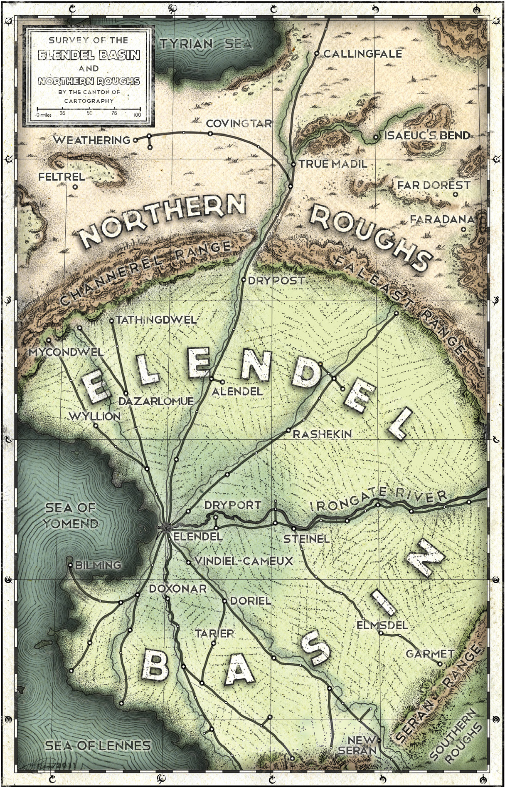
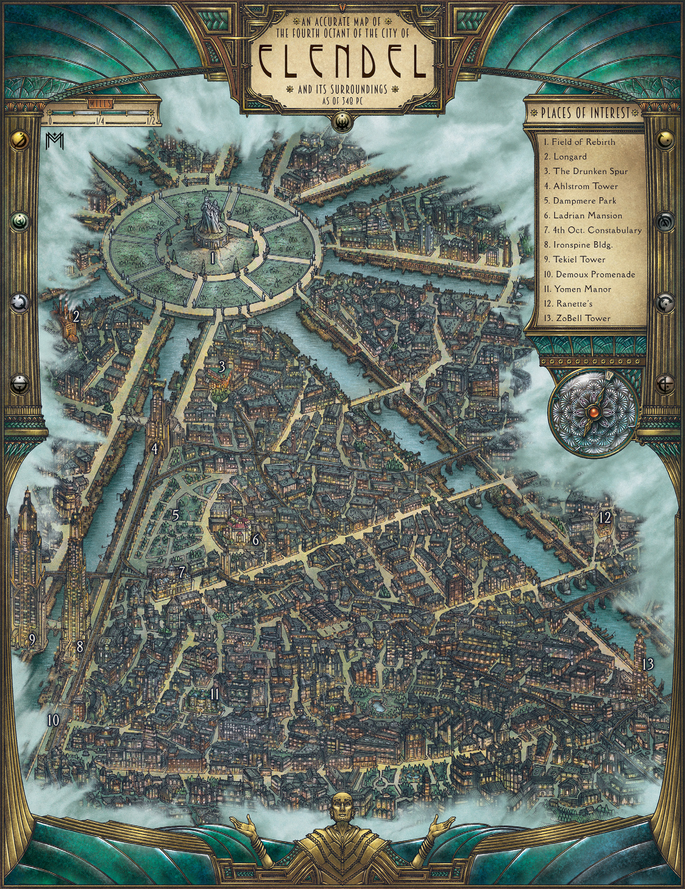
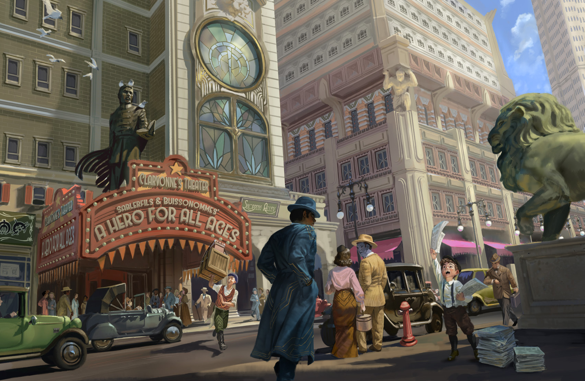
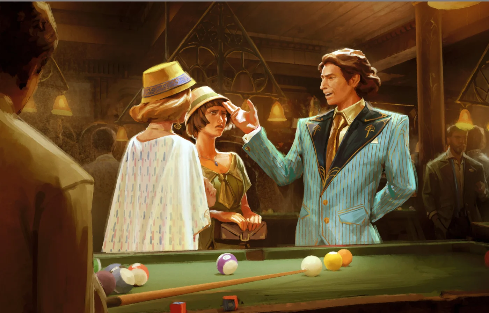
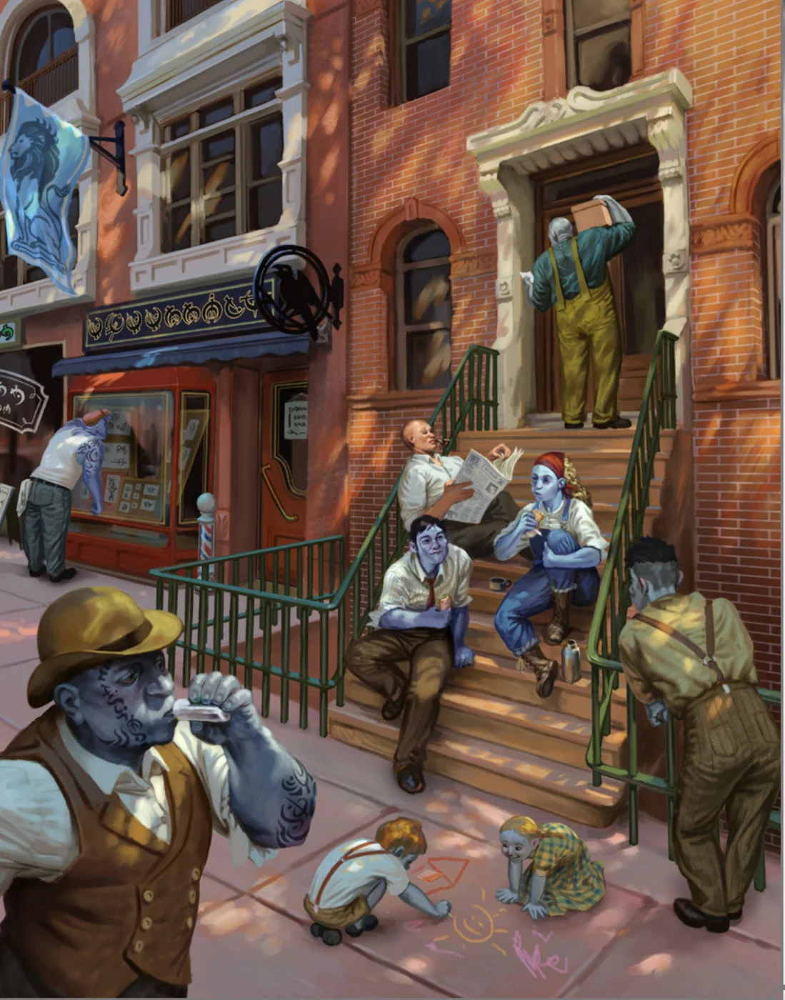
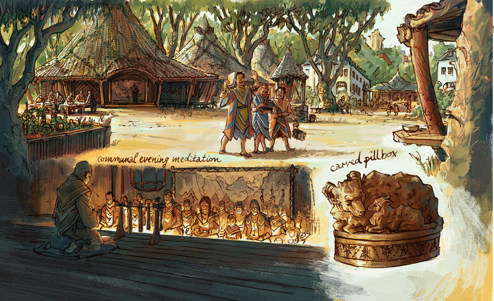
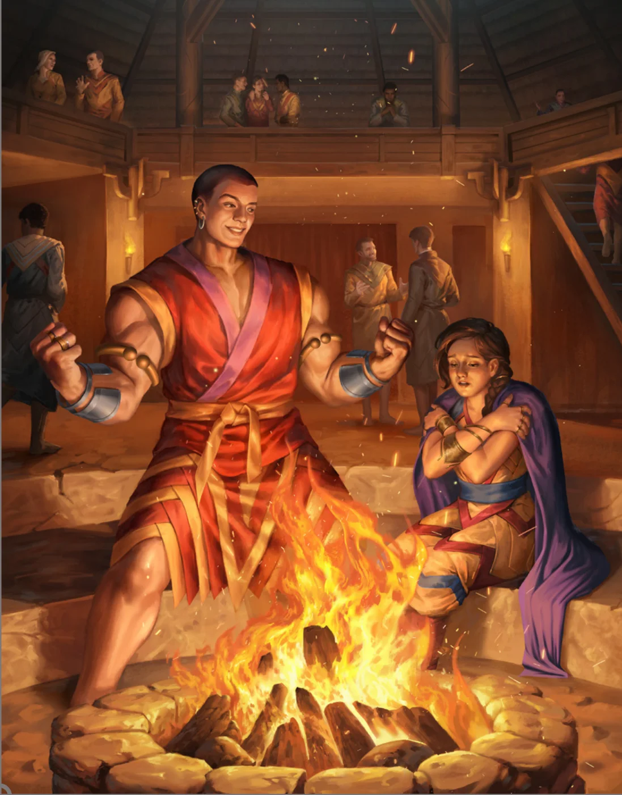

### 第二時代的依藍戴盆地

依藍戴（Elendel）第七分區的一座鋼鐵廠裡，工人將熔融的金屬倒入鑄模。城的另一頭，衣著考究的貴族在社交俱樂部裡品飲昂貴烈酒，含蓄地談笑。他們上方，一名射幣（Coinshot）攀掛在摩天大樓側面，凝望整座城市。迷霧湧入，掩去閃爍的電燈光。迷霧下方，市中心在街頭賽車的轟鳴聲中活躍起來。東邊，一艘貨運駁船緩緩駛上一條運河；這是城內八條運河之一。船工檢查貨物，確保那些未申報的貨品藏得夠好，才從富裕貴族沿河綿延的廣大莊園之間通過。運河旁，一列火車加速駛向外圍城市（Outer Cities）中的一座，那裡的居民正醞釀著對政治的不滿。

依藍戴盆地（Elendel Basin）以Yomend海（Sea of Yomend）、Lennes海（Sea of Lennes），以及香奈瑞山脈（Channerel Range）、Faleast山脈（Faleast Range）和Seran山脈（Seran Range）三道山脈為界。這片物產豐饒的樂土，以溫和的氣候和舒適富足的生活受到喜愛。盆地有超過一千萬居民，工業與現代便利設施遍及各處。然而，盆地並不像表面上那樣平靜祥和。依藍戴政府以經濟政策維持對盆地其他社群的控制，外圍城市則因此發聲反對權力集中與中央統治。各種文化在盆地裡交融、碰撞：從依藍戴到外圍城市，從富人到勞動階級，從泰瑞司人（Terris）、克羅司混血（koloss-blooded），到新近接觸的司卡德利亞南方人（Southern Scadrians），無不如此。而和諧（Harmony）時聚時散的迷霧，始終在一切之間守望、引導。

### 依藍戴

依藍戴之名，是為了紀念居民稱作末代皇帝（Last Emperor）的依藍德．泛圖爾（Elend Venture）。城市以重生之野（Field of Rebirth）為中心；當年最後帝國（Final Empire）的倖存者正是在這片原野走出避難處，踏入和諧重新塑造的世界。依藍戴是司卡德利亞（Scadrial）最大的城市，約有五百萬人以此為家。盆地大多數人口曾集中於此，但外圍城市發展之後，新的估算顯示，城外人口已超過城內。

依藍戴是一座富裕的城市。大量大家族（Great Houses）與貴族聚居於此，儘管早期統治者竭盡所能，城市仍深受最後帝國遺留的不平等所害。以下幾節主要著重城市歷史。第7章會詳述個別地點，並為發生在依藍戴的故事提供靈感。

### 政府

迷霧之子大人（Lord Mistborn）曾名為鬼影（Spook），他統治依藍戴約一個世紀後便消失了。議會（Senate）隨後選出一位總督（Governor）。從此，經選舉產生的總督構成行政部門。政府的立法部門共有243席，分由擁有世襲頭銜的議員與選任議員占據。選任席位由職業公會掌握，而多數公會領袖都以依藍戴為據點。政府的第三部分是司法部門，負責監督檢察官辦公室。城市劃分為八個分區，各有約六百名警員組成的警局。各區警局在逮捕與起訴的成績上彼此競爭，以爭取聲望。依藍戴雖不是統治全盆地的國家政府，其經濟影響力卻讓議會得以大幅左右其他城市。外圍城市認為這是干涉內政，但依藍戴警員確實擁有在城外執勤的有限權限，包括派員前往其他轄區，以及在不受當地警局指揮的情況下行使警權。政府制定稅賦與關稅，也提出法案、制定法律，例如九四年鎔金術協定（Allomantic Agreement of ’94）。協定限制鎔金術（Allomancy）的使用，包括禁止利用煽動者（Rioters）與安撫者（Soothers）牟取不法商業利益。不過，業者可以登記經營安撫會館，在取得顧客同意後提供服務。

### 軍事

依藍戴維持約一萬人的軍隊，其中包括一支保護南方航運的小型海軍。依藍戴盆地的居民從未經歷嚴重戰事，不過曾與蠻橫區（the Roughs）較為暴烈的克羅司（koloss）氏族發生小規模衝突。然而，隨著與南司卡德利亞（Southern Scadrial）爆發衝突的威脅日益逼近，議會批准擴大募兵，打算在幾年內建立一支規模可觀的陸軍。

第2章：地區與文化 60

<!-- 依圖像轉寫的印刷文字；原生文字擷取未收錄。 -->

製圖廷（Canton of Cartography）測繪的依藍戴盆地與北方蠻橫區（Northern Roughs）。

| 地圖標籤 |
| --- |
| Tyrian海（Tyrian Sea） |
| Callingfale |
| Covingtar |
| Isaeuc曲灣（Isaeuc’s Bend） |
| Weathering |
| Feltrel |
| True Madil |
| Far Dorest |
| Faradana |
| 北方蠻橫區 |
| 香奈瑞山脈 |
| Faleast山脈 |
| Drypost |
| Tathingdwel |
| Mycondwel |
| 依藍戴盆地 |
| Dazarlomue |
| Alendel |
| Wyllion |
| Rashekin |
| Yomend海 |
| Dryport |
| 依藍戴 |
| 鐵門河（Irongate River） |
| Steinel |
| Vindiel-Cameux |
| Bilming |
| Doxonar |
| Doriel |
| Tarier |
| Elmsdel |
| Garmet |
| New Seran |
| Seran山脈 |
| 南方蠻橫區（Southern Roughs） |
| Lennes海 |

比例尺：0、25、50、75、100英里。

2011

第2章：地區與文化 61

ISAAC STEWART

### 文化

依藍戴是階級分明的社會，世襲貴族擁有很大比例的土地與企業。公會及專業人士雖持續累積經濟實力與政治影響力，貴族家族，尤其是大家族，仍保有顯著優勢。城內有龐大的勞動階級，也有相當一部分人口生活貧困。依藍戴的貧民區不像最後帝國時那麼悲慘，但老舊失修的街區仍明顯處於弱勢。

### 正規教育

和諧在《創始之書》（Words of Founding）中訂下規範，要求所有人都能接受廣泛而普及的教育。因此，依藍戴重視教育，希望藉此推動社會進步、減少不平等。城內的孩子幼年時都就讀於鄰里經營的學校。對成人而言，依藍戴大學（University of Elendel）是聲望最高、費用也最昂貴的大學教育選擇，但另有其他免費或收費平實的學院與大專院校。

### 大報

依藍戴有數十家小型印刷所，每天印製大幅報紙；同一家印刷所有時還分出早報與午報。這些報刊包括以勞動階級為讀者、偏愛聳動消息的《依藍戴日報》（Elendel Daily），迎合上流社會品味與觀念、立場保守的《家族紀錄報》（The House Record），以及以偏頗聞名的《依藍戴真相報》（The Truth in Elendel）。外圍城市方面，New Seran的《新勢力報》（New Ascendancy）刊登反依藍戴言論與爭取勞工權益的文章。Bilming的《雙季報》（The Two Seasons）以調查報導為特色，《真相哨兵報》（Sentinel of Truth）則什麼聳動、刺激的內容都登。商家常在大報上刊登廣告，報紙也往往連載冒險故事，例如大受歡迎的鎔金術師 Jak（Allomancer Jak）和Nicki Savage的故事；後者早期以Nicelle Sauvage之名刊出。

### 時尚

衣著是依藍戴生活的重要部分。當地人將剪裁合身的西裝或洋裝視為地位、財富與成功的象徵。上流階級女性的洋裝通常色彩濃麗，搭配厚重的及地裙襬、蕾絲，以及穿在外層、近似背心的合身短外套。更大膽的時尚則包括綴有亮片的俐落洋裝。上流階級男性偏好在深色西裝內穿背心與素面襯衫，再用鮮豔的領巾襯托暗色衣裝。

依藍戴的勞動階級通常穿色彩低調的簡單洋裝，或穿有鈕扣的襯衫、吊帶與長褲。女性雖多半穿洋裝，但在警察等職業中，穿長褲也越來越普遍。需要盛裝時，依藍戴各階級的人往往會加上項鍊、耳環、帽子、領帶等別緻配件。

### 存留者的傳承

依藍戴與盆地的許多社會規範，都源自存留者（Preservers）。這是歷史上對卡西爾（Kelsier）在最後帝國時期那支團隊的稱呼，其傳承包括以下幾項：

昇華戰士（Ascendant Warrior）。就像紋（Vin）一樣，所有女性都應享有平等與機會。

末代皇帝的理想（The Last Emperor’s Ideal）。將權力交到平民手中。

迷霧之子大人。「總有的，社會的變得更好著。」社會必須努力讓自己進步。

倖存者的訓諭（The Survivor’s Mandate）。活下去。

### 變遷之城

電力問世後，工作時間隨之延長，許多勞工被迫工作到更深的夜裡，否則就會遭到解僱。這引發了數次社會動盪，包括鋼鐵與紡織業的勞資爭議，以及營造工人和碼頭工人的工會罷工。從汽車取代馬車，到摩天大樓越蓋越高，技術進步不斷改變城市面貌。有些依藍戴人為這飛速進展感到興奮，也有人感到不安。

### 上流階級

法律雖已明定權力共享，貴族血脈在依藍戴仍握有相當大的權勢，因此拖慢了社會變革。舉例來說，即使有昇華戰士紋留下的傳承，上流社會仍期望女性遵循最後帝國時代的性別規範。盆地中有一百多個貴族家族，而依藍戴的上流社會則由數百名地位、財富與責任各不相同的人士組成。只要議會中的世襲貴族席位達到法定出席人數，並通過批准，就能授予貴族頭銜。

第2章：地區與文化 62

MARCO BERNARDINI

<!-- 依圖像轉寫的印刷文字；原生文字擷取未收錄。 -->

落灰之終（Catacendre）後348年（348 PC）的依藍戴市第四分區及周邊精確地圖。

重要地點

| 地圖編號 | 地圖標籤 |
| --- | --- |
| 1 | 重生之野 |
| 2 | Longard |
| 3 | 醉馬刺（The Drunken Spur） |
| 4 | Ahlstrom塔（Ahlstrom Tower） |
| 5 | Dampmere公園（Dampmere Park） |
| 6 | 拉德利安宅邸（Ladrian Mansion） |
| 7 | 第四分區警局（4th Oct. Constabulary） |
| 8 | 鐵脊大樓（Ironspine Bldg.） |
| 9 | 太齊爾塔（Tekiel Tower） |
| 10 | 德穆大道（Demoux Promenade） |
| 11 | 尤門莊園（Yomen Manor） |
| 12 | 拉奈特處（Ranette’s） |
| 13 | ZoBell塔（ZoBell Tower） |

比例尺：0、1/4、1/2英里。

北（N）

<!-- 依圖像轉寫的印刷文字；原生文字擷取未收錄。 -->

| 印刷招牌 |
| --- |
| Clarvonne’s劇院（Clarvonne’s Theater） |
| Sablefils & Buissonommes’ |
| 《萬世英雄》（A Hero for All Ages） |
| 購物巷 |

依藍戴的街頭，從來沒有冷場。

十六個大家族擁有城內相當大比例的資產，包括約三分之一的土地，以及多數大型企業。貴族身為議員，也代表住在這些地區的選民，並負責支付工資、管理相關企業。

### 宗教

人們承認和諧是神，也是滅絕（Ruin）與存留（Preservation）力量的持有者，但盆地最大的宗教卻是倖存者教（Survivorism）。社會普遍認為倖存者教信徒虔誠，而且不太冒進。另一方面，碎刺教（Sliverism）則更具爭議。有些人覺得這個宗教令人反感，另一些人卻將其視為正義的傳承，從中獲得莫大慰藉。盆地另一個主要宗教是道教（the Path）；其他宗教的信徒認為它簡單，卻往往又難以理解。（關於司卡德利亞宗教的更多資訊，見第3章「主要宗教」。）

### 資源

貨運運河從山間流入依藍戴，鐵路則沿著運河路線，以依藍戴為中心向外放射，宛如車輪的輻條。盆地的鐵路與車站由當地貴族維護，但鐵路一旦穿越山口、離開盆地，就由在蠻橫區營運的企業接手。有些企業由貴族資助，另一些則由創業投資者維持。依藍戴向外圍城市課稅，以維持基礎建設與政府運作，城市本身則專注於航運、製造與加工。蠻橫區，以及外圍城市的礦場與產業，將原料運入依藍戴，供其使用與剝削。

ROMAIN KURDI

第2章：地區與文化 64

### 現代化

歷經三個世紀的發展，城市需要更完善的交通基礎建設。依藍戴開始優先推動這些改變，擴建鐵路、引進地下鐵，並整平道路以供汽車行駛。依藍戴改用汽車的速度極快，而Bilming甚至更快；這座城市優先推進生質柴油生產與石油加工技術。

### 外圍城市

依藍戴居民雖認為自己是盆地中心，整個地區其實都分布著繁榮的城市。所謂「外圍城市」，指盆地內除依藍戴以外的任何城市，其中主要的政治勢力是Bilming與New Seran。這兩座城市的更多資訊，見第7章。

### 政府

外圍城市採行各種不同的市政體制。許多城市設有市長，包括Bilming與New Seran；Bilming另有代表不同政黨的市議會。

Steinel、Rashekin等城市由當地勢力最大的貴族家族或宗教團體治理。另一些城市則由礦業與鐵路公司主管組成的議事會管理，例如通往北方蠻橫區的門戶Drypost。至於Tathingdwel與Mycondwel等泰瑞司社群，則各自接受其席諾德（Synods）的管轄。

### 軍事

外圍城市最值得一提的軍力，是Bilming海軍與其三艘白鑞戰艦（Pewternauts）。這些軍艦配備砲塔、強化船體，以及最新式的電氣測距儀。其他外圍城市及其貴族也維持小型軍隊，以嚇阻來自蠻橫區的攻擊，並在盆地內追捕匪徒；不過，自落灰之終以前至今，這些城市便不曾發生過任何戰爭。

JOSHUA CHIA

依藍戴、New Seran與Bilming的市民爆發了爭執。

### 文化

外圍城市在經濟上受到的待遇，滋長了對依藍戴悶燒已久的怨恨。外圍城市的政治人物、貴族與大報都指控，許多人稱為「戴城」（the ’Del）的依藍戴，不斷犧牲盆地其他社群的利益來中飽私囊。許多外圍城市刻意在時尚上與依藍戴有所區別。舉例來說，依藍戴衣著偏暗，Bilming人卻偏好鮮豔的服裝，還經常採用互相衝突、引人注目的配色。New Seran人則偏好較輕薄的西裝，常帶有細直條紋，或穿著粉彩色洋裝。外圍城市的高等教育、藝術與科學和依藍戴一樣普及。事實上，因為限制較少，又有「組織」（the Set）等團體贊助，這些領域往往甚至更加先進。

### 資源

數百年來，外圍城市為依藍戴供應糧食、紡織品、礦石、石材與木料等原料。依藍戴的製造商再加工這些資源，將商品運回各城。部分外圍城市累積了足夠財富，能自行建造製造與生產設施後，這種關係便開始改變。外圍城市的商品品質終於能與依藍戴匹敵。有些產業甚至超越依藍戴，例如Bilming先進又高效率的煉油廠。不過，由於依藍戴的貿易限制、進口稅，以及多數城市間缺乏直接航運，外圍城市的商品往往仍然更貴。

### 航運與物流

外圍城市之間的公路交通，效率不如運河與鐵路。運河全都流向依藍戴，鐵路也全都通往依藍戴，轉接點與橫向路線極少。這讓依藍戴得以設定價格、操控市場，從中獲利。例如，來自蠻橫區的金屬礦石，以及Seran山脈附近Garmet開採的石材，都必須先經過依藍戴，才能再運往Bilming或New Seran。因此，從Garmet將石材運往New Seran，明明陸路距離只有一百英里，卻得繞行將近五百英里。

### 坎得拉

盆地居民稱坎得拉（kandra）為無面不朽者（Faceless Immortals）。落灰之終後，他們離開祖居的家園，融入盆地社會。存世的坎得拉不到一千名，其中有些被和諧派往其他世界擔任密探。無論身處司卡德利亞還是其他地方，多數坎得拉都充當和諧的耳目，蒐集廣大寰宇（cosmere）的情報。

### 性別

坎得拉能夠變形，因此對生理性別、性別表現與性別認同的看法，都不同於盆地文化中的其他族群。一名坎得拉今天可能以女性面貌示人，隔天就呈現另一種性別，甚至同一天參加不同場合時也可能改變。有些坎得拉偏好維持一致的性別表現與身體性別特徵，但性別流動者占了很高的比例。

### 盆地生活

無論住在依藍戴或盆地其他地方，坎得拉都過著有住家、工作與朋友的普通生活。他們採用自己創造的身分，而不再運用最後帝國時期所稱的「扮演」（the performance）。坎得拉已有數百年時間發展各種怪癖，往往有極其專門的興趣與習慣。他們與和諧，以及自身圍繞契約（Contracts）的傳統，也建立了新的關係。更多細節，見本章前段的「坎得拉契約」。數百年過去，坎得拉逐漸在社會中找到自己的位置。和諧也指示他們引導、照顧年幼或處境危險的人類、克羅司混血兒童，有時擔任監護人，有時成為寄養父母。

### 克羅司混血社區

盆地的每座城市，以及幾座較大的城鎮，都出現了克羅司混血聚居的街坊或街區。從Bilming喧鬧的花崗岩街（Granite Row），到依藍戴充滿都會氣息的氏族住宅區（Clan Estates），再到New Seran溫馨的Flint窪地（Flint’s Hollow）街區，克羅司混血文化雖有一些共通之處，彼此之間仍有很大的差異。

### 家與親族

大多數克羅司混血社區的家庭結構，都與克羅司氏族的相處方式十分相近。他們認為姑姨、叔舅與堂表兄弟姊妹，就和父母、手足一樣親近。大家庭聚餐與戶外聚會十分常見，即使沒有住在這些街區的克羅司混血，也歡迎攜家帶眷前來作客。

第2章：地區與文化 66

在一條以克羅司混血為多數的街坊裡，朋友與鄰居一同放鬆休憩。

克羅司混血家庭通常尊重並鼓勵四處遊歷、探索的心願。人們離開社區，獨自闖蕩數月或數年，是很常見的事；他們深信，自己隨時回來都會受到歡迎。

### 文化交流

New Seran、Drypost等鄰近蠻橫區的盆地社群，有一項傳統：克羅司混血兒童每年夏天會到蠻橫區的克羅司氏族住上幾週。相對地，蠻橫區的克羅司混血兒童每年冬天，也會到盆地的克羅司混血社區住上幾週。這種交流幫助孩子了解兩種文化，並認識接受或拒絕克羅司氏族的尖刺，對自己會有什麼意義。依藍戴的克羅司混血社區較少採取這種做法，但到了夏季，看到六名克羅司混血少年結伴搭火車離開依藍戴，前往蠻橫區尋訪克羅司氏族，也不算罕見。

### 第二時代的泰瑞司聚居地

身穿白色罩衫的泰瑞司孩子，在泰瑞司村（the Village）草木繁茂的街道上，穿梭於高大的樹木之間。笑聲迴盪，一名穿著tinningdar長袍的男子關上教室窗板時，聽得不苟言笑地皺起眉。學校裡，弧形牆面雕刻著山巒景色，教師在一排排整齊坐好的泰瑞司少年之間走動，引導他們練習冥想。街對面，一間傳統泰瑞司小屋內，一名神色疲憊的女子向席諾德報告，手中撥弄著塞滿醫療用品的鼓脹背袋。她擔憂依藍戴一處貧困街區的疾病情況，正向他們說明。席諾德的一名成員，是位膚色淺褐、頭髮雪白的女子。她輕敲手杖，聽著孩子遊戲的聲音露出微笑，才轉回眼前的議題。

熬過落灰之終的初代（Originators）中，將近五分之一是泰瑞司人。他們的後代面臨一個耐人尋味的挑戰：在快速變動的世界裡，傳統文化與價值觀還有多少適用？每個泰瑞司孩子都能在自己的社群找到歸屬，但這些社群也伴隨著期望與義務。遍布盆地的泰瑞司聚居地（Terris Enclaves）是自治區，泰瑞司人在此聚居，延續共同的文化。其中最有影響力、也最廣為人知的，是位於依藍戴第五分區、面積廣大且草木叢生的泰瑞司村。村子大部分籠罩在茂密的樹冠下，粗壯的樹根拱起城市的鵝卵石街道，形成一片被森林擾動、起伏不平的石地。建築既有被野生植物攀滿、吞沒的依藍戴式房屋，也有中央設壁爐的傳統八角泰瑞司小屋。無論是否選擇住在聚居地，泰瑞司人都已融入盆地文化的各個階層。

### 政府

每個聚居地都有自己的席諾德，也各有決定成員資格的方法。在泰瑞司村，席諾德由自願服務的長老掌理，近期則由Vwafendal長老（Elder Vwafendal）帶領。正如依藍戴對待外圍城市的態度，泰瑞司村的席諾德也行事儼然以全盆地泰瑞司人的統治者自居。其他席諾德則是地方治理機構，權威較低。

第2章：地區與文化 67

ROMAIN KURDI

盆地的聚居地包括：香奈瑞山脈山麓、以泰瑞司人為多數的城市Tathingdwel；Bilming郊區較為進步的聚居地泰瑞司鎮（Terristown）；以及New Seran時髦的邊域區（the Reaches），這個街區正迎來愈來愈多非泰瑞司居民。其他聚居地還包括盆地周圍山區的泰瑞司基本教義派聚落。

### 軍事

各地的泰瑞司席諾德（Terris Synods）有一項共識：最能保障泰瑞司人安全的，就是泰瑞司人自己。聚居地積極與所在城市締結並維持協議，確保泰瑞司人能自行維持治安。依藍戴與New Seran尊重這些協議，但在Bilming，泰瑞司鎮居民與當地引發分裂的政治勢力發生衝突，使協議承受壓力。聚居地經常派藏金術師（Feruchemists）巡邏，例如身體力量強大的白鑞單藏金術師（Ferrings），以及感官敏銳的錫單藏金術師。然而，這被視為對社群的責任，並不是用來交易的商品。思想傳統的泰瑞司人有時認為，以金錢交換金屬之子（Metalborn）的能力令人反感，但隨著時間過去，這種態度已逐漸減少。

### 文化

傳統泰瑞司文化重視順從、謙和，以及恭敬而有尊嚴的態度。這些價值源自鋼鐵教廷（Steel Ministry）數百年來強加於他們的侍從官文化，後來逐漸演變而成。泰瑞司長老教導，內省與妥協比對抗更有價值。泰瑞司的學校非常重視教育與學術，這延續了泰瑞司守護者（Keepers of Terris）保存知識的使命。除了著重治療與醫學，教師也會仔細教導孩子，統御主（Lord Ruler）的各項計畫曾造成什麼傷害，同時頌揚泰瑞司人如何熬過歷史最黑暗的年代。落灰之終後，數位助產士的日誌成為泰瑞司醫療實務的基石；這些內容詳盡的紀錄，當年一直瞞著聖務官（obligators）祕密保存。

### 演變中的時尚

聚居地內，大多數泰瑞司成人穿著tinningdar。這是從泰瑞司侍從官長袍演變而來、色彩鮮豔並帶有V字紋的長袍。每件tinningdar的紋樣與顏色，都標示穿著者的角色與職業，例如醫者或教師，也標示其擁有的單藏金術師能力。居住在聚居地以外的泰瑞司人，選擇傳統裝扮時，可能穿上完整的tinningdar，也可能只在衣著中加入V字紋設計。

<!-- 依圖像轉寫的印刷文字；原生文字擷取未收錄。 -->

| 手寫標籤 |
| --- |
| 晚間集體冥想 |
| 雕刻藥盒 |

MARIE SEEBERGER

### 冥想與正念

所有泰瑞司聚居地都實踐各式成熟的冥想技巧，從正念、肯定語句，到反覆念誦、專注呼吸，或將注意力集中在實物上。他們會獨自冥想、安靜地集體冥想，或參與有人引導的冥想課程。針對不同的疾病與挑戰，也會指定特定冥想方式，或搭配不同的專注主題。

### 宗教

泰瑞司聚居地尊敬和諧，視其為永世英雄（Hero of Ages）與最後一位泰瑞司守護者，但對於崇拜對象卻意見分歧。有些社群認為和諧是存留的繼承者。另一些則像祖先一樣崇拜存留，認為和諧受到了滅絕的污染。不過，多數教派都同意，應努力保存而非毀滅、教導而非支配、締造和平而非煽動衝突。（常見泰瑞司信仰的細節，見第3章「泰瑞司宗教」。）

### 資源

泰瑞司人被視為依藍戴盆地首屈一指的醫者與醫療從業者。有些人嚴格遵循《創始之書》與日誌中傳承的泰瑞司知識行醫，另一些人則也就讀依藍戴大學，學習現代方法，擴充自己的本領。許多泰瑞司醫者專精產婦照護，著重照護選擇、醫療支持，以及降低產婦死亡率。他們將此視為一種方式，取回統御主虐待泰瑞司人所產生的知識，讓這些知識重新由自己掌握。

### 混合傳承與變動的世界

泰瑞司文化深深排斥藏金術（Feruchemy）與鎔金術混合，認為這樣太有可能讓世上再出現一個統御主。最保守的教派，例如香奈瑞山脈的基本教義派，認為鎔金術根本就不該存在。具有泰瑞司血統的人，往往必須決定自己要遵循文化到什麼程度。大多數聚居地的長老傾向灌輸教義、與世隔絕。當泰瑞司長老似乎甘願讓世界拋下自己繼續前進，緊張關係也隨之加劇。許多年輕泰瑞司人希望與世界一同進步，各自決定要接受教義、捨棄教誨，或在聚居地內外找到自己的平衡。

泰瑞司少年練習自己的單藏金術師能力。

能受雇的藏金術師遠比鎔金術師（Allomancers）稀少，或許是因為泰瑞司傳統對自身力量懷抱如此深切的敬重。

第2章：地區與文化 69

SONDERFLEX工作室（SONDERFLEX STUDIO）

