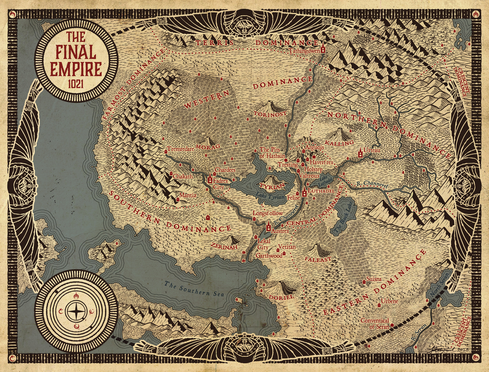
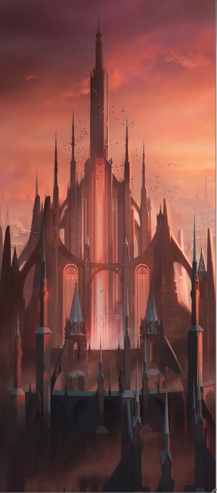
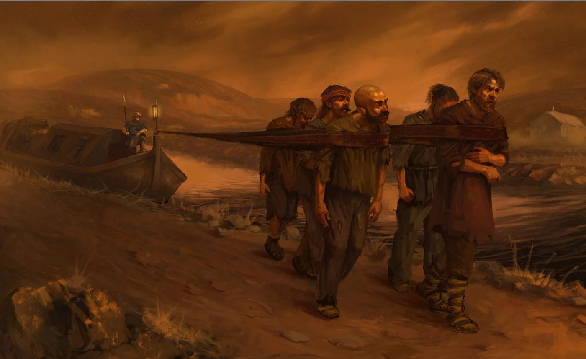

### 第一時代的司卡德利亞疆域

歷史學家記錄了最後帝國（Final Empire）的種種事件、它的覆亡，以及其後重建秩序的新帝國（New Empire）。本節概述最後帝國時期及隨後革命中的司卡德利亞（Scadrial），接下來的各節則會進一步介紹第一時代的各個統御區（Dominances）。（關於哪些事件使世界產生這些變化，見第 4 章。）

### 十大統御區

第一時代的統御區，是統御主（Lord Ruler）控制下的十塊領土。影響力龐大的內統御區（Inner Dominances），受到統御主麾下鋼鐵教廷（Steel Ministry）及其各聖務廷（Cantons）的嚴密監視與管制。外圍統御區（Outer Dominances）對最後帝國的重要性則各不相同。例如，泰瑞司統御區（Terris Dominance）受到強力監管；新月統御區（Crescent Dominance）與偏遠統御區（Remote Dominance）的荒地，卻是幾乎自治的避風港，庇護著人稱焦土人（burnlanders）的司卡（skaa）反抗軍。

### 最後帝國的語言

統御主禁止帝國語（Imperial）以外的一切語言，不過在某些地區，仍能找到東方街頭俚語等方言，以及少數留存著帝國建立前語言的群體。

### 內統御區

下列地區是最後帝國人口最稠密的區域：

中央統御區（Central Dominance）。最後帝國的首都陸沙德（Luthadel）位於此地，中央統御區也是政治運作的主要舞臺。大家族（Great Houses）無論還掌握哪些土地，都會在這裡設置貴族城堡。

北方統御區（Northern Dominance）。北方統御區天然資源豐富，透過貿易向其他統御區供應煤炭與農作物。

東方統御區（Eastern Dominance）。東方統御區與新月統御區接壤，境內有廣大的水域與金礦。

南方統御區（Southern Dominance）。南方統御區毗鄰南海（Southern Sea），以礦坑產出的紅銅與鋅進行貿易。除此之外，當地大致自成一隅，保持著與人無爭的形象。

西方統御區（Western Dominance）。西方統御區地勢高聳，岩石遍布的地景中矗立著兩座灰山（Ashmounts）。

### 外圍統御區

下列地區距離統御主的首都與權力中心最遠：

泰瑞司統御區。統御主試圖嚴格控制泰瑞司統御區的人口，因為每一名泰瑞司（Terris）人都有可能天生帶有賦予藏金術（Feruchemy）能力的遺傳特徵。

極遠統御區（Farmost Dominance）。這個地區雖然相對穩定，卻也出現過涉及駐軍與克羅司（koloss）氏族的小規模衝突。他們的行動尚稱溫和，大多未引起統御主的注意。

新月統御區。新月統御區有廣袤的沙丘，居民主要是逃亡中的司卡反抗軍。他們會劫掠東方統御區，奪取食物與補給。

南方群島（Southern Islands）。南方群島由兩座大島與數座小島組成，以生產鐵與海中作物進行貿易。

偏遠統御區。偏遠統御區與世隔絕，也不受統御主重視，讓想避開鋼鐵教廷注意的人有一處勉強能容身的地方。

### 其他土地

在最後帝國的日常事務中，外圍統御區被認為不如內統御區重要；然而，南方還有一些土地，更在帝國的關注範圍之外。其中最重要的，位於一塊相連的大陸上，人稱南司卡德利亞（Southern Scadrial）。南司卡德利亞沒有灰山，與司卡德利亞其他地方相比，幾乎不像同一個世界。最後帝國與南司卡德利亞之間毫無往來，當地以外幾乎也沒有人知道它的存在。

第 2 章：地區與文化 36

MARIE SEEBERGER

### 統御主的設計

統御主殘暴而好控制，卻自認是人類的救世主。他毫不留情地改造世界的土地與人民，讓他們能抵禦碎力（Shards）及其行動。統御主創造灰山、匯集資源，並組織整個帝國，不惜一切代價維持生產。

### 秘密儲藏庫

為了因應足以毀滅世界的災難，統御主維持著隱密的資源儲藏庫，幫助人類存活。他將這些儲藏庫設於內統御區，嚴守秘密，以免其中的物資遭到不必要的動用。

### 農場與城市

大部分遭奴役的司卡都在農場工作，生產的糧食不僅養活最後帝國的人民，也用來填滿儲藏庫。司卡的勞動環境惡劣，必須吸入灰燼，還得承受主人的毆打與其他暴行。有些走投無路的司卡試圖反抗，但這些起義往往以統御主派兵將他們全數屠殺告終。城市裡的司卡則在工廠、鍛造廠與木材場工作，加工原料。他們比鄉間司卡自由，也較少受傳統規範與迷信束縛。少數城市司卡甚至能透過各種行業，維持一份勉強過得去的生計。即使如此，司卡仍遭到自認對他們有管轄權的貴族虐待，技藝精湛的工匠也無法為成品取得合理報酬。許多司卡為了生存而走上犯罪之路。

### 最後帝國之後

統御主死亡、最後帝國崩潰後，權力真空隨之出現，司卡德利亞的碎力也陷入不穩定，威脅著整個世界。野心勃勃的領導者爭奪控制權，使最後帝國殘酷的秩序被混亂取代。這些暴力衝突，加上滅絕（Ruin）與存留（Preservation）帶來的影響，開始將世界撕裂。

### 領土控制權的轉移

最後帝國崩潰後，新興領導者紛紛競相征服領土。有些人以純粹的軍事武力爭奪，有些人推動宣傳，也有人透過巧妙計謀擴張勢力。一般人很難知道自己所在之地以外的政治局勢如何。

### 克羅司軍隊

擺脫統御主控制後，克羅司軍隊透過交易建立新的效忠關係，也遭到情緒鎔金術（emotional Allomancy）奴役。他們能摧毀敵方城市，但若沒有團結起來對抗外敵，也經常彼此交戰。

### 環境浩劫

滅絕獲釋之前，內統御區很少發生地震。此後，大地開始每隔幾週就震動一次，而且越來越頻繁。許多人將此視為世界即將終結的徵兆。

坎得拉家園（kandra Homeland），由藝術、學識與發光的真菌照亮。

<!-- Pure map artwork, left half of the Final Empire map. The native alternate text is not printed on the page and is excluded from body text. All printed map labels are transcribed with the complete map on physical page 42. -->

38

<!-- Printed map labels, transcribed visually from the complete two-page map. Raster text is absent from native extraction. Original capitalization/spelling is retained. -->

| 地圖標籤 |
| --- |
| 最後帝國 |
| 1021 |
| 泰瑞司統御區 |
| 極遠統御區 |
| 西方統御區 |
| 北方統御區 |
| 南方統御區 |
| 中央統御區 |
| 東方統御區 |
| 新月統御區 |
| 塔辛文（Tathingdwen） |
| Tremredare |
| Chardees |
| Chakath |
| 哈佛富雷克斯市（Fadrex City） |
| Mantiz |
| 海司辛深坑（The Pits of Hathsin） |
| Tresting |
| Arguois |
| Haverfrex |
| Holstep |
| Valtroux |
| 陸沙德 |
| Felise |
| Longsfollow |
| Austrex |
| 雷卡城（Lekal City） |
| Vetitan |
| Garthwood |
| Suisna |
| Urbene |
| 瑟藍集所（Conventical of Seran） |
| 南海 |
| Tyrian湖（Lake Tyrian） |
| 陸沙德湖（Lake Luthadel） |
| 黑湖（The Black Lake） |
| 北Seran湖（North Seran） |
| 香奈瑞河（R. Channerel） |
| Seran河（R. Seran） |
| Morag |
| Torinost |
| Kalling |
| Tyrian |
| Zerinah |
| Faleast |
| Doriel |

<!-- Compass: four stylized glyphs, not Latin direction labels. No printed distance scale or numeric distance legend. Red dotted boundaries, settlement pictograms, mountains, waterways and the decorative Lord Ruler border remain in the complete original map; no directional route arrows are printed. Handwritten artist date: 2010. -->

2010

39

ISAAC STEWART

### 中央統御區：第一時代

統御主的旨意，在中央統御區得到最徹底的貫徹。鍍金陽臺俯瞰著耕田、拉船的司卡，財富流過香奈瑞河沿岸的速度，比河水還快。一名身帶香水味的竊賊，用偷來的夾幣（clips）付了越牆的費用。一名貴族在精心栽培的私人花園枝蔭下，度過醜聞風波。一名司卡勞工用沾著自己鮮血的雙手，捧住一筆財富。所有人都像指南針的指針，感受到陸沙德無可抗拒的牽引。在那裡，帝國菁英在彩繪玻璃窗後翩翩起舞，貴族放縱行徑的受害者則穿行於染灰的巷弄，只有一個目的：活下去。

中央統御區樹立帝國理想的典範，其他統御區則如受過良好教導的孩子般接受引導。身處陸沙德勢力範圍內的司卡與泰瑞司人，承受著皇帝最沉重的壓迫。當地氣候溫和，適合農業。冬季相對短暫而暖和，有些年甚至不曾飄下一片雪花。開墾的平原間散布著強韌的灌木地與小片白楊林。當地唯一的灰山 Tyrian，從同名湖泊的水面聳起。

### 政府

統御主將中央統御區的日常治理交給鋼鐵教廷與貴族。他居住在最後帝國首都陸沙德市中心的巍峨宮殿克雷迪克．霄（Kredik Shaw），這也是他最鮮明的權力象徵。第 6 章會詳述陸沙德與克雷迪克．霄。統御主掌握貴族的天金（atium）配給、課徵高額城堡稅，並透過聖務官（obligators）監督，藉此制衡貴族，尤其是大家族的權力。鋼鐵教廷是統御主的耳目與雙手，協助他持續統治帝國。教廷在中央統御區的權威最強，主要聖務廷及許多上聖祭司（high prelans），包括至上聖祭司（lord prelan），都設於陸沙德。貴族負責管理自己的領地與居住其中的司卡。統御主營造貴族彼此競爭的環境，讓他們忙著超越對方，而不去質疑他的權威。

統御主的宮殿克雷迪克．霄。

第 2 章：地區與文化 40

VLADIMIR ISHELIN

### 大家族

貴族大家族從陸沙德的城堡中，統治著商業帝國，以及由遠親、附庸和司卡組成的私人軍隊。中央統御區中不屬於大家族的貴族，不是為他們效力，就是設法躋身這些顯赫家族的行列。多數大家族都有主要財源，但也都擁有多樣化的資產與商業往來。大家族之間有個不成文的協議：不用迷霧之子（Mistborn）暗殺彼此。上一次災難性的家族戰爭，發生在最後帝國終結的一百多年前；高階貴族更願意在辦公室與舞廳裡，進行充滿敵意的競爭。然而，司卡反抗軍開始暗中挑起貴族間的緊張關係，大家族再次爆發衝突（見第 4 章〈最後帝國的覆亡〉）。

### 泛圖爾家族

泛圖爾家族（House Venture）憑藉強大的財力，維持著大家族之首的地位。他們在中央統御區與祖籍所在的北方統御區都具有權威。家族的政治對手包括海斯丁家族（House Hasting）與雷卡家族（House Lekal）。就其他貴族所知，泛圖爾並不靠任何特定產業或事業累積財富。然而，泛圖爾的財富藏著一個嚴守的秘密：他們與鋼鐵教廷簽約，管理統御主位於海司辛深坑的天金礦。第 5 章會介紹泛圖爾家族成員，包括史特拉夫．泛圖爾大人（Lord Straff Venture）。

### 海斯丁家族

海斯丁家族是實力雄厚的商業家族，仰賴利潤豐厚的武器合約。許多陸沙德司卡在海斯丁的鍛造廠與鋼鐵廠工作。陸沙德以外，海斯丁也控制著中央與南方統御區各地的礦坑及農場。海斯丁以極其狡詐的手段聞名。據說在最後帝國覆亡之前，海斯丁大人將家族資源運用到了極限，因此取得僅次於家族主要政敵泛圖爾家族的地位。

### 埃拉瑞爾家族

埃拉瑞爾家族（House Elariel）是歷史最悠久的大家族之一。他們仰賴名望與熟練的政治手腕，維持排名第三的地位，以及在中央和西方統御區的廣大影響力。

埃拉瑞爾謹慎協商婚約，與其他大家族建立正常關係，也讓較低階的貴族成為附庸。他們還運用親族人脈、掠奪性的融資手法，以及由間諜、刺客與破壞者組成的廣大網絡，吞併脆弱的小家族，保存埃拉瑞爾的祖傳財富。

### 太齊爾家族

太齊爾家族（House Tekiel）控制著連接東方平原與中央統御區的運河路線。Tevidian Tekiel 獲任命為至上聖祭司後，他們也與鋼鐵教廷取得許多有利合約。太齊爾主家擁有強大的鎔金術血統，不只孕育出技藝高超的迷霧人（Mistings），也出過多名迷霧之子。

### 雷卡家族

雷卡家族在中央與南方統御區各地擁有廣大的土地，不僅能撐過區域性的洪水與乾旱，更能主導植物性食品與紡織品市場。在中央統御區，雷卡租用了相當多的司卡人口，供家族眾多農場勞動。雷卡雖是泛圖爾的政敵，卻將守衛自家領地，置於對其他大家族發動攻勢之上。

### 艾瑞凱勒與艾瑞凱家族

艾瑞凱勒家族（House Erikeller）與艾瑞凱家族（House Erikell）原本是同一個團結的家族，正迅速崛起。經歷一場暴力分裂後，新分出的兩個家族排名下滑，成為死敵。兩個家族都是主要軍火供應商，因此與海斯丁競爭。艾瑞凱與泛圖爾、太齊爾簽有供貨合約，艾瑞凱勒則為雷卡的保安部隊供應裝備。

### 浩特家族

在統御主倒台前的十年間，浩特家族（House Haught）都在從瀕臨財務崩潰的險境中復原。浩特主要經營紙張、紙漿與木材貿易。家族的林地、造紙廠及盟友分散在數個不同統御區，大多遠離陸沙德。浩特難以與其他大家族結盟，在中央統御區內也缺乏重要資產與影響力。

第 2 章：地區與文化 41

### 兀爾班家族

兀爾班家族（House Urbain）起源於中央統御區。他們在其他統御區沒有領地，但對中央統御區政治的深入瞭解，彌補了資源相對不足的弱點。兀爾班以殺霧者（hazekiller）守衛的本領聞名，會將他們外派，擔任其他家族的傭兵或訓練人員。

### 布維達家族

在導致最後帝國覆亡的家族戰爭初期，布維達家族（House Buvidas）是最新、最弱的大家族，當時才剛建好城堡。布維達崛起的過程中，曾企圖摧毀浩特家族，卻未能成功。他們以詭詐的商業手段與咄咄逼人的外交作風聞名，因此其他大家族都謹慎對待布維達。

### 軍事

統御主的大部分軍隊駐紮在帝國邊境，克羅司在內統御區很少出現。最後帝國的最後兩百年間，五個內統御區都沒有發生重大起義。道路、田地與礦坑由貴族控制的私人軍隊，或社區駐軍守衛。家族守衛及駐軍中的高階軍官，通常都是貴族。有戰鬥本領的司卡則被招募，成為貴族或地方駐軍的步兵。這些士兵逐漸形成傭兵心態，習慣在執勤時與昔日朋友交戰，或對他們施行管制；貴族家族發生衝突時，他們甚至彼此作戰。

### 陸沙德衛戍部隊

中央統御區規模最大、紀律最嚴的戰鬥部隊，是約有兩萬名士兵的陸沙德衛戍部隊（Luthadel Garrison）。衛戍部隊通常在陸沙德街頭維持治安；但若小型駐軍無法應付當地威脅，他們有時也會被派出城外。克雷迪克．霄由陸沙德衛戍部隊中招募的披甲守衛，以及一支強大的殺霧者部隊保衛。

### 文化

中央統御區雖然是各統御區中面積最小的，人口卻最多。尤其在城市中心，貴族的集中程度比帝國其他地區更高。司卡與貴族的外貌都相當多樣，有各式各樣的膚色、眼睛顏色、髮型、體型及其他身體特徵。過去，中央統御區以深色頭髮、較淺膚色最常見；但其他統御區持續移入的人口，使中央統御區成為帝國最多元的地方。貴族家族輪流舉辦每晚的舞會與其他活動。每天都有氣派馬車穿梭於統御區，載著貴族往返鄉間別墅與陸沙德宏偉的城堡。貴族藉這些聚會發展盟友關係，展示財富。司卡社群則彼此照應。許多司卡，尤其農場上的司卡，雖然不識字，卻仍保有口傳故事與歷史。司卡和貴族一樣，法律上結婚都需要聖務官見證，但許多司卡發展出自己的非正式儀式，確認伴侶關係。最有才華的司卡工匠能過著相對自由的生活，有時經營自己的事業，或管理名義上屬於貴族贊助者、恩人的店舖。大多數司卡工匠不願冒險失去安穩地位，但也有些人與司卡盜賊集團及反抗軍結盟，將店內空間借作藏身處。

### 陸沙德

陸沙德是帝國權力與貿易的樞紐，以紡織廠、鍛造廠及精煉廠聞名，第 6 章會進一步介紹。城內建築方正，富人使用瓦頂，其他人則使用尖形木屋頂。十大家族的城堡散布全城，仿造古典時期的司卡德利亞（Classical Scadrial）之克雷尼恩（Khlenni）大教堂興建。克雷迪克．霄又稱千塔之丘（Hill of a Thousand Spires），像一隻身披無數尖刺的昆蟲，俯臨整座城市，令貴族城堡與教廷總部相形見絀。陸沙德與其他大型工業中心的大多數司卡，都在工廠工作，住在貴族雇主擁有的擁擠公寓裡。司卡通常領取的不是夾幣與盒金（boxings），而是能兌換特定食物或資源的代幣。

第 2 章：地區與文化 42

### 貴族聚居地

統御區內的其他城市都比首都小得多。這些聚落不是由特定產業主導，就是住著往返陸沙德的貴族。以下是其中幾處：

Felise（Fellise）。Felise 是個小巧卻奢華的城市，居民主要是貴族與他們的隨從，從陸沙德搭馬車一小時便可抵達。城內遍布宅邸與別墅，整潔優美的街道兩旁，種著觀賞用的白楊樹。

湖畔城鎮。陸沙德湖的灰比水還多，需要運河工人專責維護，才能維持通航。這座湖雖不適合游泳或運動，西北岸與南岸卻有數處貴族莊園與度假村，俯瞰那片幽暗、不討喜的湖水。另一邊，運河工人擁擠的聚落，則緊鄰他們從湖裡挖出的巨大灰堆。

### 農場與勞動營地

農場與採礦營地裡的司卡公寓，運作起來就像小村莊。貴族監工控制著日常運作，剝削司卡，延續這種無所不包的奴役制度。

司卡長者為婚禮、出生與喪禮祝福，也傳下關於霧魅（mistwraiths）、精靈與 brollins 的長篇故事。

### 海司辛深坑

海司辛深坑惡名昭彰，是帝國關押司卡反抗軍與叛徒最嚴酷的監獄。只有鋼鐵教廷與泛圖爾家族知道，深坑藏著司卡德利亞唯一的天金礦。囚犯穿行於迷宮般的坑道，將手伸入布滿剃刀般銳利晶體的凹穴，取出珍貴的天金晶球。鮮少司卡德利亞人知道，深坑內也有滅絕的垂裂點（Perpendicularity），是躍界者（worldhoppers）往返司卡德利亞最穩定的途徑。深坑附近，坎得拉家園位於更廣大的海司辛洞穴系統中。家園住著第一代與第二代的坎得拉領袖，以及所有未在外執行契約（Contracts）的坎得拉。第 6 章會更詳細介紹海司辛深坑與坎得拉家園。

遭奴役的司卡拉著運河船，穿越中央統御區。

ARTUR MÓSCA

### 反抗最後帝國

即使在中央統御區，貴族與鋼鐵教廷的權力也不是絕對的。抵抗最後帝國壓迫的人，可能在犯罪地下社會或司卡反抗軍中找到盟友。

### 盜賊集團

財富與權力難免滋生貪腐，貪腐又創造了機會。司卡盜賊集團策劃巧妙的搶案，靠陸沙德腐敗體制外溢的財富維生。犯罪地下社會分為兩邊：一般的司卡盜賊集團，以及以技藝、膽識和招募司卡迷霧人聞名的菁英集團。較弱小的集團從事小規模竊盜與詐騙；有些司卡竊賊則打造貴族假名與身分，方便進行更精密的騙局。地下社會的這兩邊通常互不往來。若菁英集團雇用小集團做些普通工作，就會挑選一名中介人（twixt），在雙方之間接洽。

### 司卡反抗軍

在中央統御區，公開反抗幾乎不可能，反抗軍少數的成就也很快遭鋼鐵教廷掩蓋。然而，反抗軍仍在中央統御區各地建立了地下基地，包括 Arguois 洞穴。司卡迷霧人通常同情反抗軍的理想，但許多人發現，自己的天生能力在盜賊集團能得到更好的報酬。因此，反抗軍未能擁有一支規模可觀的迷霧人部隊。

### 資源

帝國的財富、資源與鎔金術師（Allomancers），都集中在中央統御區。

### 鎔金術

中央統御區是鎔金術師最常出現的地方。當地的貴族，以及混有貴族血統的司卡，更可能擁有能傳下鎔金術（Allomancy）能力的貴族祖先。大家族謹慎追蹤鎔金術血統，珍視任何能提高家族出現迷霧之子可能性的機會。司卡德利亞幾乎所有迷霧之子，都出身大家族，或陸沙德的小家族。

### 運河與關稅

香奈瑞河流經中央統御區的心臟地帶，透過天然河道或運河，與幾乎每個統御區的水系相連。中央統御區的運河與水道，是最後帝國貿易的命脈。按照原本的設計，統御區之間運送貨物，幾乎總是以途經中央統御區最快。大家族控制著穿越陸沙德的主要運河，運用關稅與稅捐，維持對較低階貴族的優勢。

### 天然資源

當地平坦的平原非常適合農業，但需要一批專責、遭奴役的司卡，持續清除田中的灰燼，種出足以供應食物與紡織需求的農作物。中央統御區的土地富含金屬，因此未加工與精煉過的金屬都是主要出口品。原料金屬會運往陸沙德，進行精煉與加工。

### 最後帝國之後

最後帝國覆亡後，中央統御區由依藍德．泛圖爾國王（King Elend Venture）統治。依藍德成立議會（Assembly），由二十四名民選代表組成：八名貴族、八名司卡勞工，以及八名新興中產階級代表；中產階級由司卡商人與各行業從業者組成。其他統御區的統治者挑戰依藍德的統治，包括他的父親史特拉夫．泛圖爾。在配偶紋（Vin）的協助下，依藍德克服這些威脅，將王國擴張為新帝國。統治後期，依藍德採取更偏向極權的統治，限制議會的權力，希望藉此應對滅絕與世界末日所帶來的日益嚴重威脅。

第 2 章：地區與文化 44

深秋的空氣雖然涼爽，中央統御區的冬季卻大致溫和。有些年甚至連一片雪花都不曾落下。
