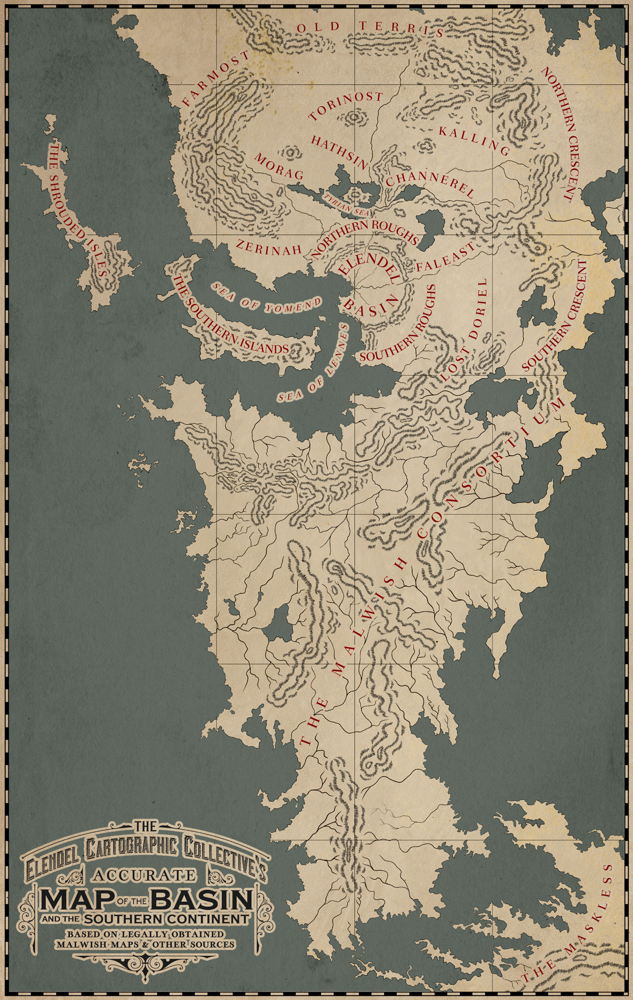

### 第二時代的司卡德利亞疆域

司卡德利亞（Scadrial）的故事跨越數千年，各個時代都經歷過劇烈的變革。時代之間的差異如此巨大，人們很容易把依藍戴盆地（Elendel Basin）與最後帝國（Final Empire）誤認為不同星球上的文明，而非同一片土地耗費龐大授予（Investiture）改造後的模樣。本節概述司卡德利亞從第一時代過渡到第二時代時的變化，後續各節則會更詳細介紹第二時代的各個地區。

### 改頭換面的世界

和諧（Harmony）逆轉了統御主（Lord Ruler）對司卡德利亞的改造，將星球移回原本的軌道。他重塑大陸地貌，改變海洋的形狀，並使已滅絕的物種重現世間。在這個新世界裡，綠色植物生長在藍天之下，金色陽光不再被令人窒息的落灰（ashfalls）遮蔽。司卡德利亞特有的迷霧仍偶爾籠罩大地，但迷霧散去時，星辰便在澄澈的夜空中閃爍。

### 歷代英雄

促成最後帝國覆滅的英雄，成了傳說與歷史中備受尊崇的人物。第二時代最普遍的宗教（見第3章〈主要宗教〉）都將卡西爾（Kelsier）、紋（Vin）、沼澤（Marsh）與沙賽德（Sazed）視為宗教人物：

倖存者教（Survivorism）。倖存者教會（Church of the Survivor）延續至今，其現代形式便是倖存者教，也是當代最主要的宗教之一。

碎刺教（Sliverism）。在帝國覆滅中倖存的聖務官（Obligators）將鋼鐵教廷（Steel Ministry）的信仰傳承下來，形成了碎刺教。碎刺教信徒（Sliverists）敬奉鐵眼（Ironeyes）與其他承繼神聖遺產的人物。

道教（The Path）。奉行和諧教誨的人追隨道教。道徒（Pathians）研究泰瑞司（Terris）守護者（Keepers）保存的三百種古代宗教信仰。

### 金屬技藝的演變

金屬技藝（Metallic Arts）曾被視為神祕的祕密，由貴族、鋼鐵教廷與泰瑞司守護者嚴加保守。到了第二時代，鎔金術（Allomancy）與藏金術（Feruchemy）已不再侷限於特定文化或出身，一般民眾也了解這兩門技藝的基本知識。射幣（Coinshots）與鋼奔（Steelrunners）受僱擔任高價快遞員。安撫（Soothing）與煽動（Rioting）受到管制，可用於治療，但在經濟與政治場合中則受到限制。第二時代的大多數金屬之子（Metalborn）只會發展出一種能力，成為迷霧人（Misting）或單藏金術師（Ferring）。已有好幾個世代未曾誕生迷霧之子（Mistborn）或擁有完整能力的藏金術師（Feruchemists）。罕見的雙生師（Twinborn）則各擁有一種鎔金能力與一種藏金能力。這兩種能力共有256種可能的配對組合，因此許多雙生師的能力組合獨一無二。和諧試圖封鎖血金術（Hemalurgy）的知識，但鬼血（Ghostbloods）與「組織」（the Set）等祕密團體仍知曉這門黑暗技藝，詳見第5章。

### 依藍戴盆地

最後帝國各族群的後裔，主要居住在依藍戴（Elendel）城及周邊地區，這整片地區統稱為依藍戴盆地。和諧將盆地設計為新生文明的搖籃，提高土地的肥沃程度，並將盆地置於適合種植糧食的理想氣候帶。

### 泰瑞司文化復興

泰瑞司文化在第二時代迎來復興。許多泰瑞司人完全融入盆地的文化與社會，但也有人住在自治的泰瑞司聚居地（Terris enclaves），保留自己的文化。聚居地居民穿著傳統泰瑞司服飾，包括帝國時代泰瑞司侍從官曾穿過的V字紋長袍，如今稱為tinningdar。

### 盆地的語言

落灰之終（Catacendre）後的數百年間，帝國語（Imperial）的各種方言仍在依藍戴盆地通用，但已改稱司卡語（skaa）。與此同時，東方街頭俚語演變為學術語言上皇族語（High Imperial），泰瑞司人也重新拾回自己的古老語言。《創始之書》（Words of Founding）保存了近兩百種古代語言，但司卡語仍是依藍戴盆地與蠻橫區（the Roughs）最主要的通用語言。

### 蠻橫區

蠻橫區位於環繞盆地、提供天然屏障的山脈之外，是一片邊疆地帶。當地治安由獨立的執法者（lawkeepers）維持，他們權限廣泛，受到的規範卻很少。

第2章：地區與文化 57

<!-- Visually transcribed printed text; absent from native extraction. -->

依藍戴製圖協會（The Elendel Cartographic Collective）繪製的盆地與南方大陸（Southern Continent）精確地圖，依據依法取得的Malwish地圖及其他來源製作。

| 地圖標籤 |
| --- |
| 舊泰瑞司（Old Terris） |
| Farmost |
| Torinost |
| Kalling |
| 海司辛（Hathsin） |
| Morag |
| 香奈瑞河（Channerel） |
| Tyrian海（Tyrian Sea） |
| Zerinah |
| 北方蠻橫區（Northern Roughs） |
| 依藍戴盆地 |
| Faleast |
| 失落的Doriel（Lost Doriel） |
| 南方蠻橫區（Southern Roughs） |
| 北新月（Northern Crescent） |
| 南新月（Southern Crescent） |
| 遮蔽群島（The Shrouded Isles） |
| 南方群島（The Southern Islands） |
| Sea of Yomend |
| Lennes海（Sea of Lennes） |
| Malwish聯盟（The Malwish Consortium） |
| 無面具者（The Maskless） |

第2章：地區與文化 58

ISAAC STEWART

### 新興氏族

和諧改造了最後帝國的克羅司（koloss），使他們能夠繁衍後代，誕生了擁有自身文化與社會的新族群：克羅司混血（koloss-blooded）。蠻橫區是克羅司氏族的家園，他們使用歷代傳下的血金術尖刺（Hemalurgic spikes），將自願接受轉變的人變成完整克羅司（full koloss）。大多數完整克羅司出生時都是克羅司混血，但也有一些不具克羅司血統的人類，希望加入氏族。有些不願成為克羅司的年輕人遷往較大的聚居中心，但許多人仍留在蠻橫區，維繫與家人及自身文化的關係。

### 帝國的殘垣

最後帝國大半毀於地震、風暴與海嘯，但蠻橫區之外仍留有廢墟。尋寶者踏上遭人遺忘的帝國道路，發掘貴族堡邸與鋼鐵教廷要塞，尋找灰燼世界（World of Ash）留下的寶藏。

### 南司卡德利亞

南司卡德利亞（Southern Scadrial）的文明只能有限地運用金屬技藝，卻仍適應了灰燼世界的環境，隨後又面臨前所未有的氣溫驟降。南方人以獨特的面具習俗聞名，在落灰之終後三百年，與北方鄰居建立了聯繫。

### Malwish的統合者

南方五大文明逐漸在Malwish的領導下組成聯盟，部分原因是為了因應與依藍戴盆地居民開戰的潛在威脅。

### 不受拘束的創新

落灰之終後，司卡德利亞各國迎來工業革命與科技快速進步的時代。最終，電力照亮了盆地的城市中心，街道上的汽車也比馬車更多。

### 火藥風雲

統御主為了維護鎔金術師（Allomancers）的權力與至高地位，封鎖了火藥的祕密。他的統治結束後，火器被重新發現，成為人們的首選武器。進步的火藥桶已在司卡德利亞引爆，再也無法回頭。

### 金屬技藝的新用途

司卡德利亞南方人（Southern Scadrians）開發出金屬技藝的新用途。未綁定金屬意識庫（Unkeyed metalminds）可供多位藏金術師使用，不受製作者的身分（Identity）限制。受授予的徽章（Invested medallions）則賦予佩戴者藏金能力。鎔金術方塊（Primer cubes），北方人通常稱為鎔金手榴彈（Allomantic grenades），能讓迷霧人以新方式運用能力，並延伸作用距離。

### 授予航空技術

Malwish發明了以金屬技藝驅動的浮空船（airships）。這些令人驚嘆的船艦可用於貿易、探索與戰爭。更多授予技術（Invested technology）與司卡德利亞南方浮空船的資訊，見第1章〈科學與科技〉。

### 北方與南方

彼此相連的北方大陸與南方大陸，是關係緊張的鄰居。盆地擁有較多金屬之子與天然資源，但人們越來越擔心Malwish會運用優越的科技發動入侵。司卡德利亞南方人的好戰派系則推動開戰，希望趁己方科技仍有明顯優勢時出擊。雙方持續相互試探，同時維持脆弱的和平。

射幣與扯手（Lurcher）快遞員能在依藍戴賺取不錯的收入。

KEVIN SIDHARTA

