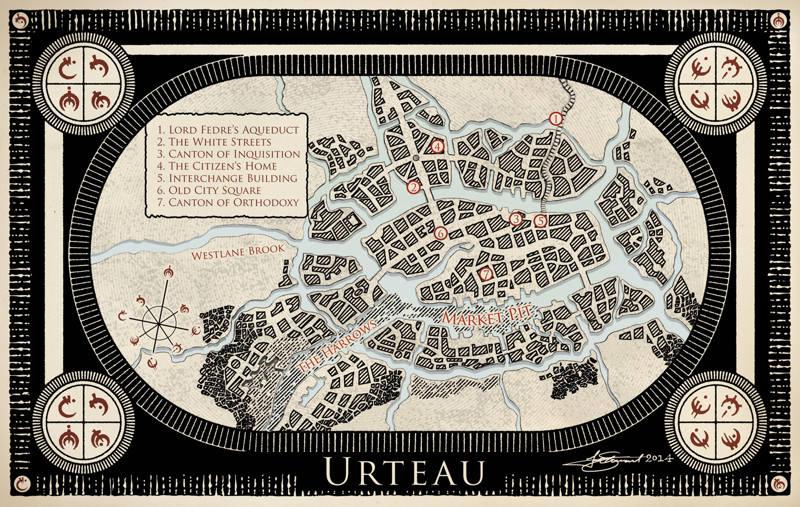

### 北方統御區：第一時代

一名年幼的司卡（skaa）男孩穿著磨薄的長褲與沾灰的襯衫，在河邊伸手抓魚。他疲倦的母親則滿懷疼愛地搖搖頭。一艘裝飾華美的船朝他們漂來，母子倆連忙躲到看不見的地方。船上載著兩名各懷心機、身穿出遊服的貴族女子，船尾還有一名划槳的僕人。地平線上，一座灰山（Ashmount）傲然矗立，懶洋洋地噴吐黑煙，襯著朱紅色的天空。兩名貴族都將陽傘壓得很低，以帶著絲質褶邊的傘面擋住落灰，也防範可能偷聽的人。北方統御區（Northern Dominance）的貴族享有豐裕得令人髮指的生活，受他們剝削的司卡卻愈來愈看不見希望。

與其他統御區相比，北方統御區的草木較為茂盛，境內有山脈、谷地與森林，Kalling灰山也坐落於此。一連串水道流經這片土地，既支援農耕，也方便運送貿易貨物。由於此地鄰近中央統御區（Central Dominance），統御主（Lord Ruler）格外重視這裡的秩序。

### 政府

北方統御區有大批聖務官（obligator），監督統御主旨意的落實。只要傳出一點司卡叛亂的風聲，他們就會立刻展開徹底調查。鎢都（Urteau）是北方統御區的首府，也是帝國歷史最悠久的城市之一。這座城市以街溝（streetslots）聞名。這些沾滿灰燼的運河，數百年來早已滴水不剩。其中最著名的兩處是市集溝（Market Pit）與勞難區（Harrows）。司卡在市集溝以物易物，交換簡單的貨物與服務；勞難區則擁擠又混亂，住著沒有固定工作的司卡。鎢都的貴族街區有木造建築、精緻的彩繪玻璃與別出心裁的花園點綴，劃給司卡的區域卻破敗不堪、人滿為患。

### 文化

北方統御區的大家族（Great Houses）以格外重視投資與貿易關係聞名。最後帝國（Final Empire）最強大的大家族——泛圖爾家族（House Venture）——在北方統御區擁有世襲領地，對當地影響深遠。

北方統御區鮮少有真正的群體歸屬感。多數大家族對治下的司卡極其殘酷。但無論貴族或司卡，每個人在社會上都有無數機會，可以藉由打壓同儕來出人頭地，或至少讓自己免受其害。初次見面就表現得太過友善，反而會引來強烈猜疑。大多數人措辭謹慎，在更加了解對方之前，與同一社會階級的人相處時，只求維持適度的和氣。

### 貴族繼承人

大家族的婚生子女會在舞會上與其他孩子結成模擬同盟，練習將來要扮演的角色。這些同盟沒有實際效力，因此孩子們可以試著建立合作關係，不必承受犯錯的壓力。有時父母會利用這一點，讓孩子假借練習談判之名，試探潛在交易的可能。這些經驗能增進年輕貴族的社交直覺與談判技巧，卻也可能無意間種下一輩子的嫌隙。對青少年與年輕成人而言，求偶純粹是同盟談判，感情完全不在考量之內。貴族理應基於現實考量或為了物質利益而結婚，而勢力較強的一方往往會在婚外尋求親密伴侶。因此，訂婚就像畢業一樣，是值得慶祝的成就，重點大多放在雙方各自的個人與追求上。

### 運河城鎮

商人、搬運工與水手經常往來於北方統御區各條水道沿線的運河港鎮，偶爾也會有旅途中的鎔金術師（Allomancer）造訪。運河城鎮的生活設施很不理想，但行經此地的鎔金術師卻能住進奢華的港口堡塔（port keeps）。這些豪華的圓柱形高塔以一座大型尖塔為標誌，樓層最多可達十六層。各樓層可經由螺旋樓梯抵達；前來作客的迷霧之子（Mistborn）或射幣（Coinshots）也可以對底層中央裝設的鋼製圓盤施加推力（Push），從樓梯中央的開放通道向上升去。

第 2 章：地區與文化 47

貴族鎔金術師通常不會以能力從事體力勞動，但住在港口堡塔時，他們可能會自願幫忙。比方說，水位偏低時，船隻可能受困，這時迷霧之子、射幣、扯手（Lurchers）與白鑞臂（Pewterarms）就能協助，讓船隻更快脫困。主要運河即使只堵塞一天，都可能讓商業經營者損失數千盒金（boxings）。因此，船隻行經設有港口堡塔的城鎮時，都得繳稅，用以維持堡塔奢華迷人的環境與服務人員。鋼鐵審判者（Steel Inquisitors）辦理公務時也能預訂港口堡塔，但不會有人要求他們提供服務。

### 資源

北方統御區的天然資源豐富，包括首府附近的錫礦與煤礦，以及受到水道充分灌溉的肥沃土壤。森林中各種針葉樹的樹液會經過蒸餾，用來製成糖漿、膠與酒。貿易則透過河流與運河進行。在首府鎢都的地下，統御主祕密藏起了極其龐大的存水。

### 最後帝國之後

統御主死後留下權力真空，史特拉夫．泛圖爾（Straff Venture）大人便自立為北方統御區之王。紋（Vin）殺死史特拉夫後，他麾下的將軍加那爾（Janarle）向依藍德（Elend）的新帝國（New Empire）宣誓效忠，並成為這片統御區的國王。首府鎢都爆發司卡叛亂，迫使加那爾逃離。隨後，號稱「公民」（Citizen）的魁利恩（Quellion）建立了新的司卡政府。魁利恩受到卡西爾（Kelsier）啟發而追求正義，獵殺殘暴的貴族，並提升司卡的生活水準。然而，他也顯露出冷酷無情的領導作風，為了保住權力，並按照自己的意願施以懲罰，不惜採取極端而不道德的手段。魁利恩發明了一種名為佩幣（pek）的新貨幣，幣值低於夾幣（clip）。他也要求多數人穿灰色，以象徵平等；官員則穿紅色，深藍色服裝專屬魁利恩本人。在鎢都政變中，沙賽德（Sazed）、鬼影（Spook）、微風（Breeze）與奧瑞安妮（Allrianne）（見第 5 章「卡西爾與他的團隊」）聯手當地由度恩（Durn）領導的司卡地下勢力，從魁利恩手中奪回了這座城市。

「公民」垮臺後的鎢都。

<!-- 依原始點陣地圖目視轉寫印刷標籤；七個編號標記對應下列圖例。羅盤使用八個字形符號，而非拉丁字母方位名稱。原圖沒有印刷距離比例尺或路線箭頭。 -->

| 地圖標記 | 地圖標籤 |
| --- | --- |
| 1 | Fedre大人的輸水道（Lord Fedre’s Aqueduct） |
| 2 | 白街（The White Streets） |
| 3 | 審判廷（Canton of Inquisition） |
| 4 | 公民之家（The Citizen’s Home） |
| 5 | Interchange大樓（Interchange Building） |
| 6 | 舊城廣場（Old City Square） |
| 7 | 教義廷（Canton of Orthodoxy） |
| — | Westlane溪（Westlane Brook） |
| — | 勞難區 |
| — | 市集溝 |
| — | 鎢都 |
| — | 2014 |

第 2 章：地區與文化 48

ISAAC STEWART

