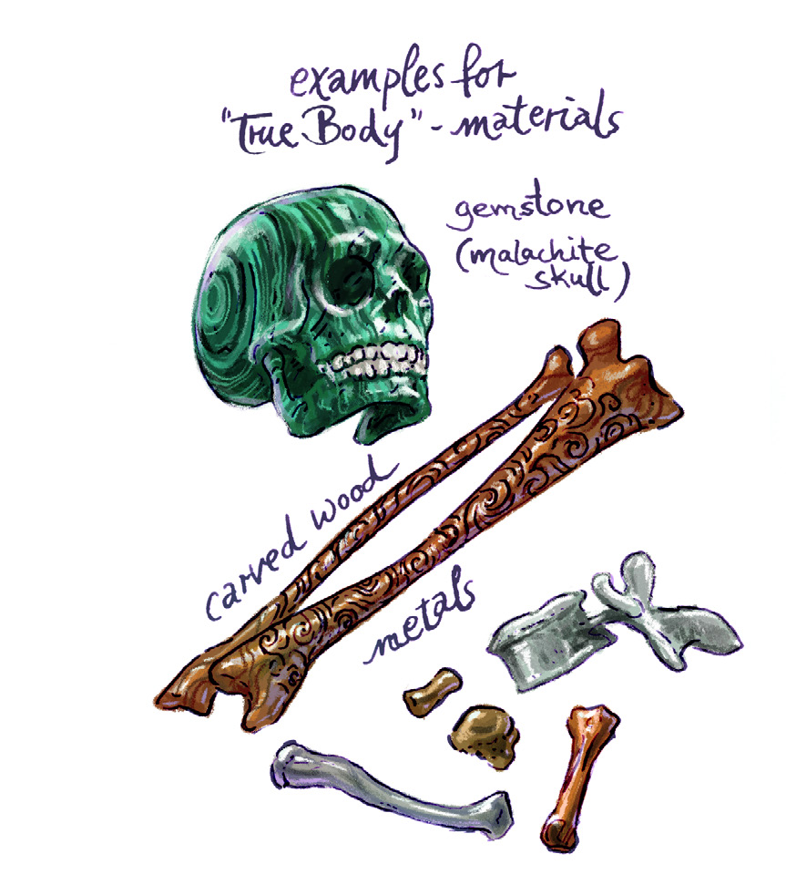
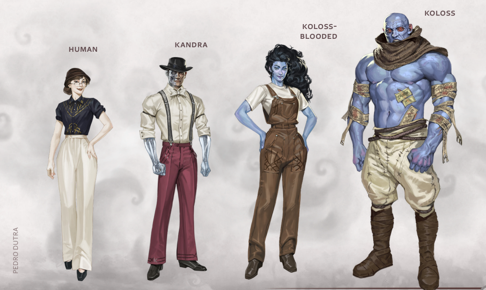

司卡德利亞（Scadrial）的族群聰慧而富有創意，能適應世界劇烈的環境變遷與科技躍進。本章詳述司卡德利亞許多族群與文化在兩個不同時代的樣貌。第一時代的各地區先以最後帝國（Final Empire）時期的狀態呈現，再以一節說明統御主（Lord Ruler）倒台後的變化。第二時代的各地區則以《悼環》（The Bands of Mourning）事件結束三年後的狀態呈現。（第 4 章提供古典時期的司卡德利亞（Classical Scadrial）、劃分第一與第二時代的落灰之終（Catacendre），以及各時代重要歷史背景的資訊。）

### 司卡德利亞的族群

司卡德利亞的族群包括擁有可遺傳之授予之術（Invested Arts）的人類（humans）、坎得拉（kandra）與克羅司（koloss）這兩種具有智慧的血金術（Hemalurgy）生物，以及克羅司的後裔——克羅司混血（koloss-blooded）。

### 人類

在司卡德利亞有記載的歷史中，人類一直以這顆星球為家。第一時代的北司卡德利亞（Northern Scadrial）居民主要分為泰瑞司（Terris）人、貴族與司卡（skaa）三個群體。統御主改造了他們的基因，使他們能在充滿灰燼的世界中生存，但這段起源鮮為人知。到了第二時代，一群未受最後帝國影響的司卡德利亞南方人（Southern Scadrians）現身世人面前。

### 貴族

統御主在昇華（Ascension）時，選出了作為統治階級的貴族。他賜予他們鎔金能力（Allomantic powers），而這份力量能沿血脈傳承。

### 司卡

司卡是遭統御主奴役的人類。最後帝國時期，多數司卡被迫為殘暴的主人工作，只有少數幸運的人得以在城市中獨立謀生。最初的司卡沒有可遺傳的授予之術。然而，隨著數百年過去，司卡與貴族通婚繁衍；這種混合血統讓司卡族群也有了鎔金術（Allomancy）的潛能。最後帝國時期，司卡身分在社會上仍有重要意義，但落灰之終後，這項區分便逐漸過時。

### 司卡德利亞南方人

統御主將司卡德利亞南方人置於南極，他們與世隔絕，直到落灰之終。他們的基因未受改造，與古典時期司卡德利亞的人類十分相似。（見本章末的〈南司卡德利亞〉。）

### 泰瑞司

第一與第二時代的泰瑞司人都珍視自己豐富的文化，並有意識地傳承知識與習俗。除了深厚的歷史見識，泰瑞司文化也重視謙遜與開放心胸。許多泰瑞司家系傳承著金屬技藝（Metallic Arts）之一的藏金術（Feruchemy），但統御主曾採取駭人的手段，控制並阻礙這份強大的傳承（見本章後面的〈泰瑞司統御區〉）。落灰之終後，許多泰瑞司人選擇住在聚居地中，既能靠近主流人類社會的重要中心，又能避免完全同化，以及失去習俗與傳統的風險（見本章接近末尾的〈泰瑞司聚居地〉）。

對頁：司卡德利亞的族群——司卡、貴族、泰瑞司人、Malwish 與克羅司混血。

第 2 章：地區與文化 33

IVANA ABBATE

### 坎得拉

坎得拉是擅長變形的族群，經過仔細練習，便能模仿人類及其他生物。他們自然狀態下的身體與霧魅（mistwraiths）十分相似，但後來發展出使用人造骨骼的真體（True Bodies），並在坎得拉家園（Homeland）中使用。統御主創造了坎得拉，使他們成為近乎不死的血金術生物。《迷霧之子玩家手冊》（Mistborn Handbook）第 2 章提供更多坎得拉的資訊。

### 坎得拉世代

每一代坎得拉都有獨特的文化，而每個坎得拉與自己世代文化的關係也各不相同。最後帝國末期，坎得拉共有十一個世代。坎得拉初代（First Generation）原本是人類，也是統御主的藏金術師（Feruchemist）朋友。他說服他們以力量換取不死之身。他們成為統御主忠誠的間諜，之後再運用統御主賜予的祝福（Blessings）——成對的血金術尖刺（Hemalurgic spikes）——將霧魅變成二代（Second Generation）。已有數百歲的坎得拉初代深居簡出，選擇透過二代代理統治。統御主死後，坎得拉無法再取得新的祝福，族群人口也因此停滯不增。

### 坎得拉契約

最後帝國時期，多數坎得拉只有在與人類貴族家族訂立契約（Contract）後，才會離開坎得拉家園。契約要求他們假扮某個人，滿足該家族的需求。落灰之終後，和諧（Harmony）讓坎得拉不再受與統御主所訂初約（First Contract）及貴族契約的束縛。初約以初代為引導坎得拉社會所訂的一系列承諾為基礎。統御主將這些承諾編入初約，其中包含下列核心原則：

- 效忠統御主。

- 尊崇較早世代的坎得拉。

- 保障每個坎得拉的法律權利。

- 訂立創造新坎得拉的條款。

- 如果初代下令，便必須拔除自己的尖刺，從而放棄智慧。

最後一項條款是為了防止滅絕（Ruin）一旦逃出囚禁，便控制坎得拉。最後帝國初期，坎得拉另外訂立了契約。這份協議實際上讓坎得拉受人類奴役，以換取保護，免遭殺人的鎔金術師（Allomancers）傷害。許多坎得拉怨恨人類，既因為人類帶來的危險，也因為人類對坎得拉的剝削。契約包含下列協議：

- 他們會為人類服務。

- 除非與某個人類訂有契約，否則必須留在家園。

- 他們絕不殺害人類。

### 壽命

坎得拉實質上不會老死。他們的身體不會隨年齡衰敗，也不像其他血統（ancestries）那樣受疾病或病痛影響。然而，漫長生命仍會對有智慧的心智造成影響。統御主倒台、坎得拉得以自由生活後的數百年間，許多初代與二代坎得拉選擇接受和諧賜予的「解脫」（the escape），讓自己能選擇結束生命。對坎得拉而言，解脫被視為極為個人而私密的選擇。

<!-- Handwritten labels within the illustration, transcribed visually; native text does not contain these labels. -->

「真體」材料範例

- 寶石（孔雀石頭骨）
- 雕刻木材
- 金屬

坎得拉工匠將真體雕琢成令人驚嘆的藝術品。

第 2 章：地區與文化 34

MARIE SEEBERGER

有些坎得拉會以慶祝來紀念漫長生命的終結，往往與親密的夥伴和摯愛分享回憶與故事。另一些則將解脫視為獨自進行的莊嚴時刻。準備接受解脫時，許多第二時代的坎得拉會回到昔日的坎得拉家園；那裡如今位於依藍戴（Elendel）的重生之野（Field of Rebirth）下方。

### 克羅司

藍色的皮膚、高大的身形與驚人的體能，讓克羅司在司卡德利亞各族群中格外顯眼。最後帝國的居民並不知道，統御主是將人類變成自己能控制的巨型血金術生物，藉此創造克羅司。

### 完整克羅司

「克羅司」一詞通常指完整克羅司（full koloss），也就是接受四枚以鐵（iron）製成之血金術尖刺的人類。尖刺賦予他們克羅司聞名的力量與高大身形。最後帝國時期，統御主將克羅司部隊駐紮在各個人口較稀疏的統御區（dominances）。落灰之終後，克羅司終於能依自己的意願自由生活；多數選擇組成在荒野中遊走的氏族，並定期與其他氏族聯繫。

每個克羅司身上的尖刺，都使他們的身體承受超出生理極限的壓力，也傷害了他們的靈網（spiritwebs）（見第 1 章〈血金術〉）。新的尖刺會嚴重擾亂接受者的認知與情緒功能。然而，尖刺經過數百年的重複使用而逐漸老舊，影響也隨之減輕；它們所穿透的各種靈網，有助於使尖刺穩定。因此，後來幾代克羅司能保有更細膩的認知與情緒。

### 克羅司混血

落灰之終後，和諧賦予克羅司像人類一樣繁衍的能力。克羅司混血便由此而來：他們有克羅司血統，外貌與人類十分相近。他們的膚色從典型的克羅司藍色到各種灰色都有，也經常混有人類膚色。只要生來具有克羅司血統，就被視為克羅司混血，即使同時也有人類血統。克羅司混血多半生活在城市的人類之間，或住在蠻橫區（Roughs）自己的社群中。到了青少年時期，有些人會選擇接受鐵尖刺，成為完整克羅司（關於蠻橫區文化中的這項傳統，見本章接近末尾的〈蠻橫區〉範例）。《迷霧之子玩家手冊》第 2 章提供更多克羅司混血的資訊。

人類

坎得拉

克羅司混血

克羅司

第 2 章：地區與文化 35

PEDRO DUTRA

