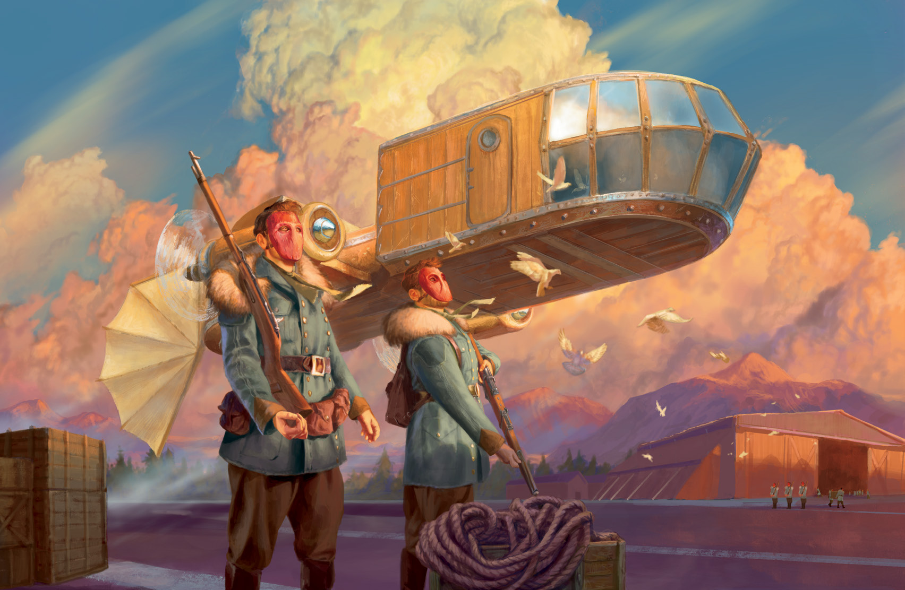
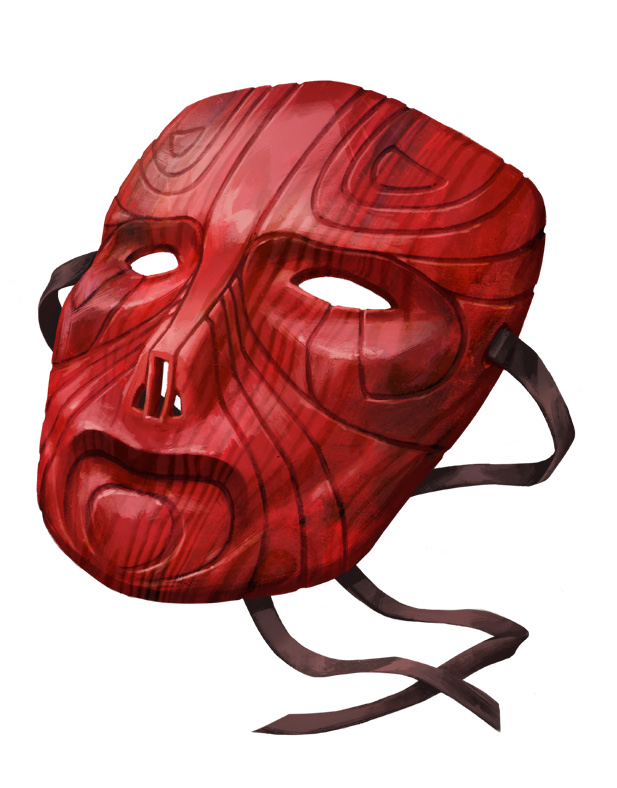
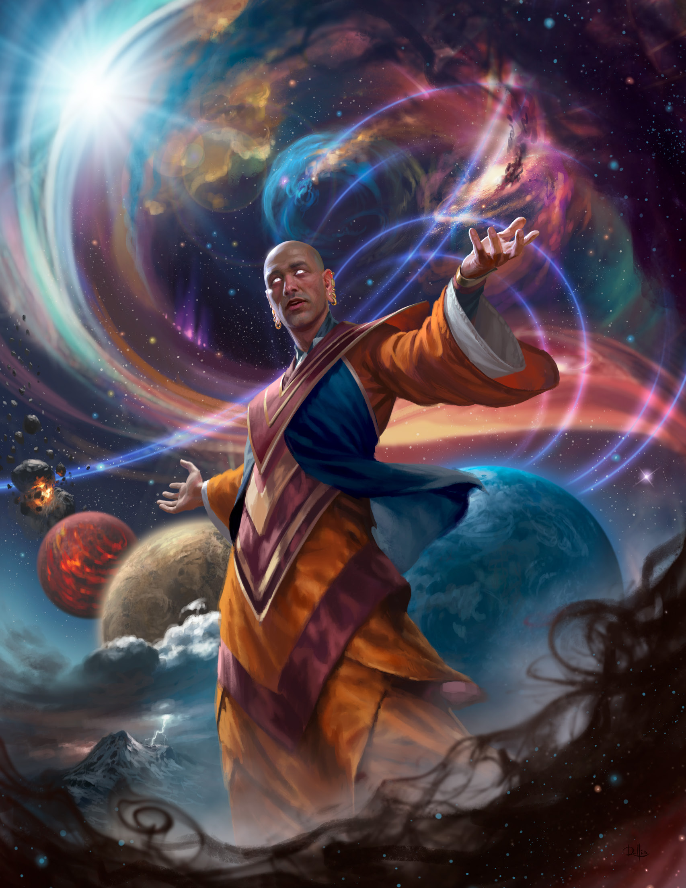

### 南司卡德利亞第二時代

一艘三層高的浮空船（airship）滿載北方貨物，還載著一小群遊客，轉向離開依藍戴（Elendel），踏上漫長的返鄉旅程。城內，永久停泊設施的工程正如火如荼地進行。船上的下層船員完成最後檢查，查看貨物。上層甲板上，一位戴著面具的淑女正示範幾個複雜的舞步，樂師們則在一旁為樂器調音。

北司卡德利亞（Northern Scadrial）經歷落灰之終（Catacendre）時，南司卡德利亞（Southern Scadrial）遭逢了冰殲時代（Ice Death）。這場浩劫摧毀了他們的社會（見第 4 章〈和諧的昇華〉）。南方人認為這是 Jaggenmire 的懲罰；這位二元一體的神祇由 Herr 與他的姊妹兼妻子 Frue 組成。

一位被司卡德利亞南方人（Southern Scadrians）稱為君王（Sovereign）的人物，將他們從冰殲時代中拯救出來。他教導他們製作徽章（medallions），最早的徽章能讓非金屬之子（Metalborn）使用黃銅藏金術（brass Feruchemy）。「火母（Firemothers）」與「火父（Firefathers）」犧牲自身的熱量，讓族人得以存活。此後，司卡德利亞南方人利用他們能取得的 ettmetal，持續改良這項技術。ettmetal 是和諧（Harmony）的神金屬（God Metal），也稱為 harmonium。

冰殲時代之後的三百年間，南司卡德利亞的五個國家與北司卡德利亞鮮有往來。在這段期間，南方人的科技突飛猛進。後來，一艘 Malwish 浮空船墜毀於盆地的 Dulsing 鎮，開啟了洲際交流的新時期。

### 冰殲時代留下的飲食傳統

即使在落灰之終與冰殲時代過去數百年後，酸味箱根（sour boxroot）、紅砂苔（red gritmoss）與鼠尾菇（mousetail mushrooms）等耐寒作物，仍深受司卡德利亞南方人喜愛。

### Malwish

Malwish 是唯一與依藍戴政府建立聯繫的國家，人民含蓄而多疑。他們使用 Malwish 語，並透過藏金術徽章（Feruchemical medallions）與其他南方國家及司卡德利亞北方人（Northern Scadrians）溝通（見第 1 章〈授予科技〉）。

一艘掠行艇（skimmer）從 Malwish 的飛行場起飛。

ANDREA PIPARO

### 政府

Malwish 積極在南司卡德利亞締結同盟，希望將南方諸國統合為 Malwish聯盟（Malwish Consortium；見第 4 章〈Malwish聯盟的成立〉）。他們有幾位政治人物與海軍將領主張，北方的災難是他們一切困境的根源。首位派駐依藍戴盆地（Elendel Basin）的大使是 Jonnes上將（Admiral Jonnes）。她是一位通情達理的女性，與依藍戴議會（Senate）合作。

### 文化

Malwish 重視商業、創新與藝術，也格外看重待客之道。怠慢客人的需求會令人極為難堪，而客人讓主人為難，也被視為非常無禮。

Malwish 說話講究文采與描繪，在傳達意思的同時也表達情感。和舞蹈、駕駛與音樂一樣，善於言談也是 Malwish 磨練的技藝。常見的衣著包括及膝褲、高筒襪，以及穿在白襯衫外的雙排扣背心。長褲與條紋長裙都很受歡迎。

多數 Malwish 相信，每一位金屬之子體內都蘊含神性，因此本身就是神。他們十分敬重擁有鎔金能力（Allomantic powers）或藏金能力（Feruchemical powers）的人。

### 面具

面具在司卡德利亞南方文化中占有核心地位。所有 Malwish 都戴面具，並會更換面具來反映自己的職業或個人風格。面具能減少旁人的審視，維持自律的形象；例如，讓人看見自己咀嚼食物就被視為不禮貌。過去摘下面具曾是禁忌，但隨著習俗改變，挪動面具也成為肢勢表達的一部分，用來傳達強烈情感或加重語氣。

### 資源

ettmetal 是 Malwish 最珍貴的資源，可用來驅動浮空船，也能製作鎔金術方塊（Allomantic primer cubes）與藏金術徽章等科技產物。見第 1 章〈科學與科技〉。

### 其他國家

南司卡德利亞由包括 Malwish 在內的五個國家組成，各國都有自己的面具佩戴傳統。司卡德利亞北方人對其餘四國幾乎一無所知，但少數依藍戴人得知了以下兩國的情況：

墮落者（The Fallen）。墮落者曾領導南司卡德利亞，卻在冰殲時代之後遭到譴責。司卡德利亞南方人認定，墮落者一定做了什麼冒犯 Jaggenmire 的事。墮落者通常只能佩戴樸素、未上色的面具。不過，只要有人完成特別值得讚揚的事蹟，彷彿為族人的過失贖罪，便能獲准佩戴較華麗的面具。

獵人族（The Hunters）。獵人族曾以戰士聞名，但在冰殲時代之後，他們致力尋找那場摧毀南方社會的浩劫究竟因何而起。他們雖然嚴厲、要求甚高，通常卻也公平正直。獵人族的每個人在童年都會得到一副面具，成年時再換上另一副。

他們總是嚷嚷著盆地有多麼渺小、軟弱。那是充滿侵略性、崇尚武力的姿態。

一副 Malwish 面具。

第 2 章：地區與文化 75

ANNA VERHOOG

