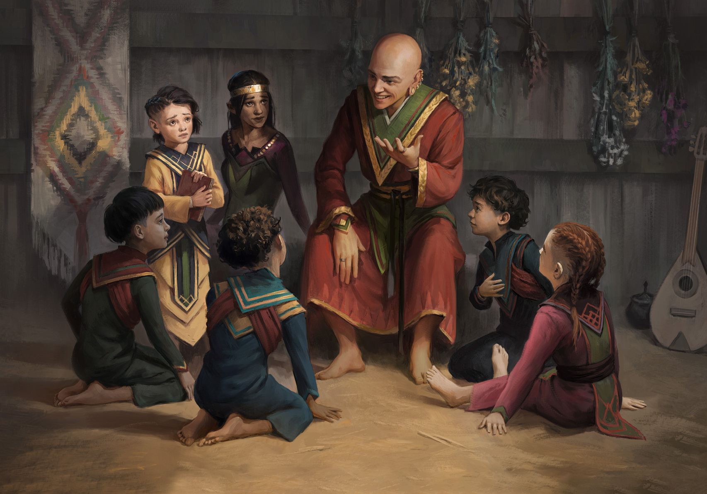

### 泰瑞司統御區：第一時代

一名刺有紋身的聖務官（obligator）神情陰沉而嚴厲，監看著年幼的侍從官練習正式餐桌禮儀。年長的侍從官身穿鮮豔長袍，說話尖刻，在桌間踱步，調整餐具擺設，糾正孩子的坐姿。樸素冷硬的石造建築外，一艘貨運駁船在碼頭停靠，一名雙眼插著尖刺的鋼鐵審判者（Steel Inquisitor）在旁監督。髮絲斑白的泰瑞司人（Terris）婦女正從船上卸貨，長年勞動讓她們的雙手強而有力。健壯的短腿綿羊在八角木屋間遊蕩；衣袍一塵不染、舉止文雅的侍從官緩步走過，討論家族政治。木屋裡爐火燃燒，泰瑞司人分享故事、詩歌與歌曲。泰瑞司統御區（Terris Dominance）生活的每一個層面，都受到鋼鐵教廷（Steel Ministry）的監視。儘管如此，泰瑞司人仍在等待。仍然銘記。

泰瑞司統御區位於遙遠的北方，荒涼多雪，境內多山，人口稀少。首府塔辛文（Tathingdwen）設有侍從官訓練學院，也是統御主（Lord Ruler）的泰瑞司侍從官計畫（Steward Program）與育種計畫（Breeding Program）總部所在。泰瑞司人的祕密領導者席諾德（Synod）也在此。塔辛文坐落於一條大河的河口，城中遍布堅固耐久的茅頂原木屋。各地散布許多小村莊，居民大多是未被選入育種計畫的泰瑞司婦女，以及未被賣給貴族家族的侍從官。最偏遠的村莊則全由泰瑞司男性居住。以下各節主要介紹這個統御區的歷史，以及教廷對當地的控制。第 6 章詳述各處地點，並提供在泰瑞司統御區展開故事的靈感。

泰瑞司如今是片泥土凍結的苔原——唉，幾乎沒有植物能在那裡存活。但它曾經蒼翠而美麗，就像文獻裡寫的那樣。

### 政府

最後帝國（Final Empire）第六世紀時，審判廷（Canton of Inquisition）提出侍從官計畫，藉此控制人口。此後，審判廷統治泰瑞司統御區，監管族譜、育種計畫及侍從官計畫。泰瑞司人沒有自己的軍隊，也未受過武術訓練。即使如此，教廷仍派出小隊巡迴各地，監視泰瑞司村民。

### 文化

即使遭到征服，泰瑞司社會仍珍視人、地方與文化本身的價值。他們雖然失去了祖傳的宗教（見第 3 章〈泰瑞司宗教〉），卻在不知不覺間，透過泰瑞司文化保留了其中的教誨：節制、信仰與理解。就連「Terr」這個字，也有「保存」之意。不從事體力勞動時，泰瑞司人會佩戴許多金屬飾品。侍從官穿著長袍，衣袍正面有獨特的 V 字形連續圖樣。貴族家族買下泰瑞司侍從官（Terris Steward）後，會配給以該家族代表色製成的新長袍。由於泰瑞司文化在形塑過程中，許多層面都仰賴外界認可，大多數泰瑞司人將追求完美視為理想、求生之道，或兼而有之。對某些人而言，這也促使冥想成為一種文化習慣，用來安定心神。

### 泰瑞司守護者

守護者（Keeper）成立於最後帝國第三世紀，是一群隱藏在泰瑞司人之中的博學藏金術師（Feruchemist）。他們將世界各地的文化與知識儲存在紅銅意識（Coppermind）中，加以守護，也致力保存泰瑞司人所承載的藏金術（Feruchemy）傳承。守護者與其領導議會席諾德暗中引導泰瑞司人，要他們耐心等待、堅韌不屈。席諾德與守護者在延續藏金術的使命上取得了顯著成果，但有些泰瑞司人仍感到不滿，認為這些隱身幕後的領導者只顧維持族人受征服的現狀。

第 2 章：地區與文化 54

### 侍從官計畫

多數泰瑞司男性出生後不久便遭閹割，倖存者則被養育成侍從官。教廷的侍從官計畫旨在為最後帝國培育溫順的僕役，讓他們自幼接受訓練，以滿足統御主的意願。計畫中的孩子與泰瑞司文化的其他部分隔絕，直到十幾歲初期；這段期間，他們接受嚴格教育，學習最後帝國的禮儀與社交規範。這種要求嚴苛的訓練需要進口物資，以模擬宮廷活動，包括食物、華服、樂器、教學手冊，以及昂貴的酒與茶。

### 育種計畫

統御主的育種計畫有兩個目的：消滅藏金術，並培育順從的人口。計畫之外不准生育，聖務官也嚴密監控人口。計畫中出生的孩子被隔離在教廷建築內，在嚴格監視下長大，依照嚴苛且分隔實施的課程接受教育。年輕泰瑞司人到了十幾歲初期，不是侍從官的男性少年便被放逐到外圍村莊，採礦、耕作及放牧。大多數少女會加入塔辛文與內圍村莊的泰瑞司社群。年少的侍從官也會加入內圍村莊，繼續練習與受訓，直到被貴族家族買走。

### 計畫遴選

只有極少數格外溫順、優雅而節制的年輕泰瑞司人，會被選為泰瑞司父母。挑選育種計畫的「父親」時，聖務官會巡訪外圍村莊，尋找具備所需特質的人選。同時，被指派為「泰瑞司母親」的人則會被移往另一處教廷設施，服用促進生育的藥物。聖務官強迫她們生育，經常透過人為安排，讓她們懷上雙胞胎或三胞胎。一名泰瑞司母親一生可能生下數十個孩子，並在教廷建築裡，在嚴格監督下養育他們。

### 體制內的抵抗

守護者滲透教廷的侍從官計畫與育種計畫，尋找初露能力的藏金術師，教導他們隱藏能力。守護者也設法破壞教廷族譜的可信度，並讓藏金術師進入育種計畫。育種計畫中的接生者雖受聖務官管轄，也以自己的方式抵抗。她們努力發展與改進醫療方法，藉此減輕痛苦、照顧泰瑞司母親，並記錄技術，造福後世。

### 泰瑞司村莊

侍從官計畫與育種計畫強調僵化的思想灌輸與控制，侵蝕了泰瑞司文化。相較之下，內圍與外圍村莊的習俗卻與最後帝國大不相同。共同生活的家庭包括兄弟姊妹——雙胞胎與三胞胎往往格外親密——也包括不同世代，以及多位戀愛伴侶或柏拉圖式伴侶。泰瑞司人的性別表達、性傾向及關係結構相當多元，尤其是不屬於侍從官的人口。內圍村莊公開展現這種多元性；全由男性組成的外圍村莊，則在聖務官面前維持服從計畫的表象。泰瑞司青少年或年長的母親初次進入村莊時，會發現這裡有大家庭制度，以及由體貼、和善的人組成的緊密社群。村民在泰瑞司八角木屋裡圍著熊熊爐火，以共享餐食、贈送藝術品與說故事比賽歡迎新來者。

### 資源

泰瑞司統御區是片貧瘠的苔原。雖然也出口一些金屬與毛皮，但該地主要的出口是侍從官計畫培育出來的人。有時，挑剔的貴族會親自造訪統御區，評估侍從官人選，而不等他們被送往其他統御區。聖務官經常招待這些訪客泡溫泉、從山間別墅欣賞壯麗景色，同時將侍從官當成珍貴牲畜般展示。

第 2 章：地區與文化 55

### 泰瑞司醫者

泰瑞司文化非常重視醫療知識，醫者與接生者和泰瑞司長老一樣，備受敬重。育種計畫對身體造成的傷害，迫使他們發展出這些專門知識，之後再由守護者傳播出去。

### 最後帝國之後

泰瑞司統御區得知統御主死訊後，鋼鐵審判者便消失無蹤。審判廷試圖自立為政府，但席諾德走出暗處，取代他們，成為泰瑞司人的領導者。這個初建的教廷政府沒料到泰瑞司人會如此沉著頑強地抵抗，因而垮臺，許多聖務官離開統御區，尋找審判者。接下來一年由席諾德執政，守護者公開授課，育種計畫與侍從官計畫也遭廢除。

昇華之井（Well of Ascension）事件期間，數十名鋼鐵審判者帶著一支克羅司（koloss）大軍來到塔辛文，要抓捕席諾德與守護者。許多勇敢的泰瑞司人奮戰，為族人爭取逃生機會；這場戰鬥中，襲擊者俘虜並殺害了大多數泰瑞司藏金術師，以血金術（Hemalurgy）竊取他們的能力。倖存的泰瑞司人約有四萬人，他們前往中央統御區（Central Dominance），尋找當時已知席諾德最後一位倖存成員廷朵（Tindwyl）。他們最後在海司辛深坑（Pits of Hathsin）定居，直到落灰之終（Catacendre）。

泰瑞司人慷慨拿出自己的物資，幫助那些逃離陸沙德（Luthadel）的人。

最後帝國垮臺後，一名守護者教導泰瑞司孩童認識自己的傳承。

SVETLANA KOSTINA

