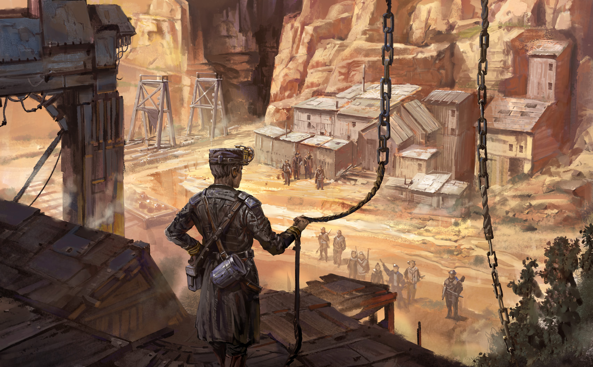
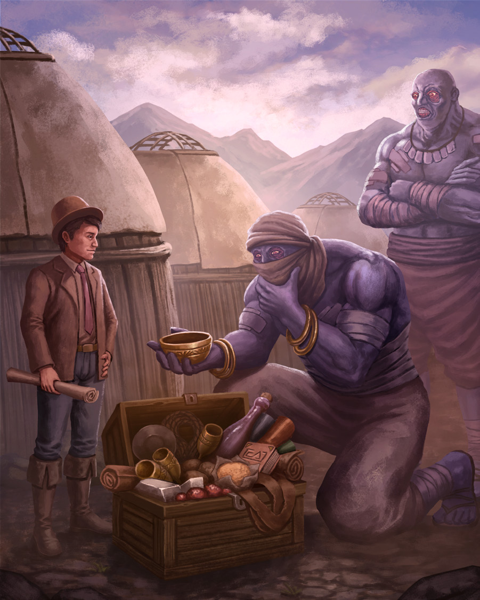

### 蠻橫區（The Roughs）：第二時代

擠滿客人的酒館角落，一架走音的鋼琴奏出輕快的旋律。遠方傳來雷鳴般的馬蹄聲，客人們紛紛從酒杯上抬起頭來。小鎮外，一名女車伕駕著驛馬車，拚命催促四匹馬，榨出牠們最後一分速度。盜匪們以領巾蒙面，高舉手槍，騎著自己的小馬同樣拚命追趕。鎮口，兩名持步槍的副警長在木箱後就位，仔細瞄準，等待盜匪進入射程。遠處一座廢棄礦坑上方的山麓，一名藍皮膚的克羅司（koloss）望著這場衝突揚起的塵煙。他身後，一名裹著皮革的克羅司長老微笑著，看克羅司混血（koloss-blooded）孩子演出他們上次到盆地時看過的戲劇。

盆地居民認為蠻橫區充滿冒險與危險。這片人煙稀少的邊疆，正值經濟蓬勃發展之際。北方蠻橫區（Northern Roughs）的土壤貧瘠，天候惡劣，尤其常見暴洪與龍捲風，但也蘊藏礦物及其他珍貴的天然資源。南方蠻橫區（Southern Roughs）則大多是尚未開發的原始叢林。

蠻橫區居民往往認命而務實。他們通常不信任權威，尤其是來自依藍戴盆地（Elendel Basin）的權威，而且凡事靠自己，甚至到了過頭的地步。

礦災、盜匪、與克羅司氏族的衝突，再加上資源一旦枯竭、聚落隨時可能淪為鬼鎮的陰影，讓蠻橫區居民早已學會如何在困境中盡力過活。

### 政府

每隔幾年，就會有人談論蠻橫區獨立，但依藍戴的貴族與商界利益團體強烈反對這類主張。傳聞有些獨立團體曾遭暴力打壓，卻始終無法證實，也找不到證據將幕後金主指向依藍戴。

True Madil與Covingtar等較大的城市會選出市長，不過True Madil的實權掌握在礦業公司手中。較小的城市與其他城鎮則透過鎮民大會治理，或授權個別執法者（lawkeeper）擔任地方政府。通常，社群裡富有或有魅力的人，例如墾殖農、鐵匠、酒館老闆或雜貨商，即使沒有正式頭銜，也會出面領導。

一名礦場監工俯瞰員工淒涼的宿舍區。

PENG LU

### 礦業公司

礦業公司的經營者，一半是依藍戴盆地的貴族，一半是富有的企業家。他們把利潤與成果看得比什麼都重要。

北方蠻橫區的主要公司包括鑽岩航運公司（Diamond Rock Shipping Company）、雷卡物流與礦業公司（Lekal Logistics and Minerals）、真鋼金屬公司（Truesteel Metals）與Tyrian鐵業公司（Tyrian Iron）。這些公司和許多較小的團體不斷互相競爭，手段包括破壞礦坑、資助盜匪幫派，以及走私武器。

公司高層經常往返True Madil與盆地，有時搭乘豪華河船，但更常搭乘奢華的私人火車車廂。

### 犯法者與執法者

人們四處遷徙，不只是為了找工作，也是為了遠離過去犯下的罪行。蠻橫區盜匪猖獗，他們用領巾蒙住臉，以免遭懸賞通緝，也好進入設有專職執法者的城鎮。

盜匪攔截火車、將驛馬車逼離道路，或走私違禁品時，就會得罪礦業公司。這些公司備有懸賞名冊，描述每名罪犯的特徵、列出罪行，並懸賞將他們繩之以法。

這些罪犯被稱為「通緝犯（warranted）」。其中有些人平時另有營生，只在日子難過時才犯法。這類罪犯在搶劫或犯案後，通常會躲進安全屋避風頭。

另外還有職業盜匪。百發百中幫（Surefires）、Doral幫（Doral’s Gang）與Billi and the Brutes等幫派，都因大膽張狂的行徑而聲名狼藉。他們通常棲身於隱密的犯罪據點，有時是鬼鎮，有時是峽谷或洞穴。但有些人完全居無定所，在惡地遊蕩，露宿荒野，直到準備好再次犯案。

多年來，瓦希黎恩．拉德利安（Waxillium Ladrian）、蕾希（Lessie）、Barl、John Deadfinger、Lucille Penrod與「百命」邁爾斯（Miles Hundredlives）等執法者，持續追捕這些罪犯與流浪漢，將他們逮捕歸案。

### 聚落

大多數聚落的人口只有數百人，不過True Madil、Far Dorest與Weathering等城市則有數千人。

蠻橫區城市的建築低矮而分散，以牧場與墾殖農莊為主，鎮中心另有幾棟建築。大多數建築以木材建造，也有一些是磚造。北方蠻橫區很少有建築高達三層，其中大多位於True Madil。這座城市的主要街道以磚鋪成，商家門面設有遮陽棚。

蠻橫區大多數城市都有相當比例的克羅司混血少數族群；Faradana的克羅司混血人口尤其多，並與幾個較和平的克羅司氏族進行貿易。

### 求生城鎮

北方蠻橫區的聚落仰賴資源流通維生，資源大多來自附近礦坑，有時也來自墾殖農莊。一旦礦脈枯竭，或嚴冬奪走牲畜性命，居民便會前往他處尋求更好的機會，聚落也可能因此淪為空蕩蕩的鬼鎮。

### 文化

北方蠻橫區大多數居民都是近年才搬來的。少數家族在此居住較久，但即使如此，也只能追溯到三、四代以前。

整體而言，蠻橫區居民鄙視盆地文化。他們認為盆地規矩法令太多，而他們想要自由。這些蠻橫區人是吃苦耐勞的工人與墾殖農，努力建立關係緊密、彼此扶持的社群。

然而，也有些探礦者相信，只要運氣夠好，就能一夕致富。相較於墾殖農，這些探礦者更崇尚個人主義，行事也以自身利益為先。

不論動機為何，大多數蠻橫區人都至少在墾殖農莊或礦場做過幾季的工。許多人四處漂泊，在聚落之間往來找工作。

### 教育

教育由各地方社群出資，因此小鎮可能只有一位老師，在僅有一間教室的建築裡授課。有些公司會為當地兒童提供小學教育，但無論經費或教育水準，都比不上盆地的學校。

第2章：地區與文化 71

### 時尚

衣著簡單耐穿，各種性別的人普遍都戴寬邊帽、穿蠻橫區長褲，以及結實耐穿的鈕扣襯衫。防塵長外套也很常見，想要引人注目的人，會在外套上裝飾繽紛的圖案。

### 蠻橫區的泰瑞司人

由於遠離聚居地，蠻橫區的泰瑞司（Terris）家庭往往融入當地文化，逐漸與自身的文化傳承疏遠。然而，一群自稱尋鄉者（Hearthseekers）的泰瑞司人，開始組織遠征隊，前往尚未探索的北方尋找傳說中的舊泰瑞司（Old Terris）。這也讓泰瑞司聚居地開始對北方蠻橫區更加關注。

### 宗教

大多數蠻橫區人信奉道教（the Path）、倖存者教會（Church of the Survivor）或碎刺教（Sliverism）（見第3章的「主要宗教」）。Covingtar是北方蠻橫區的宗教中心，城中有兩座倖存者教會的教堂、一座碎刺教教堂，以及樸素而美麗的道徒（Pathian）花園。

倖存者教會的教堂相當常見，尤其是在礦業城鎮。行經蠻橫區時，經常會在十字路口看見路旁的倖存者神龕，以豎立的長矛與牌匾為標誌。越往北、越接近歷史上最後帝國（Final Empire）的核心地帶，碎刺教教堂的數量就越多。道教信仰吸引許多崇尚個人主義的墾殖農，而道徒花園則提供冥想與向道徒傳教士請益的機會。

### 資源

鐵路雜亂地穿越北方蠻橫區，通往各個礦權區；關閉的礦坑與廢棄鐵路散布各處。

### 出口

北方蠻橫區的主要資源是煤、石油、岩鹽、黏土、砂礫等原料，以及可精煉供工業或鎔金術使用的常見金屬。金、銀等貴金屬礦脈在整個地區也相當豐富。

礦業公司開採資源，再運往依藍戴（Elendel）加工。無論貨物由驛馬車隊、鐵路或駁船運送，經常都會成為受僱從事破壞的盜匪的目標。

### 進口

運入北方蠻橫區的貨物主要是食品、製成品與藥品。雖然當地有許多墾殖農莊與農場，從物產豐饒的盆地進口糧食，仍然省事得多。這些貴重物資，以及偶爾隨車運送的礦場薪資箱，都讓劫匪垂涎，因此這些火車都有公司的警衛嚴密看守。

### Conrad三角洲（Conrad Delta）

雖然南方蠻橫區大部分地區都是茂密叢林，尤其是New Seran正南方的土地，但當地仍發展出一些聚落。其中最著名的是New Tremredare，這座位於Conrad三角洲頂端的港口，濱臨Lennes海（Sea of Lennes）。這片河汊沼澤擁有僅見於當地微氣候的珍稀動植物，沼澤中也遍布最後帝國失落城市的遺跡。

人類與克羅司商人進行交涉。

DAVID ALUNAN

第2章：地區與文化 72

### 文化

New Tremredare的文化，大致類似依藍戴那些講究體面的犯罪事業，帶著上流社會的氣息，骨子裡卻是冷酷無情的競爭手段，以及罪犯的務實作風。

### 資源

珍奇動植物帶來獨特的藥品，例如沉柳藥膏，以及鱷魚皮等新商品。這些資源經由New Tremredare流通，在依藍戴與Bilming都能賣出高價。

除了當地的天然資源，總有出身上流社會的冒險者，在Conrad三角洲、更廣大的南方蠻橫區，以及更遠處的荒地尋找考古遺址。

### 克羅司氏族

克羅司數百年的歷史，形成一張由聯盟、世仇、關注地域與勢力範圍交錯重疊而成的網絡。各氏族彼此衝突，卻也認同共同的起源與一套核心價值。

克羅司文化最重視自決，不只為自己，也為鄰人，無論對方是克羅司或人類。他們的祖先先受統御主（Lord Ruler）奴役，之後又受滅絕（Ruin）奴役。落灰之終（Catacendre）後的克羅司文化，以第一位克羅司英雄「人類（Human）」為典範發展而來。克羅司相信，一個人自己做出選擇，或創造新事物，都是美好的事。

### 尖刺傳統

克羅司混血青年接受或拒絕血金術尖刺（Hemalurgic spikes）的決定，會形塑氏族的傳承，以及長遠的靈性本質。無論青年選擇獻出或保留自己獨有的靈性，氏族都會為此舉行慶典與儀式，因為長老們欣賞孩子選擇自己的道路。

有些克羅司氏族會接受人類成為克羅司的請求。氏族通常會要求外來人類奉獻並效忠多年，才會給予接受尖刺的機會。接受尖刺的人，應該生育後代，或照顧生育者，以促進氏族在身體與心靈上的成長。

### 集會

氏族和平相會時，便會舉行為期一週、稱為集會的慶典。期間有盛宴、競賽，也會交流故事與交換儲備的尖刺。

各氏族充分交流，然後再度分開，有些成員會在這時轉入其他氏族。當多個氏族參與時，便成為大集會，可能持續數個月，本身就像一座小城市。

克羅司相信，與其他氏族交換尖刺，能維持自身的靈性多樣性。他們的傳說認為，同一群體反覆使用同一根尖刺，會使其承載的情感與靈性過於集中，讓氏族面臨停滯不前的風險。

### 宗教

克羅司把選擇放在首位。他們認為，一個人不應受從眾心態或傳統約束，這些只能作為選擇時的參考。許多氏族將這項理想具象化，奉為名叫Kohreia的半神存在。

盆地的學者認為，這個存在是和諧（Harmony）的一種展現，但克羅司堅稱Kohreia與和諧不同。克羅司承認自己同時源自存留（Preservation）與滅絕，但他們選擇「如今要自己掌握命運」。克羅司稱Kohreia為「自選之靈」，也稱她為「黎明時帶來露水的她」。

### 氏族與人類的關係

數十個氏族散布在蠻橫區各地。西北部的Kogarroch、Hinnaird與Hudowen氏族，以劫掠和好戰的性情聞名。他們經常與北方聚落Callingfale及Tyrian鐵業公司衝突，也會與西邊Zerinah的Hularen和Calder氏族往來。

北方蠻橫區東北部的Chennant與Hukainly氏族，和Faradana維持良好的貿易關係；該鎮有龐大的克羅司混血社群。南方蠻橫區的Douglan諸氏族在叢林中遊走，Kovlair氏族則在山麓的永久聚落定居。Dramal氏族往來於Conrad三角洲的水道，並與當地其他居民發生小規模衝突。

所有氏族都會與克羅司混血青年進行某種程度的文化交流，對象既有蠻橫區聚落的青年，也有盆地克羅司混血社群的青年。

### 與泰瑞司人的關係

大多數克羅司氏族都發誓，永遠不傷害泰瑞司人。這項承諾，一方面是因為各氏族曾在滅絕控制下參與摧毀泰瑞司家園，另一方面則是感謝和諧讓他們重獲自由。

第2章：地區與文化 73
