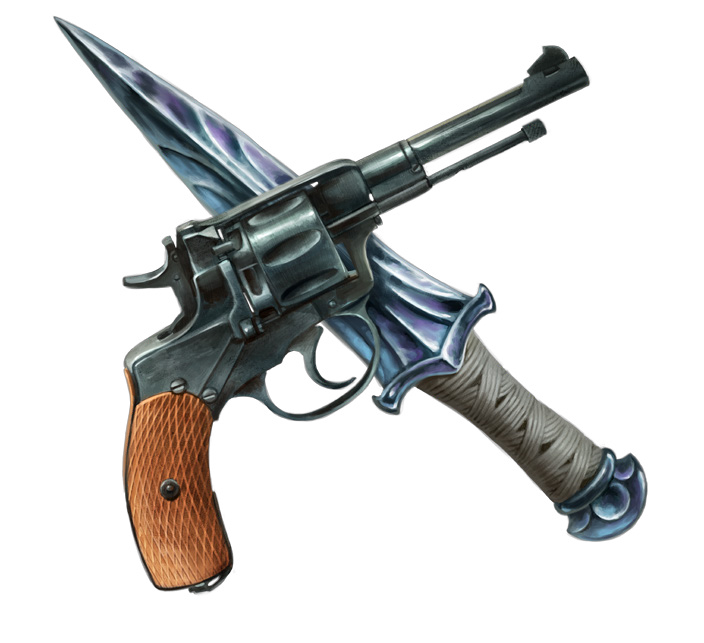
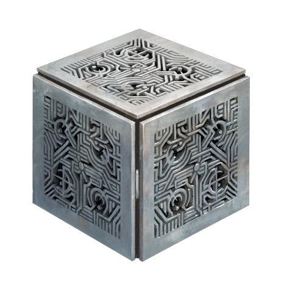
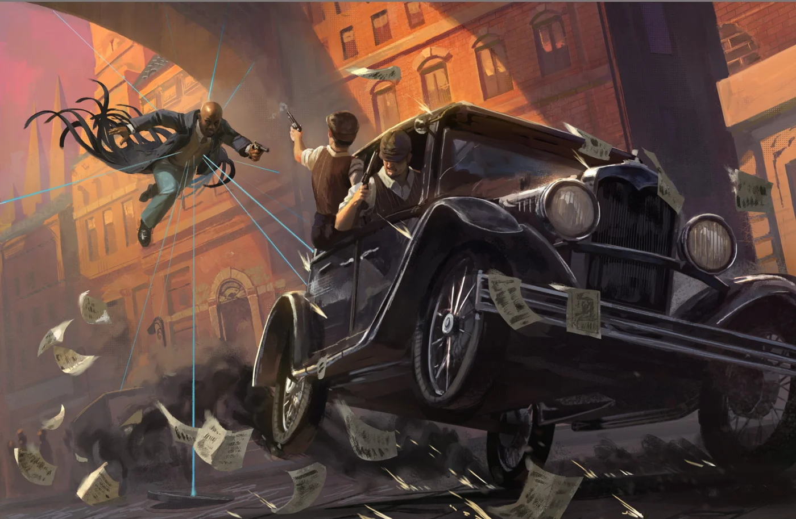
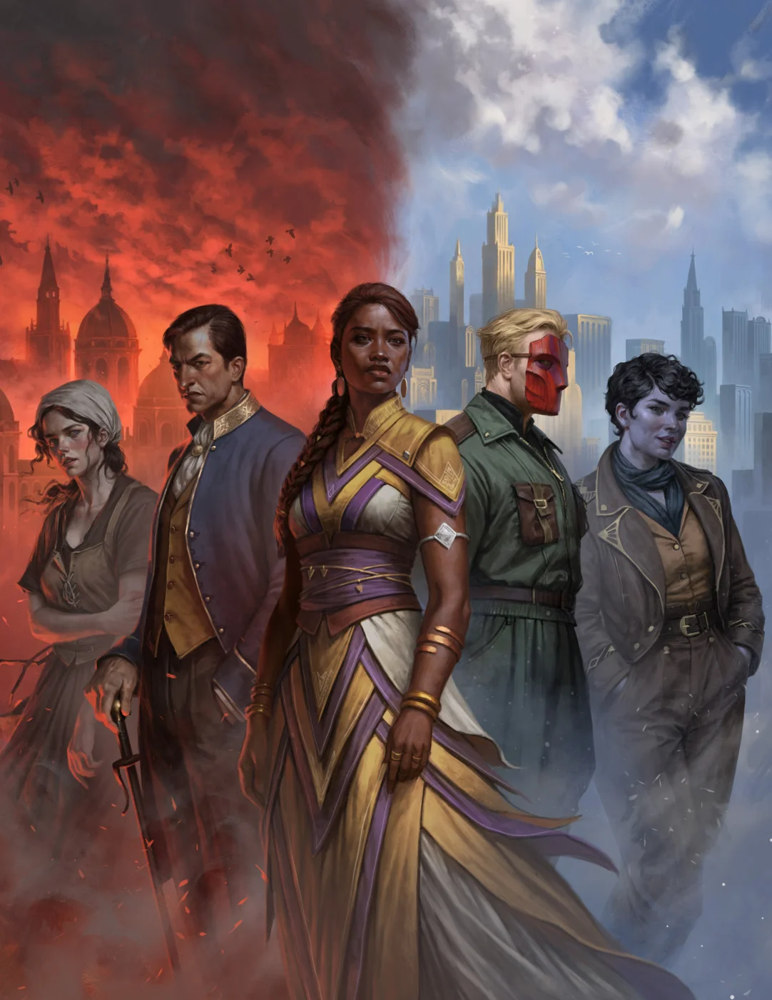

### 和諧的世界

第二時代

統御主（Lord Ruler）統治了一千多年後遭到殺害，司卡（skaa）也起身革命。不久，滅絕（Ruin）逃離囚禁，幾乎讓司卡德利亞（Scadrial）走向終結。然而，滅絕與存留（Preservation）的力量正面交鋒，摧毀了兩者的持有者（Vessels）。泰瑞司（Terris）守護者（Keeper）沙賽德（Sazed）接掌這兩股力量，成為和諧（Harmony）。

和諧昇華（Ascension）後，修復了統御主對星球造成的損害：讓星球回到原本的軌道，重新將古典時期的動植物引入各地，並撤銷統御主對生物基因的改造。和諧重塑世界的這場事件稱為落灰之終（Catacendre），也為灰燼世界（World of Ash）畫下句點。

重塑司卡德利亞時，和諧精心打造了一片特別肥沃的地區，稱為依藍戴盆地（Elendel Basin），讓人們能在落灰之終後重新繁衍、遍布司卡德利亞。然而，星球軌道的改變使南極的氣溫驟降，引發 冰殲時代（Ice Death），造成饑荒，南方社會幾乎崩潰，與北司卡德利亞（Northern Scadrial）蓬勃發展的社會形成強烈對比。關於這些事件的詳細資訊，見第 4 章〈和諧的昇華〉與〈冰殲時代〉。

接下來的各節概述落灰之終後的世界；第二時代個別歷史事件的詳情，見第 4 章。

### 存留者

卡西爾（Kelsier）團隊的成員在統御主與滅絕的敗亡中扮演重要角色，因此成為歷史上的代表人物，人稱 存留者（Preservers）。他們的名字與故事留存在宗教、藝術之中，甚至成為地理名稱。

- 迷霧之子大人（Lord Mistborn）曾以 Lestibournes 或鬼影（Spook）之名為人所知，以皇帝的身分統治依藍戴盆地長達一百年。

- 許多 存留者 撰寫了奠定新社會基礎的著作，為人們指引方向。這些著作與《創始之書》（Words of Founding）並存；後者將沙賽德紅銅意識（copperminds）中的所有紀錄寫成文字。

- 舊世界的許多性別偏見雖然延續至新世界，社會對性別的部分期待仍有改變。紋（Vin）以昇華戰士（Ascendant Warrior）的身分，確立了女性戰士的典範；奧瑞安妮（Allrianne）則提倡貴族女性氣質的價值。

關於 存留者 的更多資訊，見第 5 章〈卡西爾與他的團隊〉。

### 社會樣貌

落灰之終的倖存者被稱為初代（Originators）。他們的價值觀、傳承，以及舊世界如何覆亡的故事，自然深深影響了社會。倖存者有五分之一是泰瑞司人，如今終於能公開傳播自己的傳統。

### 上流社會

倖存的貴族家系在依藍戴盆地仍保有強大權勢。落灰之終後，貴族階級占有土地，並主持社會重建。

### 克羅司混血

隨著和諧崛起，克羅司（koloss）獲得了自由與繁衍的能力。他們的子女稱為克羅司混血（koloss-blooded），外貌與人類相近，皮膚呈藍色或灰色。克羅司混血的年輕人可以選擇接受血金術尖刺（Hemalurgic spikes），成為完整的克羅司，或繼續以克羅司混血的身分生活。

### 宗教

依藍戴盆地的多種宗教蓬勃發展，包括倖存者教會（Church of the Survivor）、道教（the Path）及碎刺教（Sliverism）（見第 3 章〈主要宗教〉）。信徒承認司卡德利亞及其歷史中各種力量與神性存在。

### 蠻橫區

依藍戴盆地的肥沃土地之外，延伸著北方蠻橫區（Northern Roughs）的乾燥草原，以及南方蠻橫區（Southern Roughs）錯綜複雜的邊疆地帶。兩地都人煙稀少，幾乎無法可管。

### 泰瑞司聚居地

依藍戴盆地有數個繁榮的泰瑞司社群，其中最知名的是依藍戴（Elendel）城內的泰瑞司村（the Village）。這些社群的人們將最後帝國（Final Empire）統治下的一千年經歷，與和諧揭示的古老文化融合，發展出獨特的文化。

### 勞動階級

勞動階級已不再是奴隸或司卡，從富裕的企業主到一般勞工都包含在內。他們甚至在政府中擁有代表，然而貴族所掌握的政治權力仍遠超其人口比例。

對頁：迷霧中的卡西爾。

第 1 章：世界 27

MIRANDA MEEKS

### 貨幣與銀行業

依藍戴盆地的城市採用盒金（boxings）與夾幣（clips）作為正式貨幣。硬幣上不再鑄有克雷迪克．霄（Kredik Shaw）令人畏懼的形象，改成迷霧之子大人的側面像。紙鈔的使用也更普遍；最常見的是面額 1 note 的紙鈔，每 note 相當於 10 盒金；此外也流通著面額 5、10、20 及 50 note 的紙鈔。

在私人企業帶動的經濟下，銀行業已在整個盆地穩固發展。許多貴族家族在銀行公司中握有重要利益，其中包括勢力雄厚的 First Central Bank 與 First Insurance Bank。銀行服務傳統上雖與富人較為相關，許多公司仍急於利用這套體系，剝削窮人與勞動階級。

### 曆法

依藍戴盆地及周邊地區以落灰之終後（Post-Catacendre，PC）紀年。一年有 368 天，平均分為 16 個月，每月 23 天。一週七天取名自七種鎔金金屬，依序為鐵日（Ironday）、鋼日（Steelday）、錫日（Tinday）、白鑞日（Pewterday）、鋅日（Zincday）、黃銅日（Brassday）與紅銅日（Copperday）。這套曆法的月份以紀念 存留者 與碎力（Shards）為名，每年從秋季的 Lers 月開始。下方的〈落灰之終後的月份與節日〉表列出各月份，以及一年中最重要的節日。

### 落灰之終後的月份與節日

| 季節 | 月份 | 節日 |
| --- | --- | --- |
| 秋季 | Lers | — |
|  | Kels | Survivorday。倖存者教會最神聖的日子，於 Kels 月的第一天慶祝。 |
|  | Marsh | All Slivers’ Night。碎刺教的聖日，人們會戴上節慶用的審判者（Inquisitor）面具，在外待到深夜，於 Marsh 月的最後一晚慶祝。 |
|  | Doxil | — |
| 冬季 | Hammondar | 建城紀念日（Day of Founding）。慶祝依藍戴城正式建立，又稱 Tinth of Hammondar。 |
|  | Tenson | Vershaday。紀念名為「人類」（Human）的克羅司英雄，以及克羅司混血的傳承。 |
|  | Alcett | Harmontide。從 Tenson 月底至 Alcett 月初慶祝的仲冬節日。 |
|  | Lestib | — |
| 春季 | Belsdret | — |
|  | Cladence | — |
|  | Marewill | Mistwatch Eve。道徒（Pathian）的聖日。 |
|  | Breezin | — |
| 夏季 | Vinuarch | 昇華日（Day of Ascent）。紀念昇華戰士紋的節日。 |
|  | Elendar | — |
|  | Tindwylar | Mareweather。夏季節日。 |
|  | Sazembar | — |

落灰之終後的司卡德利亞。

DAVID FRASHESKI

### 邁向未來

北方大陸（Northern Continent）內部局勢最為緊繃時，依藍戴盆地的人們與南方大陸（Southern Continent）上發展起來的諸國建立了聯繫，尤其是 Malwish（見第 2 章〈南司卡德利亞〉）。北方各城市與 Malwish 之間的文化及政治關係日益緊張，在許多人眼中，戰爭似乎已無可避免。

儘管如此，Malwish 在授予技術（Invested technology）方面的進步仍徹底改變了司卡德利亞。其中影響最深遠的發明之一是藏金術徽章（Feruchemical medallion），能讓任何人使用藏金能力（Feruchemical abilities）。運用這些技術的浮空船（airships）升上天空，世界也來到了重大變革的門檻。

### 科學與科技

司卡德利亞歷經災變，星球上的科學發展也一路起伏。然而，落灰之終後的世界很快便躍居寰宇（cosmere）科技進步的前列。

### 歷代發展

古典時期末，司卡德利亞已準備迎接工業革命。其中，克雷尼恩（Khlennium）王國以先進的鐘錶機械與蒸汽應用聞名。然而，深暗（Deepness）使古代諸國及其科技一同崩潰。

### 存留與停滯

為了維持權力，也為了確保自己能守護昇華之井（Well of Ascension），統御主強制維持了長達千年的科技停滯。他甚至壓制古典時期的司卡德利亞（Classical Scadrial）許多才剛萌芽的技術。不過，身為存留的殘體（Sliver），統御主仍監督了幾項技術的發展，支援他為防範滅絕脫困所做的應變準備。其中最廣為人知的或許是司卡德利亞的罐頭工廠，讓食物能長期儲存，並運送到司卡德利亞各地，乃至寰宇其他地方。

### 和諧與進步

落灰之終後，司卡德利亞再度踏上科技進步的道路。和諧結合了存留與滅絕的力量，悄悄引導司卡德利亞發展，協助人們重建社會。

多年來，許多科學進展出自獨自在私人實驗室裡研究的科學家。例如，Remmingtel Tarcsel 與 Professor Yennev Hanlanaze 嶄露頭角後，便為電力的未來展開競爭。然而，隨著依藍戴盆地來到歷史轉捩點，那個時代也逐漸結束：各組織、城市、政府與國家之間的科技軍備競賽已迫在眉睫。

### 冶金學

冶金學（Metallurgy）與礦物學在司卡德利亞始終極為重要。推動這些學問進步的原因之一，是鎔金術（Allomancy）、藏金術（Feruchemy）及血金術（Hemalurgy）需要經過精煉的純金屬，或比例精準的合金。

統御主統治期間，鋁的精煉製程既隱密又昂貴。即使其中的祕密公開後，鋁在依藍戴盆地依然是極其昂貴的金屬。鋁因具備鎔金惰性（Allomantically inert）而備受珍視，能在對抗金屬之子（Metalborn）時提供關鍵優勢。例如，鋼與鐵的迷霧人（Mistings，通常稱為射幣〔Coinshots〕與扯手〔Lurchers〕）無法繳除敵人手中的鋁製武器，也無法改變鋁製投射物的軌跡。

### 火器

古典時期的司卡德利亞雖已有火藥武器，統御主仍壓制了這項技術，限制它對自己精心建立的階級制度構成威脅。落灰之終後，火器（firearms）不僅變得普遍，更成為戰鬥中的主力，讓沒有鎔金能力的人能與鎔金術師（Allomancers）抗衡。

第一時代的玻璃匕首（glass dagger）與第二時代的左輪手槍（revolver）。

第 1 章：世界 29

LUCAS TORQUATO

### 進階火器

受到殺霧者（hazekillers）的啟發，第二時代的發明家開始試驗專門對付金屬之子的火器；殺霧者是受過對抗鎔金術師訓練的專家。有些設計很單純，例如射幣無法偏轉的陶瓷彈頭；有些則包含更複雜的機構，例如被扯手拉引時，內部的彈片艙會釋放彈片。所幸對迷霧人而言，這些實驗性彈藥仍不常見。

鋁的生產與取得日漸容易，完全以這種鎔金惰性金屬製成的火器與子彈也逐漸普及，不過價格依然高昂。

### 授予技術

落灰之終後，司卡德利亞不斷開拓發現的新領域，人們也找到更多機會將科技與金屬技藝（Metallic Arts）結合。發明家研製出只能由熟練射幣或扯手以推、拉啟動的鎖；只有錫迷霧人（通常稱為錫眼〔Tineye〕）驟燒（flare）能力後才能讀取的精巧隱形墨水；以及只有鎘單藏金術師（Ferring，通常稱為喘息〔Gasper〕）才能使用的潛水設備。

### ettmetal

南司卡德利亞（Southern Scadrial）令人驚豔的科技以 ettmetal 為核心。北方學者稱之為 harmonium，這種神金屬（God Metal）是和諧授予（Investiture）的固態形式。ettmetal 與水反應極為劇烈，因此鎔金術師無法燃燒它，但它仍會與金屬技藝產生其他獨特的互動：

鎔金術方塊（Primer Cubes）。鎔金術師將力量注入 ettmetal 鎔金術方塊後，方塊便能重現他們的能力。例如，射幣觸碰鎔金術方塊，就能讓它在自己不再施力的情況下持續鋼推（Steelpushing）；這個效果對 Malwish 浮空船技術至關重要。同樣地，通常從人體發出的金屬技藝，也能轉移到別處發出，讓鎔金術方塊產生局部的速度圈（speed bubbles）。

爆炸物。ettmetal 與水接觸產生的爆炸反應，可用來製作簡單卻昂貴的炸彈。第二時代持續發展，盆地的部分科學家也開始試驗 ettmetal 固有的不穩定性，探索引發毀滅性強大爆炸的可能。

### 進階金屬意識庫

落灰之終後，司卡德利亞的人們開發了使用藏金能力的新方式：

未綁定金屬意識庫（Unkeyed Metalminds）。

一個名為「組織」（the Set）的組織，結合特定金屬之子的能力與血金術，學會製作金屬意識庫（metalminds），讓任何具有對應能力的單藏金術師都能使用。

未封存金屬意識庫（Unsealed Metalminds）。司卡德利亞南方人（Southern Scadrians）開發出任何人都能使用的金屬意識庫，即使沒有藏金能力也不例外。這些徽章最初由火母（Firemothers）與火父（Firefathers）使用，協助族人度過 冰殲時代。後續的進展包括讓使用者說其他語言的徽章，以及能調整自身重量、協助浮空船飛行的徽章。

### 交通運輸

各個時代的地理環境劇變，司卡德利亞人也一再重新發展運輸方式，在落灰之終後取得重大進展。

### 運河與航運

以依藍戴城為中心，放射狀的運河網路遍布整個依藍戴盆地。機械化、量產與冶金技術的進步，讓司卡德利亞的長途運輸迅速改善。雖然也有部分貨物沿海運送，這類航運網路的發展卻較為有限，遠洋船隻更極為罕見。

來自南司卡德利亞的鎔金術方塊，司卡德利亞北方人（Northern Scadrians）稱之為鎔金手榴彈（Allomantic Grenade）。

第 1 章：世界 30

ANNA VERHOOG

### 火車

工程師運用和諧在《創始之書》中暗示的蒸汽引擎，設計出新的運輸方式。依藍戴盆地的鐵路技術蓬勃發展，與運河一樣，透過以依藍戴為中心的網路服務各城市。

盆地的鐵路交會點很少，其中最重要的是位於依藍戴東南方的 Doriel，因此多數火車前往其他城市前，都得先經過依藍戴。依藍戴與 Bilming 也都提供公共鐵路運輸：依藍戴向地下鐵發展，Bilming 則以高架鐵路為主。蠻橫區的鐵路既有通往較大聚落的路線，也有通往礦區、維護欠佳的路線，不過後者許多已遭廢棄。

盆地火車技術中最具代表性的是太齊爾家族（House Tekiel）設計的保險庫式車廂 Breaknaught。這類車廂運送貴重貨物，配備最先進的保全措施。

### 汽車

最早的實驗性汽車是不可靠、靠蒸汽驅動的新奇玩意。隨著技術進步，盆地出現首批汽油汽車，城市基礎設施很快也隨之改變，以容納汽車交通。

蠻橫區的車輛多半是農民使用、方正耐用的機動車。在依藍戴，人們偏好造型精緻、配有封閉車廂的汽車。Bilming 的工廠則大量製造流線型鋼製汽車，以及更大型的商用車；這座城市在平價車輛與生質柴油等替代燃料的生產上，也居於領先地位。

### 浮空船

司卡德利亞南方人最令人驚豔的發明，或許就是浮空船。船隻大小各異，從載客不到十二人的小型快艇，到適合長期軍事行動的大型戰艦都有。

每艘司卡德利亞浮空船都需要結合 ettmetal、鎔金術與藏金術才能運作。推進與升力由推進器（impellers）提供，驅動來源可以是射幣，或儲有鋼推力量的鎔金術方塊。船員則使用未封存的鐵金屬意識庫來減輕重量；這些徽章讓佩戴者能像鐵單藏金術師一樣儲存重量。

一名扯手義警在依藍戴的街頭追逐幫派分子。

LUCAS TORQUATO

<!-- Pure full-page artwork: People of Scadrial—skaa, noble, Terris, Malwish, and koloss-blooded. The opposite-page caption and IVANA ABBATE credit are printed on physical page 36. No printed text or footer on this page. -->

