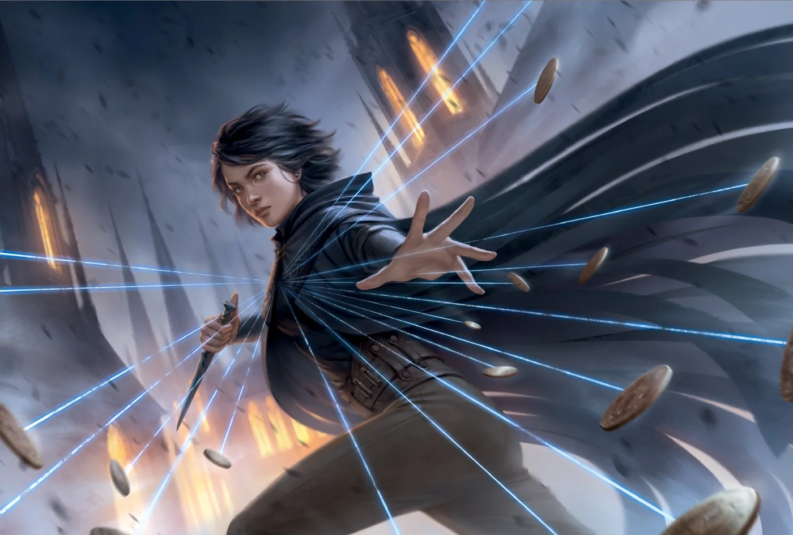
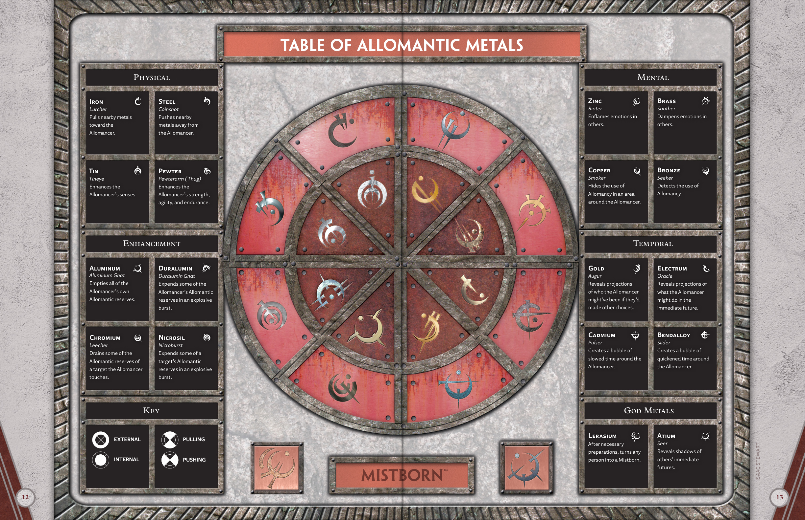
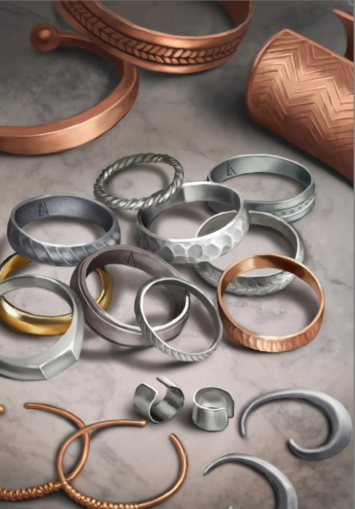
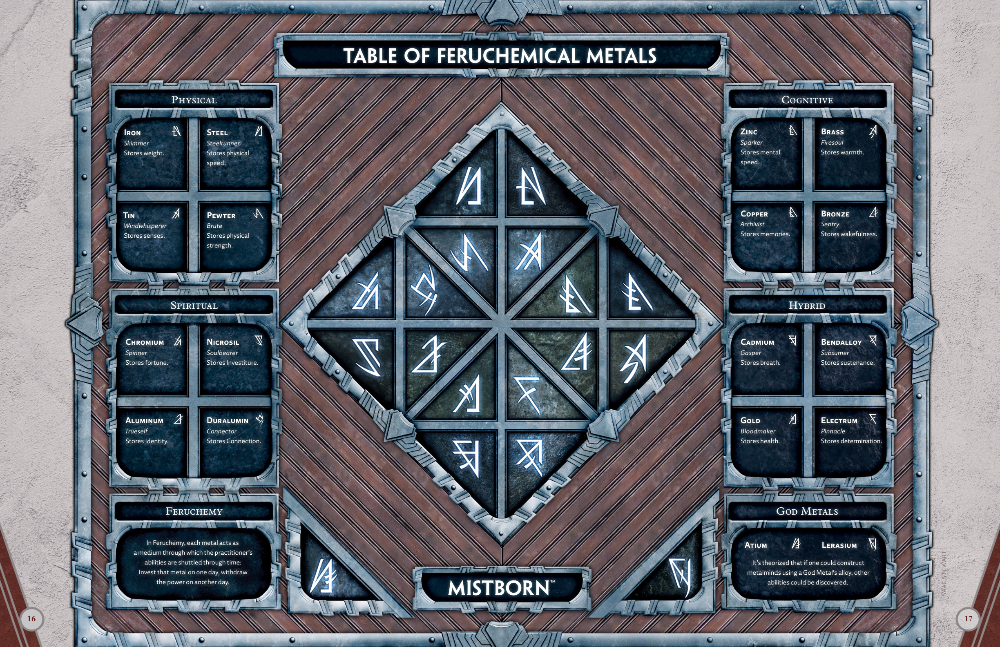
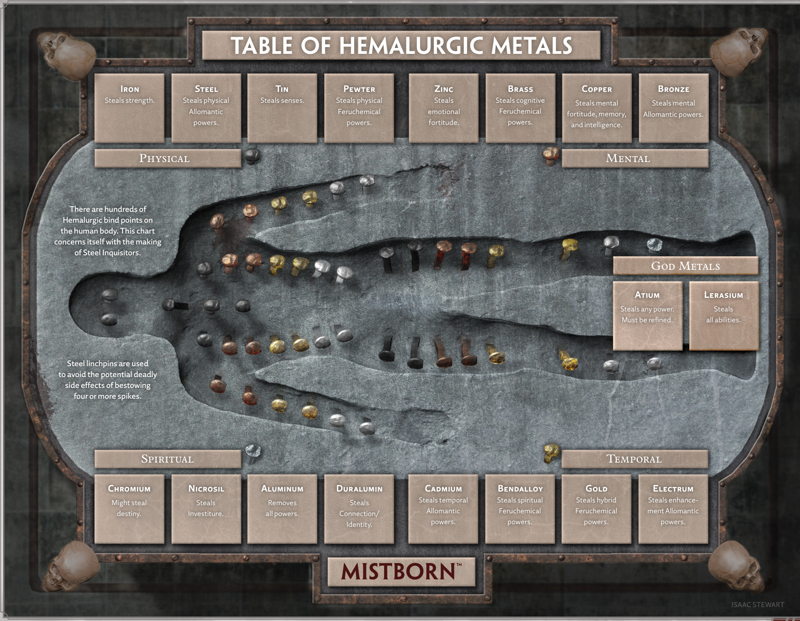
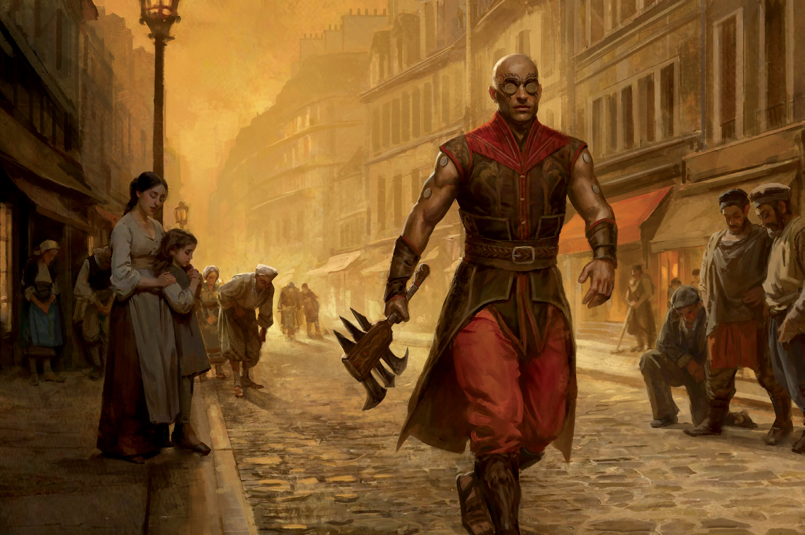
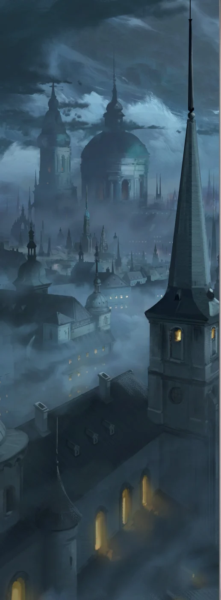
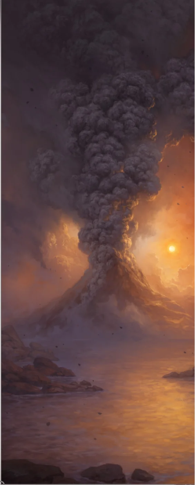
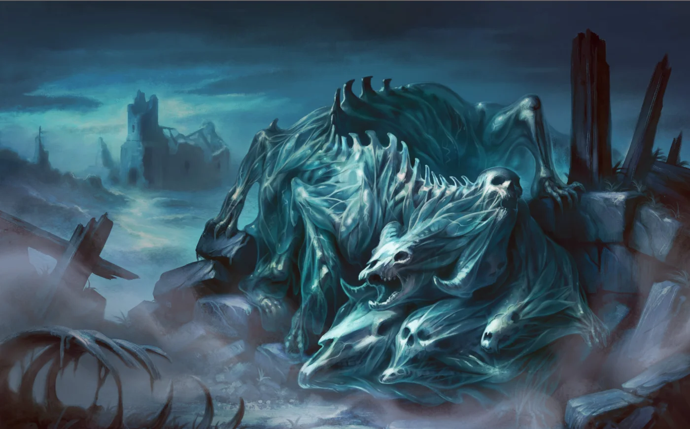
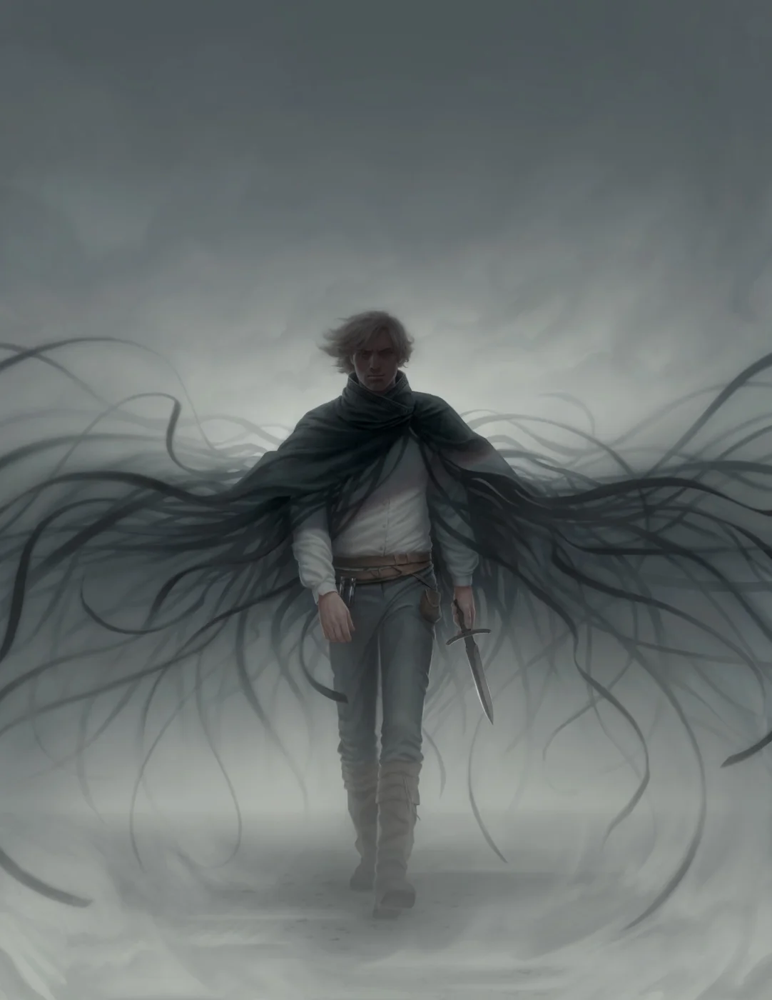

### 金屬技藝

司卡德利亞（Scadrial）的授予（Investiture）可透過三種金屬技藝（Metallic Arts）運用：鎔金術（Allomancy）、藏金術（Feruchemy）與血金術（Hemalurgy）。鎔金術與藏金術都能遺傳，也是司卡德利亞許多階級及文化分野的成因。具有鎔金或藏金能力的人，統稱為金屬之子（Metalborn）。相較之下，只要有正確的知識與材料，任何人都能施行血金術，但理解這門禁忌技藝的人寥寥無幾。

這三種技藝都能與十六種純金屬（Pure Metal）及合金（Alloy）產生作用，也能運用罕見的神金屬（God Metal）。最後帝國（Final Empire）時期，廣為人知的金屬分成四種實體金屬（Physical Metal）：鐵（Iron）、鋼（Steel）、錫（Tin）與白鑞（Pewter），以及四種意志金屬（Mental Metal）：鋅（Zinc）、黃銅（Brass）、紅銅（Copper）與青銅（Bronze）。另外兩種時序金屬（Temporal Metal），金（Gold）與電金（Electrum），以及兩種增強金屬（Enhancement Metal），鋁（Aluminum）與硬鋁（Duralumin），則較少人知道或理解。因此，鋼鐵教廷（Steel Ministry）以外的冶金學者及鎔金術師（Allomancer），誤將金與神金屬之一的天金（Atium）配對，視為時序類的「高等金屬」。

落灰之終（Catacendre）之後，其餘時序金屬——鎘（Cadmium）與彎管合金（Bendalloy）——以及其餘增強金屬——鉻（Chromium）與鎳鉻（Nicrosil）——才變得廣為人知。

除了下列各節的資訊，你也可以參閱《迷霧之子玩家手冊》（Mistborn Handbook）第 6 章，進一步了解司卡德利亞的金屬與金屬技藝。

### 鎔金術

鎔金術是屬於存留（Preservation）的金屬技藝，讓鎔金術師能從存留的授予汲取力量。鎔金術師通常會燃燒（Burn）已吞入體內的金屬，藉此運用相應的鎔金能力（Allomantic Power）。不過，若獲得存留或和諧（Harmony）的祝福，也能直接從迷霧本身汲取力量。

最後帝國時期，具有貴族血統的人類，有時會在承受劇烈痛苦或創傷後，發現自己具有鎔金能力。這段艱難的過程稱為綻裂（Snapping）。落灰之終之後，鎔金能力會在青春期前後發展出來，不再需要經歷創傷。

紋（Vin）以鋼推（Steelpush）將硬幣射向追兵。

DEANDRA SCICLUNA

### 普及情形

古典時期的司卡德利亞（Classical Scadrial）幾乎無人知曉鎔金術，僅有零星迷霧人（Misting），對自身能力也所知甚少。為了對抗滅絕（Ruin）日益增長的影響力，存留開始利用迷霧，使新的迷霧人綻裂；他們每人都能運用一種鎔金能力。當時，要讓一名迷霧人綻裂，比後世更加困難，所需的創傷也更嚴重。後世的鎔金血統愈發集中，因而降低了綻裂所需的創傷程度。司卡德利亞人誤以為這些綻裂是惡意攻擊，從此開始畏懼迷霧。

最後帝國時期，貴族中具有鎔金能力的比例遠高於司卡（skaa），而所有司卡鎔金術師的近代祖先中都有貴族。為了維持階級制度，審判廷（Canton of Inquisition）鍥而不捨地追捕並處死所有已知的司卡鎔金術師。因此，司卡的民間故事逐漸將鎔金術師神話化，而能運用所有鎔金能力的完整迷霧之子（Mistborn），在司卡之間更是幾乎聞所未聞。

### 分類

鎔金金屬（Allomantic Metal）及其能力可依下列方式分類：

類別。鎔金術將金屬分成四個主要類別：實體（Physical）、意志（Mental）、增強（Enhancement）與時序（Temporal）。此外，還有幾種強大而神秘的神金屬。這五個類別，大致指出燃燒該類金屬時會產生什麼類型的效果。

外部或內部。每種鎔金能力都歸屬於內部金屬（Internal，影響使用者本身）或外部金屬（External，影響使用者周遭的世界）。每種純金屬所對應的合金，通常也歸屬同一類。

拉引或推力。鎔金術師將純金屬的效果歸為拉引（Pulling），將相應合金的效果歸為推力（Pushing）。這兩個名稱原本用來描述鐵與鋼的鎔金效果，後來成為適用於所有金屬的標準用語。

### 主要鎔金金屬

主要鎔金金屬共有十六種。第一時代的迷霧之子能運用所有取得得到的金屬；至於迷霧人，無論在哪個時代，都只能使用一種金屬。

以下先以斜體列出每種金屬的分類，再概述其最廣為人知的鎔金效果。

### 鐵

*實體、外部、拉引*

燃燒鐵，可將附近的金屬拉向鎔金術師。鐵迷霧人稱為扯手（Lurcher）。

### 鋼

*實體、外部、推力*

燃燒鋼，可將附近的金屬從鎔金術師身邊推開。鋼迷霧人稱為射幣（Coinshot）。

### 錫

*實體、內部、拉引*

燃燒錫，可增強鎔金術師的感官。錫迷霧人稱為錫眼（Tineye）。

### 白鑞

*實體、內部、推力*

燃燒白鑞，可增強鎔金術師的力量、敏捷與耐力。白鑞迷霧人稱為白鑞臂（Pewterarm）或打手（Thug）。

### 鋅

*意志、外部、拉引*

燃燒鋅，可煽動他人的情緒。鋅迷霧人稱為煽動者（Rioter）。

### 黃銅

*意志、外部、推力*

燃燒黃銅，可抑制他人的情緒。黃銅迷霧人稱為安撫者（Soother）。

### 紅銅

*意志、內部、拉引*

燃燒紅銅，可隱藏鎔金術師周遭一定範圍內的鎔金術使用情形，也能讓鎔金術師免受鋅與黃銅的情緒鎔金術（Emotional Allomancy）影響。紅銅迷霧人稱為煙陣（Smoker）或紅銅雲（Coppercloud）。

### 青銅

*意志、內部、推力*

燃燒青銅，可偵測鎔金術的使用情形。技巧足夠純熟時，還能辨別不同金屬類別所發出的不同脈動。青銅迷霧人稱為搜尋者（Seeker）。

### 鎘

*時序、外部、拉引*

燃燒鎘，可在鎔金術師周遭創造時間流速減慢的圈域。鎘迷霧人稱為脈動（Pulser）。直到第二時代，人們才開始生產鎘。

第 1 章：世界 10

### 神金屬

下列金屬對金屬技藝十分重要，卻不符合標準分類。每種神金屬，都是某道碎力（Shard）的授予所呈現的實體形態——有時也稱為祂們的身體——或是這類金屬的合金。

### 天金

天金是滅絕的神金屬，作為鎔金金屬，在最後帝國具有無可比擬的重要性。燃燒天金，能讓鎔金術師看見他人即將到來的未來影像，並憑直覺理解這些可能的未來，隨即做出反應。因此，除了另一名也在燃燒天金的鎔金術師之外，通常沒有人能擊敗正在燃燒天金的鎔金術師。天金迷霧人稱為先知（Seer）。

第一時代時，大部分司卡德利亞人都不知道天金的真正本質，也不了解它如何產生，詳見第 6 章〈海司辛深坑〉（Pits of Hathsin）。他們只認為天金是統御主（Lord Ruler）與貴族家族交易的一種強大、卻仍屬普通物質的金屬。衡量貴族家族的勢力時，往往會看他們擁有多少迷霧之子，以及儲備了多少天金。到了第二時代，天金已不再產出。

### Lerasium

Lerasium 是存留的神金屬，極為稀有。只要做好必要準備，寰宇（cosmere）中的任何人都能燃燒 Lerasium，並因此成為迷霧之子。

### 脈天金

脈天金（Malatium）是天金與金的合金，能顯現他人若在過去做出不同選擇，如今可能成為什麼樣子的朦朧投影。脈天金迷霧人稱為占卜師（Diviner）。最後帝國末期，人們將脈天金稱為第十一金屬。到了第二時代，脈天金已不再產出。

### Harmonium／Ettmetal

Harmonium 是和諧的神金屬，第二時代的司卡德利亞南方人（Southern Scadrians）稱它為 ettmetal。Harmonium 與水的反應十分危險，它的鎔金用途目前仍不明朗。詳見本章稍後的〈授予技術〉（Invested Technologies）。

### 彎管合金

*時序、外部、推力*

燃燒彎管合金，可在鎔金術師周遭創造時間流速加快的圈域。彎管合金迷霧人稱為滑行（Slider）。直到第二時代，人們才開始生產彎管合金。

### 金

*時序、內部、拉引*

燃燒金，可顯現鎔金術師若在過去做出不同選擇，如今可能成為什麼樣子的朦朧投影。金迷霧人稱為命師（Augur）。第一時代的大部分時間裡，鋼鐵教廷都隱瞞金迷霧人的存在，不過完整的迷霧之子仍經常燃燒金。

### 電金

*時序、內部、推力*

燃燒電金，可顯現鎔金術師在眼前的未來可能採取什麼行動的朦朧投影。電金迷霧人稱為預言師（Oracle）。第一時代的大部分時間裡，鋼鐵教廷都壓制有關電金的知識。

### 鉻

*增強、外部、拉引*

燃燒鉻，可耗去鎔金術師所觸碰之人的鎔金儲備。鉻迷霧人稱為水蛭（Leecher）。直到第二時代，人們才開始生產鉻。

### 鎳鉻

*增強、外部、推力*

燃燒鎳鉻，可消耗鎔金術師所觸碰之人的鎔金儲備，讓目標的力量以爆發的方式釋放。鎳鉻迷霧人稱為鎳爆（Nicroburst）。直到第二時代，人們才開始生產鎳鉻。

### 鋁

*增強、內部、拉引*

燃燒鋁，可清空鎔金術師自己的全部鎔金儲備。鋁迷霧人稱為鋁蟲（Aluminum Gnat）。第一時代的大部分時間裡，鋼鐵教廷都壓制有關鋁的知識。

### 硬鋁

*增強、內部、推力*

燃燒硬鋁，可消耗鎔金術師自己的鎔金儲備，讓自身力量以爆發的方式釋放。硬鋁迷霧人稱為硬鋁蟲（Duralumin Gnat）。第一時代的大部分時間裡，人們都不知道硬鋁的鎔金特性。

下一個跨頁：鎔金金屬表依照分類整理各種鎔金金屬。

第 1 章：世界 11

## 鎔金金屬表

### 實體

| 金屬 | 迷霧人 | 效果 |
| --- | --- | --- |
| 鐵 | 扯手 | 將附近的金屬拉向鎔金術師。 |
| 鋼 | 射幣 | 將附近的金屬從鎔金術師身邊推開。 |
| 錫 | 錫眼 | 增強鎔金術師的感官。 |
| 白鑞 | 白鑞臂（打手） | 增強鎔金術師的力量、敏捷與耐力。 |

### 增強

| 金屬 | 迷霧人 | 效果 |
| --- | --- | --- |
| 鋁 | 鋁蟲 | 清空鎔金術師自己的全部鎔金儲備。 |
| 硬鋁 | 硬鋁蟲 | 消耗鎔金術師的部分鎔金儲備，以爆發的方式釋放。 |
| 鉻 | 水蛭 | 耗去鎔金術師觸碰之目標的部分鎔金儲備。 |
| 鎳鉻 | 鎳爆 | 消耗目標的部分鎔金儲備，以爆發的方式釋放。 |

### 圖例

外部

內部

拉引

推力

迷霧之子™

12

<!-- Continuation of Table of Allomantic Metals from physical page 15; the printed heading spans the gutter. -->

### 意志

| 金屬 | 迷霧人 | 效果 |
| --- | --- | --- |
| 鋅 | 煽動者 | 煽動他人的情緒。 |
| 黃銅 | 安撫者 | 抑制他人的情緒。 |
| 紅銅 | 煙陣 | 隱藏鎔金術師周遭一定範圍內的鎔金術使用情形。 |
| 青銅 | 搜尋者 | 偵測鎔金術的使用情形。 |

### 時序

| 金屬 | 迷霧人 | 效果 |
| --- | --- | --- |
| 金 | 命師 | 顯現鎔金術師若曾做出不同選擇，如今可能成為什麼樣子的投影。 |
| 電金 | 預言師 | 顯現鎔金術師在眼前的未來可能採取什麼行動的投影。 |
| 鎘 | 脈動 | 在鎔金術師周遭創造時間流速減慢的圈域。 |
| 彎管合金 | 滑行 | 在鎔金術師周遭創造時間流速加快的圈域。 |

### 神金屬

| 金屬 | 迷霧人 | 效果 |
| --- | --- | --- |
| Lerasium |  | 做好必要準備後，能讓任何人成為迷霧之子。 |
| 天金 | 先知 | 顯現他人即將到來的未來影像。 |

ISAAC STEWART

13

### 藏金術

藏金術是講求平衡的金屬技藝，同時屬於存留與滅絕。藏金術師（Feruchemist）無法創造或摧毀力量，而是將自己儲備的力量儲存（Store）在金屬意識庫（Metalmind）中，之後再汲取（Tap）出來，藉此維持力量的平衡。

無論是古典時期的司卡德利亞，還是最後帝國，藏金術都只見於泰瑞司（Terris）人之間。統御主花了數個世紀，試圖透過奴役泰瑞司人、嚴格控制生育來消除他們的藏金能力，藉此掌控藏金術。儘管如此，祕密行事的守護者（Keeper）仍讓藏金血統延續下來。

### 分類

藏金能力（Feruchemical Power）通常分為實體、意識（Cognitive）、靈魂（Spiritual）與混合（Hybrid）四類。每類都有四種金屬，即兩種純金屬及其合金。此外，還有幾種強大而神秘的神金屬；本節會介紹其中最廣為人知的天金。

### 藏金金屬

藏金金屬（Feruchemical Metal）共有十六種，每種都能讓藏金術師儲存不同的屬性（attribute）。第一時代的完整藏金術師能使用全部十六種金屬；到了第二時代，取而代之的是每人只能使用一種金屬的單藏金術師（Ferring）。

以下先以斜體列出每種金屬的類別，再概述其最廣為人知的藏金效果。

### 鐵

*實體*

鐵可用來儲存重量（Weight）。鐵單藏金術師稱為掠影（Skimmer）。

### 鋼

*實體*

鋼可用來儲存身體的速度。鋼單藏金術師稱為鋼奔（Steelrunner）。

### 錫

*實體*

錫可用來儲存感官（Sense）。每個錫意識（Tinmind）只能儲存一種感官。錫單藏金術師稱為風語（Windwhisperer）。

### 白鑞

*實體*

白鑞可用來儲存力量（Strength）。白鑞單藏金術師稱為蠻力（Brute）。

### 鋅

*意識*

鋅可用來儲存心智速度（Mental Speed）。鋅單藏金術師稱為星火（Sparker）。

### 黃銅

*意識*

黃銅可用來儲存溫暖（Warmth）。黃銅單藏金術師稱為火靈（Firesoul）。

### 紅銅

*意識*

紅銅可用來儲存記憶（Memory）。紅銅單藏金術師稱為庫藏（Archivist）。

### 青銅

*意識*

青銅可用來儲存清醒（Wakefulness）。青銅單藏金術師稱為哨兵（Sentry）。

沙賽德（Sazed）的金屬意識庫。

SAMI RYTKÖNEN

### 鎘

*混合*

鎘可用來儲存呼吸（Breath）。鎘單藏金術師稱為喘息（Gasper）。直到第二時代，人們才開始生產鎘。

### 彎管合金

*混合*

彎管合金可用來儲存養分。彎管合金單藏金術師稱為吞蝕（Subsumer）。直到第二時代，人們才開始生產彎管合金。

### 金

*混合*

金可用來儲存健康。金單藏金術師稱為制血者（Bloodmaker）。

### 電金

*混合*

電金可用來儲存決心（Determination）。電金單藏金術師稱為頂峰（Pinnacle）。第一時代的大部分時間裡，鋼鐵教廷都壓制有關電金的知識。

### 鉻

*靈魂*

鉻可用來儲存運氣（Fortune）。鉻單藏金術師稱為旋轉（Spinner）。直到第二時代，人們才開始生產鉻。

### 鎳鉻

*靈魂*

鎳鉻可用來儲存授予。鎳鉻單藏金術師稱為承魂（Soulbearer）。直到第二時代，人們才開始生產鎳鉻。

### 雙生師

第二時代中，極少數混合血統的人會同時生有一種鎔金能力與一種藏金能力。這些金屬之子稱為雙生師（Twinborn）。雙生師共有 256 種可能的能力組合；如果兩種能力使用同一種金屬，就稱為複合師（Compounder）。這些強大的雙生師可以運用鎔金術來複合（Compound）——也就是為藏金術提供力量來源——藉此取得近乎無窮的藏金儲備。

### 鋁

*靈魂*

鋁可用來儲存身分（Identity）。鋁單藏金術師稱為真我（Trueself）。第一時代的大部分時間裡，鋼鐵教廷都壓制有關鋁的知識。

### 硬鋁

*靈魂*

硬鋁可用來儲存牽繫（Connection）。硬鋁單藏金術師稱為聯絡（Connector）。第一時代的大部分時間裡，人們都不知道硬鋁的藏金特性。

### 天金

*神金屬*

在藏金術中，天金可用來儲存青春（Youth）。第一時代之後，天金就不再產出。如欲進一步了解這種備受珍視的金屬，請參閱前面的〈神金屬〉一節。

### 金屬的更多祕密

最後帝國所謂的天金，其實並非滅絕的純神金屬。最後帝國的所有天金，都源自海司辛深坑中的自然過程：電金混入神金屬，形成合金。這種天金與電金的合金，產生了歷來被認為屬於天金的效果：看見天金影子（Atium Shadow）與儲存青春。如同 Harmonium，純天金在金屬技藝上的用途目前仍不明朗。

隨著最後帝國崩潰，人們步入工業時代，司卡德利亞人也修正了對十種金屬的舊有認識，將新發現納入其中。然而，更新後的十六金屬表依舊不夠完善，只是學者試圖理解金屬技藝與寰宇的產物。這些工具無法揭示全部真相，不過數個世紀以來，人們一直運用它們所奠定的假設來傳遞意義。例如，落灰之終前，存留就曾以十六這個數字，向司卡德利亞人傳遞訊息。

下一個跨頁：藏金金屬表依照分類整理各種藏金金屬。

第 1 章：世界 15

## 藏金金屬表

### 實體

| 金屬 | 單藏金術師 | 效果 |
| --- | --- | --- |
| 鐵 | 掠影 | 儲存重量。 |
| 鋼 | 鋼奔 | 儲存身體的速度。 |
| 錫 | 風語 | 儲存感官。 |
| 白鑞 | 蠻力 | 儲存身體的力量。 |

### 靈魂

| 金屬 | 單藏金術師 | 效果 |
| --- | --- | --- |
| 鉻 | 旋轉 | 儲存運氣。 |
| 鎳鉻 | 承魂 | 儲存授予。 |
| 鋁 | 真我 | 儲存身分。 |
| 硬鋁 | 聯絡 | 儲存牽繫。 |

### 藏金術

在藏金術中，每種金屬都是讓施術者的能力穿越時間的媒介：某天將力量授予金屬，另一天再將力量取出。

迷霧之子™

16

<!-- Continuation of Table of Feruchemical Metals from physical page 19; the printed heading spans the gutter. -->

### 意識

| 金屬 | 單藏金術師 | 效果 |
| --- | --- | --- |
| 鋅 | 星火 | 儲存心智速度。 |
| 黃銅 | 火靈 | 儲存溫暖。 |
| 紅銅 | 庫藏 | 儲存記憶。 |
| 青銅 | 哨兵 | 儲存清醒。 |

### 混合

| 金屬 | 單藏金術師 | 效果 |
| --- | --- | --- |
| 鎘 | 喘息 | 儲存呼吸。 |
| 彎管合金 | 吞蝕 | 儲存養分。 |
| 金 | 制血者 | 儲存健康。 |
| 電金 | 頂峰 | 儲存決心。 |

### 神金屬

天金

Lerasium

有一種理論認為，若能用神金屬的合金製成金屬意識庫，就可能發現其他能力。

ISAAC STEWART

17

### 血金術

司卡德利亞最不為人知的金屬技藝屬於滅絕。血金術是一門伴隨破壞、痛苦與殘忍的技藝，幾乎總要付出重大犧牲、承受極大苦難才能施行。這種力量以金屬尖刺為核心。血金術師（Hemalurgist）將尖刺精準置入血肉時，就能從受害者身上抽取一部分力量，過程中通常會流失一些力量。之後，將尖刺刺入另一個生物，就能把竊得的力量賦予對方。這份力量可以讓接收者取得鎔金或藏金能力，也可能使血金術尖刺（Hemalurgic Spike）的承受者產生變異。

### 應用

使用血金術尖刺會產生什麼結果，取決於使用的金屬、尖刺的位置，以及受害者所具有的能力。最常見的結果包括下列幾種：

血金術生物。血金術師精準放置尖刺，就能將生物重塑成新的形態。

控制。身上有不只一根尖刺的血金術生物，可能直接受滅絕、和諧，或足夠強大的安撫者、煽動者控制。滅絕與和諧甚至能控制身上有四根以上尖刺的人類。

竊取力量。將尖刺穿過鎔金術師或藏金術師的心臟，便能將他們的一種能力轉移給最終接受尖刺的人。轉移過程中流失多少力量，取決於金屬尖刺的純度，以及尖刺留在體外的時間。

神之聲。滅絕與和諧能對身上至少刺有一根尖刺之人的心靈說話。

### 靈網與血金術

寰宇中的每個人都有靈網（Spiritweb），由交織的牽繫與授予構成，形成他們的靈魂及非實體自我的其他面向。施行血金術等技藝時，受授予的（Invested）尖刺會破壞接收者的靈網，並將新的授予加入其中。

製造鋼鐵審判者（Steel Inquisitor）時，會使用兩根標誌性的眼部尖刺、一根隱藏的關鍵尖刺（Linchpin），以及另外至少五根尖刺。

## 血金金屬表

### 實體

| 金屬 | 效果 |
| --- | --- |
| 鐵 | 竊取力量。 |
| 鋼 | 竊取實體鎔金能力。 |

### 靈魂

| 金屬 | 效果 |
| --- | --- |
| 鉻 | 可能竊取命運。 |
| 鎳鉻 | 竊取授予。 |

人體上有數百個血金術接合點（Hemalurgic Bind Point）。這張圖專門呈現製造鋼鐵審判者的方式。

使用鋼製關鍵尖刺，是為了避免植入四根以上尖刺時，可能產生的致命副作用。

第 1 章：世界 18

<!-- Continuation of Table of Hemalurgic Metals from physical page 21; the printed heading spans the gutter. -->

### 實體

<!-- Editorial continuation label: Physical is printed on physical page 21, on the preceding half of this spread. -->

| 金屬 | 效果 |
| --- | --- |
| 錫 | 竊取感官。 |
| 白鑞 | 竊取實體藏金能力。 |

### 意志

| 金屬 | 效果 |
| --- | --- |
| 鋅 | 竊取情緒韌性。 |
| 黃銅 | 竊取意識藏金能力。 |
| 紅銅 | 竊取心智韌性、記憶與智力。 |
| 青銅 | 竊取意志鎔金能力。 |

### 靈魂

<!-- Editorial continuation label: Spiritual is printed on physical page 21, on the preceding half of this spread. -->

| 金屬 | 效果 |
| --- | --- |
| 鋁 | 移除所有能力。 |
| 硬鋁 | 竊取牽繫／身分。 |

### 時序

| 金屬 | 效果 |
| --- | --- |
| 鎘 | 竊取時序鎔金能力。 |
| 彎管合金 | 竊取靈魂藏金能力。 |
| 金 | 竊取混合藏金能力。 |
| 電金 | 竊取增強鎔金能力。 |

### 神金屬

| 金屬 | 效果 |
| --- | --- |
| 天金 | 竊取任何一種能力。必須經過提煉。 |
| Lerasium | 竊取所有能力。 |

迷霧之子™

ISAAC STEWART

第 1 章：世界 19

### 施術者

綜觀司卡德利亞的歷史，血金術的施術者始終只有少數幾人。統御主昇華（Ascension）時，在滅絕的影響下，理解了血金術的原理。他的實驗正如他毀滅性的政策，造就了坎得拉（kandra）、克羅司（koloss）與鋼鐵審判者。之後，這些血金術實驗的知識只傳授給審判者。

到了第二時代，血金術研究延續於名為「組織」（the Set）的團體手中，詳見第 5 章。這個團體野心勃勃，意圖施行暴政，並利用血金術賦予成員力量，製造駭人的畸形怪物。

### 帝國之前

統御主崛起之前，司卡德利亞是個草木繁盛、欣欣向榮的世界，享有蔚藍天空與黃色太陽。許多國家都已工業化，科學知識也相當進步。這些成就在最後帝國統治下失傳，直到落灰之終數百年後，才再次達到相同水準。然而，古典時期的司卡德利亞即使早已消逝，影響仍延續甚久。詳見第 4 章〈古典時期的司卡德利亞〉。

古典時期的泰瑞司藏金術師為數眾多，不過外界對他們的能力所知不多。迷霧人幾乎無人知曉，迷霧之子則尚未出現。

### 昇華的祕密

在強大的克雷尼恩（Khlennium）王國，一位預言流傳已久的永世英雄（Hero of Ages）崛起，為古典世界的終結與統御主的統治揭開序幕。

統御主運用昇華之井（Well of Ascension）的力量，將星球移近太陽，企圖燒盡迷霧。當星球的溫度因此升高時，他又創造灰山（Ashmount），抵擋隨之而來的酷熱。接著，他改造最後帝國的人民、植物與動物，讓他們能在新的生態中生存。直到落灰之終前幾年，這些事件的細節始終保密。

關於統御主掌權的更多細節，請參閱第 4 章〈統御主的昇華〉；如欲了解他作為宗教人物的一面，請參閱第 3 章〈統御主〉。

### 統御主的世界

第一時代

灰燼世界（World of Ash）涵蓋統御主崛起到和諧重塑司卡德利亞之間的一千年，由最後帝國主宰。本節介紹灰燼世界的概況；第一時代特定歷史事件的細節，請參閱第 4 章。

### 階級與壓迫

統御主完全掌控司卡德利亞。為了獎勵盟友，並鞏固自身的偏見，他建立了一套充滿壓迫的階級制度，延續長達一千年。

### 貴族

最後帝國的貴族階級富有，政治勢力也十分強大。他們是統御主支持者的後代，而這些支持者正是統御主創造的第一批迷霧之子。因此，貴族擁有鎔金能力的可能性遠高於司卡。

### 司卡

司卡貧困而受壓迫，被迫從事工廠、採礦或糧食生產等繁重勞動。大部分遭奴役的司卡都被綁在土地與貴族身上，無法選擇生活的方式與地點。極少數司卡設法以商人或工匠的身分致富，但也只能從事受到嚴格管控的職務，或在遠離陸沙德（Luthadel）監管的外圍統御區（Outer Dominances）活動。

### 泰瑞司

統御主以殘酷手段壓制泰瑞司人，原因卻鮮為人知。大部分泰瑞司人被迫住在泰瑞司統御區（Terris Dominance），與最後帝國其餘地區隔離，人口則受到統御主的育種計畫（Breeding Program）嚴格管理。少數被挑選的人，被迫成為服侍貴族的泰瑞司侍從官（Terris Steward），一生為奴。儘管統御主百般阻撓，由藏金術師組成的學術派別守護者仍暗中努力，保存過往世界的歷史與知識。

### 帝國官僚體系

最後帝國的宗教與帝國官僚體系密不可分，其存在目的完全是以統御主之名治理並控制司卡德利亞。

第 1 章：世界 20

GAL OR

宗教活動集中於鋼鐵教廷；教廷與最強大的貴族家族並列，是帝國權勢最大的機構之一。

### 聖務廷

教廷分成數個聖務廷（Canton），各自監督不同方面的治理。財務廷（Canton of Finance）監管銀行及其他財富事務。資源廷（Canton of Resource）管理貿易、稅收與帝國基礎建設。教義廷（Canton of Orthodoxy）監督教廷的宗教與官僚事務，而令人畏懼的審判廷則負責執行統御主的法律。

### 聖務官

教廷成員稱為聖務官（obligator），以眼周的黑色刺青作為識別；有時刺青還包含表示迷霧人身分的鎔金字母。審判廷的迷霧人聖務官，使用的符號則是紅色。

聖務官在教廷中逐步晉升時，刺青也會愈發繁複。除了管理各聖務廷的工作，聖務官也見證並核准貴族之間的所有協議，包括婚姻。許多腐敗聖務官與他們監管的貴族玩著同樣的政治遊戲，為自己或所屬聖務廷謀求恩惠與財富。

### 鋼鐵審判者

鋼鐵審判者是特殊階級的聖務官，直接執行統御主的意志，負責監控帝國各地鎔金術的使用與傳播。他們透過血金術獲得金屬技藝，其最明顯的識別特徵，是穿過雙眼的巨大鋼刺。詳見第 3 章〈鋼鐵審判者〉與第 5 章〈鋼鐵教廷〉。

鋼鐵審判者巡行最後帝國，搜尋司卡鎔金術師。

### 貨幣與經濟

最後帝國的貨幣是帝國幣（imperials）。帝國金幣俗稱盒金（boxing），是最後帝國最具代表性的硬幣。它的俗稱來自硬幣上的克雷迪克．霄（Kredik Shaw）宮殿圖案，也就是統御主的「盒子」。

一枚盒金相當於 100 枚俗稱夾幣（clip）的銅製帝國幣。夾幣價值雖低，對鎔金術師卻有重要用途：迷霧之子及能燃燒鋼、鐵的迷霧人，經常將這些硬幣當成廉價彈藥，或作為支點，以鋼推與鐵拉（Ironpull）讓自己飛越天空。

帝國也有紙鈔（note），但最小面額就值 10 枚盒金，因此一般只有貴族持有。貴族也使用由統御主的聖務官授權的信用狀。

盒金雖然是大部分司卡德利亞人的日常貨幣，貴族家族的真正財富卻取決於他們的天金庫存。統御主向貴族家族出售定額天金，藉此掌控經濟，也掌控貴族。高層政治交易、貿易協議，甚至婚姻，都可能以家族天金儲備的一部分作為擔保。

### 運河

最後帝國廣大的運河網絡，是帝國經濟不可或缺的一環。這些商路連結帝國各大城市與農地。司卡及馬匹拖曳駁船，運送大批糧食與物資；貴族則搭乘較纖細的窄船，處理商務或休閒出遊。司卡雖然被迫維持運河暢通、清除積灰，通常卻不被允許自行在帝國境內旅行。

### 曆法

灰燼世界以最後帝國建立之年開始紀年，縮寫為 FE。一年有 224 天，分成 8 個月，每月 28 天，包含四個每週 7 天的星期。為了抹除既有文化，統御主將月份簡單命名為第一月、第二月，依此類推，直到第八月。一週各日則以大部分司卡德利亞人知道的八種基本鎔金金屬中的七種命名：鐵日（Ironday）、鋼日（Steelday）、錫日（Tinday）、白鑞日（Pewterday）、鋅日（Zincday）、黃銅日（Brassday）與紅銅日（Copperday）。

每晚，迷霧都會到來，繚繞在陸沙德的建築之間。

LOGAN FELICIANO

### 最後帝國之外

統御主昇華之後，司卡德利亞大片地區變得不適合居住。這些廣闊的沙漠、焦灼的山脈與沸騰的海洋，被稱為焦土（burnlands）。然而，在北司卡德利亞（Northern Scadrial），一些孤立的遊牧者、盜匪與司卡反抗者社群，仍設法在惡劣的邊境地帶勉強維生。這裡是最後帝國與外圍荒地之間，可供居住土地的邊緣。

司卡德利亞遙遠的南方，也住著一小群人類。關於這些族群的更多資訊，請參閱第 2 章〈南司卡德利亞〉（Southern Scadrial）。

### 灰山

被稱為灰山的高聳火山，將黑色灰燼送入大氣，使最後帝國的土地冷卻至適宜居住的溫度。由於司卡德利亞高層大氣籠罩著灰燼，從地面看去，太陽與天空都呈現濃烈的紅色。

最後帝國的土地上，聳立著七座各自獨立的灰山：Doriel、Faleast、Kalling、Morag、Torinost、Tyrian 與 Zerinah。它們全都從內統御區（Inner Dominances）的低地隆起，孤立而鮮明，並非山脈的一部分。每座山都俯臨帝國的城鎮，宛如彰顯統御主力量的紀念碑。其中最廣為人知的是 Tyrian山（Mount Tyrian），從同名湖中拔地而起，位於陸沙德以西僅數小時路程之處。關於灰山歷史的更多細節，請參閱第 4 章〈統御主的昇華〉。

### 落灰

七座灰山噴出的灰燼，會不時以落灰（Ashfalls）的形式降到司卡德利亞地表。內統御區幾乎持續有灰燼降下，不過各地仍會隨風向與天候變化而有所不同。外圍統御區則是間歇落灰。

灰山噴出的灰，與燃燒產生的普通灰燼不同。它們是純黑色，不帶白色或灰色薄片，會在帝國各地的建築及地景上留下黑色污漬。

積灰量太大，無法單靠水洗或風吹散去。城市裡，司卡勞工被迫清掃街道、打掃貴族莊園。鄉間的司卡農民不斷清理田地，維持作物健康。同樣地，唯有遭奴役的司卡定期清除運河積灰，最後帝國各地的貿易與運輸才能運作。

Tyrian山從 Tyrian湖（Lake Tyrian） 中聳起，不斷向天空噴出灰燼。

第 1 章：世界 23

ANTHONY AVON

### 開採與利用

最後帝國的一千年間，統御主與聖務官找出將灰山當作自然資源加以利用的方法。其中最重要的，就是開採其他地方罕見的金屬，尤其是以鋁土礦形式存在的鋁。為了讓統御主掌控這些珍貴金屬，也為了讓一般民眾繼續對祕密鎔金金屬一無所知，除了資源廷內一個獨立組織 Ashwalkers 之外，任何人都不得在灰山附近採礦。

### 最後帝國之後

灰燼世界的最後幾年，落灰是滅絕最強大的武器之一。滅絕促使灰山燃燒得更加猛烈，向司卡德利亞大氣噴出愈來愈多灰燼。落灰也隨之加劇；到了時代末期，土地上覆蓋的積灰最深達四呎。

和諧昇華後，灰山不再需要替司卡德利亞居民抵擋太陽。和諧終止了持續一千年的噴發，讓赤紅、煙塵瀰漫的天空成為過去。大部分灰山在和諧塑造依藍戴盆地（Elendel Basin）時被夷平，或以其他形式融入新地貌。例如，Faleast山（Mount Faleast）成為盆地北緣 Faleast山脈（Faleast Range）的一部分；Doriel 城則建在 Doriel山（Mount Doriel）原址的平地上。

### 植物

古典時期的司卡德利亞，以及落灰之終後的司卡德利亞，植物生態與寰宇中許多有生命的世界相似。不過，在最後帝國時期，植物在統御主的壓迫統治下受苦並改變。

### 灰燼之下

天空與大地都被灰燼籠罩，古典時期的司卡德利亞植物因而無法繼續生存。統御主便改造植物，讓它們能更有效利用減少的陽光。原本的綠色植物變成褐色，具有粗厚的莖與堅韌的葉。為了讓生態系統完整，統御主也創造了能分解落灰的新植物與微生物。

幾個世代之後，最後帝國的人民已完全不記得古典時期的司卡德利亞曾有多麼蒼翠。植物可以是綠色，甚至能開花，這種想法被視為古怪的幻想。

儘管經過改造，最後帝國各地仍生長著許多熟悉的糧食作物。穀物、玉米、大麥、蘋果與蘑菇，全都帶著深褐或髒白色調，是司卡德利亞人的主食。西方統御區（Western Dominance）的人喜愛酸味的 speckleberry 派作為甜點。鐵鏽色葡萄釀成的酒，擺上貴族餐桌；滋味濃厚的褐色艾爾啤酒，則常見於司卡經營的場所。只要有合適的門路、足夠的盒金，講究享受的人甚至能取得昂貴香料與菸草。

### 階級差距

在最後帝國的統治下，貴族與司卡德利亞植物之間的關係，自然比其他居民舒適得多，也多樣得多。貴族莊園通常擁有觀賞花園，遍布鮮豔的紅、黃、橘色。人工培育的樹園與精心修剪的造型植物，不只是身分象徵，也能讓散步的貴族躲避落灰。

### 違禁品

貴族的政治遊戲，也助長了更危險植物的流通。毒樺（Birchbane）等難以察覺的毒藥，是貴族暗中算計的常用手段。同樣地，若對 Black Frayn 這類昂貴興奮劑上癮，貴族就可能被迫尋求地下社會的人脈。

### 農事

司卡與泰瑞司人，被迫以更務實的方式運用世間植物。最後帝國大部分地區的農事，全由司卡負責。在北方多山的泰瑞司統御區，人們則用強韌、耐灰的植物放牧綿羊。

### 一抹色彩

植物染料的生產，更凸顯階級差距。從 callowfield 樹皮萃取黃色，或從 laget 根部萃取栗紅色等費力工作，都被強加在受剝削的司卡身上；從 ramshadow 葉中萃取微量藍色與綠色，更加艱辛。貴族在華麗舞會上穿著這些顏色，彰顯自己的支配地位。

### 最後帝國之後

統御主倒台後，迷霧愈來愈常出現，連白天也不例外。濃霧籠罩天空、覆蓋田野，大幅減少日照時數，使新帝國（New Empire）各地作物大規模歉收。即使統御主已死，飢荒威脅仍引發嚴重動盪。

第 1 章：世界 24

### 動物

數千年前，滅絕與存留創造司卡德利亞時，也讓這個世界擁有寰宇其他世界常見的動物，其中包括人類本身。不過，統御主昇華之後，細微改變了世上許多動物的生理構造，讓牠們更能適應他的新灰燼世界。

馬、狗、山羊與綿羊等許多動物，因為變得更強健，仍是世界生態的重要一環。儘管如此，統御主仍認為必須謹慎。他在南司卡德利亞留下一群未經基因改造的人類與動物，作為實驗失敗時的對照組。

### 霧魅

司卡德利亞特有的野生動物中，最廣為人知的或許就是霧魅（mistwraith）。牠們是不具固定形狀的半透明血肉，包裹著來自許多不同物種、彼此不相配的骨架。體型最大、年紀最老的霧魅，能高聳於人類之上，尤其在吸收馬、鹿與牛等大型動物的身體後更是如此。正如牠們的名字所暗示，霧魅只在迷霧濃厚的夜間活動。

霧魅駭人的外表，在司卡之間催生許多神話與迷信。據說，霧魅能奪走身陷迷霧之人的面孔，甚至完全取代對方。因此，許多司卡不敢踏入迷霧，寧可待在家中或庇護所。由於鮮少外出，大部分司卡從未見過霧魅，許多人認為牠們只是故事裡的東西。

事實上，霧魅大致無害。牠們通常溫馴地四處遊蕩，靠吃棄置的屍體維生。霧魅雖然不會遲疑是否吞食人類血肉，卻也不特別偏愛它。

### 最後帝國之後

和諧重塑世界後，霧魅似乎就消失了。牠們逐漸成為盆地傳說，霧魅雕像則常被放在墓園裡，用來辟邪。

然而，和諧在遠離人類聚落的地方，為倖存霧魅創造了隱密的庇護地。在環繞舊泰瑞司（Old Terris）的遙遠北方山脈中，霧魅仍繼續生活，既有壯麗山景與深邃洞穴，周遭也有各式各樣的野生動物，生活未曾中斷。

迷霧之夜，一隻霧魅爬過殘破的建築。

JORDAN KERBOW

<!-- Pure full-page artwork: Kelsier in the mists. The caption and MIRANDA MEEKS artist credit are printed on physical page 30. No printed text or footer on this page. -->

